# Lab 01 — Independent Exercises (IAM)

## Exercise 1 — The QA Identity

**Requirement:** Create a new group `usms-qa` and a user `usms-qa-01` inside it, tagged `Role=QA` and `Project=USMS`. Attach the existing `USMSDeveloperBase` policy to the *group* — no policy attached directly to the user.

**Commands run:**

```bash
aws iam create-group --group-name usms-qa

QA_ARN=$(aws iam create-user --user-name usms-qa-01 \
  --tags Key=Role,Value=QA Key=Project,Value=USMS \
  --query 'User.Arn' --output text)
echo "$QA_ARN"

aws iam add-user-to-group --group-name usms-qa --user-name usms-qa-01

aws iam attach-group-policy --group-name usms-qa \
  --policy-arn arn:aws:iam::000000000000:policy/USMSDeveloperBase

aws iam get-group --group-name usms-qa --query 'Users[*].UserName' --output text
aws iam list-attached-group-policies --group-name usms-qa --output table
aws iam list-attached-user-policies --user-name usms-qa-01 --output table
```

**Result:** `usms-qa-01` was created and placed in `usms-qa`, and the group shows `USMSDeveloperBase` attached. Critically, `list-attached-user-policies` for `usms-qa-01` came back **empty** — confirming the user gets its permissions purely through group membership, exactly as the exercise required, and reusing an existing policy rather than duplicating it.


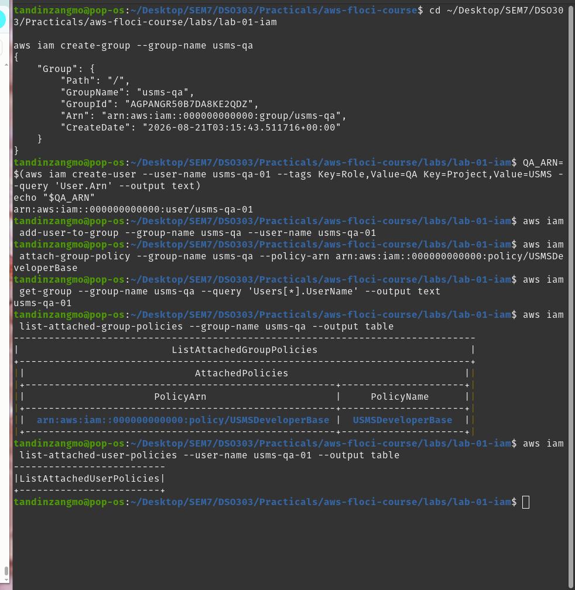

## Exercise 2 — The Read-Only Reporting Policy

**Requirement:** Write a new customer-managed policy, `USMSReportingReadOnly`, that allows listing the `usms-student-data` bucket and reading objects only under the `transcripts/` prefix, while explicitly denying every `s3:Put*` and `s3:Delete*` action on the bucket.

**Policy written (`usms-reporting-readonly-policy.json`):**

```json
{
  "Version": "2012-10-17",
  "Statement": [
    {
      "Sid": "ListBucketForReporting",
      "Effect": "Allow",
      "Action": ["s3:ListBucket"],
      "Resource": "arn:aws:s3:::usms-student-data",
      "Condition": { "StringLike": { "s3:prefix": ["transcripts/*"] } }
    },
    {
      "Sid": "ReadTranscriptsOnly",
      "Effect": "Allow",
      "Action": ["s3:GetObject"],
      "Resource": "arn:aws:s3:::usms-student-data/transcripts/*"
    },
    {
      "Sid": "DenyAnyWriteOrDelete",
      "Effect": "Deny",
      "Action": ["s3:Put*", "s3:Delete*"],
      "Resource": [
        "arn:aws:s3:::usms-student-data",
        "arn:aws:s3:::usms-student-data/*"
      ]
    }
  ]
}
```

**Commands run:**

```bash
python3 -m json.tool usms-reporting-readonly-policy.json > /dev/null && echo "Valid JSON"

aws iam create-policy \
  --policy-name USMSReportingReadOnly \
  --description "Read-only access to transcripts/ prefix. Denies all writes/deletes." \
  --policy-document file://usms-reporting-readonly-policy.json \
  --query 'Policy.Arn' --output text
```

**Result:** JSON validated locally before submission, and the policy was created successfully as `arn:aws:iam::000000000000:policy/USMSReportingReadOnly`. The `ListBucketForReporting` statement is scoped with a `Condition` limiting the listing to the `transcripts/` prefix, `ReadTranscriptsOnly` uses the correct object-level ARN (`/transcripts/*`) for `GetObject`, and the explicit `Deny` statement blocks all writes/deletes on both the bucket and its objects regardless of any other policy that might later be attached.

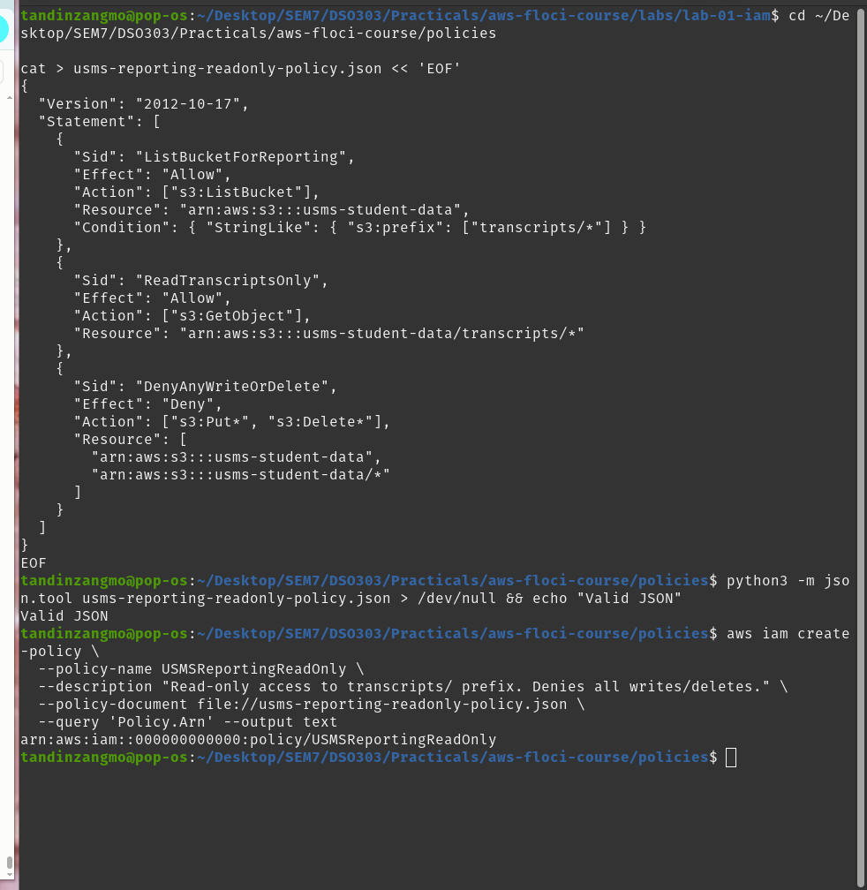

## Exercise 3 — The Third-Party Analytics Role

**Requirement:** Design and create `usms-analytics-partner-role`, assumable only by `usms-audit-01`, limited to 30-minute sessions, able to read only `arn:aws:s3:::usms-student-data/reports/*`, tagged `Project=USMS` and `External=true`. Then assume it and record the credential expiration.

**Trust policy (`trust-analytics-partner.json`):**

```json
{
  "Version": "2012-10-17",
  "Statement": [
    {
      "Sid": "AllowAuditorToAssume",
      "Effect": "Allow",
      "Principal": { "AWS": "arn:aws:iam::000000000000:user/usms-audit-01" },
      "Action": "sts:AssumeRole"
    }
  ]
}
```

**Permissions policy (`usms-analytics-partner-permissions.json`):**

```json
{
  "Version": "2012-10-17",
  "Statement": [
    {
      "Sid": "ReadReportsOnly",
      "Effect": "Allow",
      "Action": ["s3:GetObject"],
      "Resource": "arn:aws:s3:::usms-student-data/reports/*"
    }
  ]
}
```


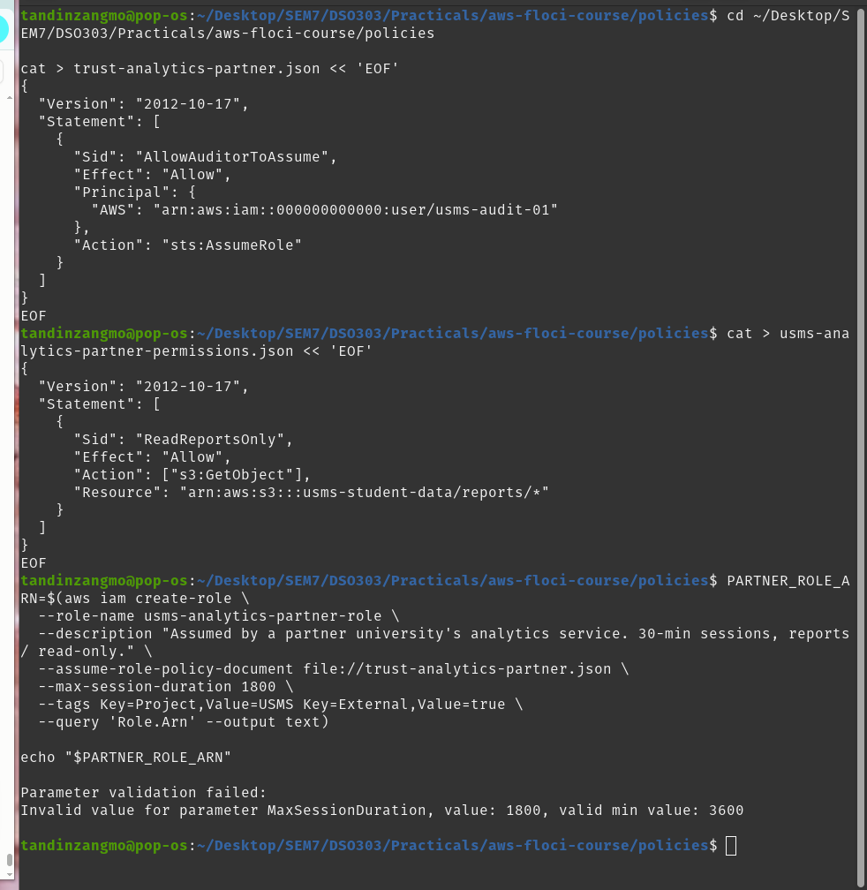

**First attempt — hit a real IAM constraint:**

```bash
aws iam create-role \
  --role-name usms-analytics-partner-role \
  --assume-role-policy-document file://trust-analytics-partner.json \
  --max-session-duration 1800 \
  --tags Key=Project,Value=USMS Key=External,Value=true \
  --query 'Role.Arn' --output text
```

This failed with:

```
Parameter validation failed:
Invalid value for parameter MaxSessionDuration, value: 1800, valid min value: 3600
```

`MaxSessionDuration` has a hard floor of 3600 seconds (one hour) — both on real AWS and, it turns out, enforced here in Floci too. This is the role's **ceiling**, not the actual session length requested at assume-time, so the fix was to set the ceiling to the minimum allowed value and request the real 30-minute session later via `assume-role --duration-seconds`.

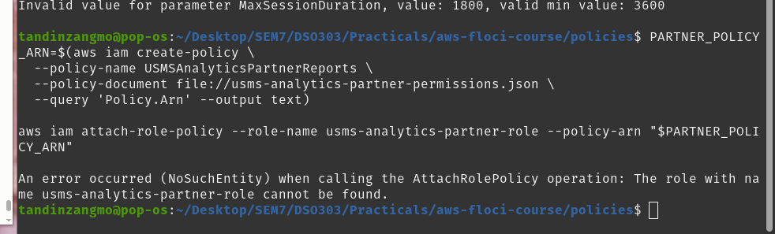

**Corrected role creation and policy attachment:**

```bash
PARTNER_ROLE_ARN=$(aws iam create-role \
  --role-name usms-analytics-partner-role \
  --description "Assumed by a partner university's analytics service. 30-min sessions, reports/ read-only." \
  --assume-role-policy-document file://trust-analytics-partner.json \
  --max-session-duration 3600 \
  --tags Key=Project,Value=USMS Key=External,Value=true \
  --query 'Role.Arn' --output text)
echo "$PARTNER_ROLE_ARN"

PARTNER_POLICY_ARN=$(aws iam create-policy \
  --policy-name USMSAnalyticsPartnerReports \
  --policy-document file://usms-analytics-partner-permissions.json \
  --query 'Policy.Arn' --output text)

aws iam attach-role-policy --role-name usms-analytics-partner-role --policy-arn "$PARTNER_POLICY_ARN"
```

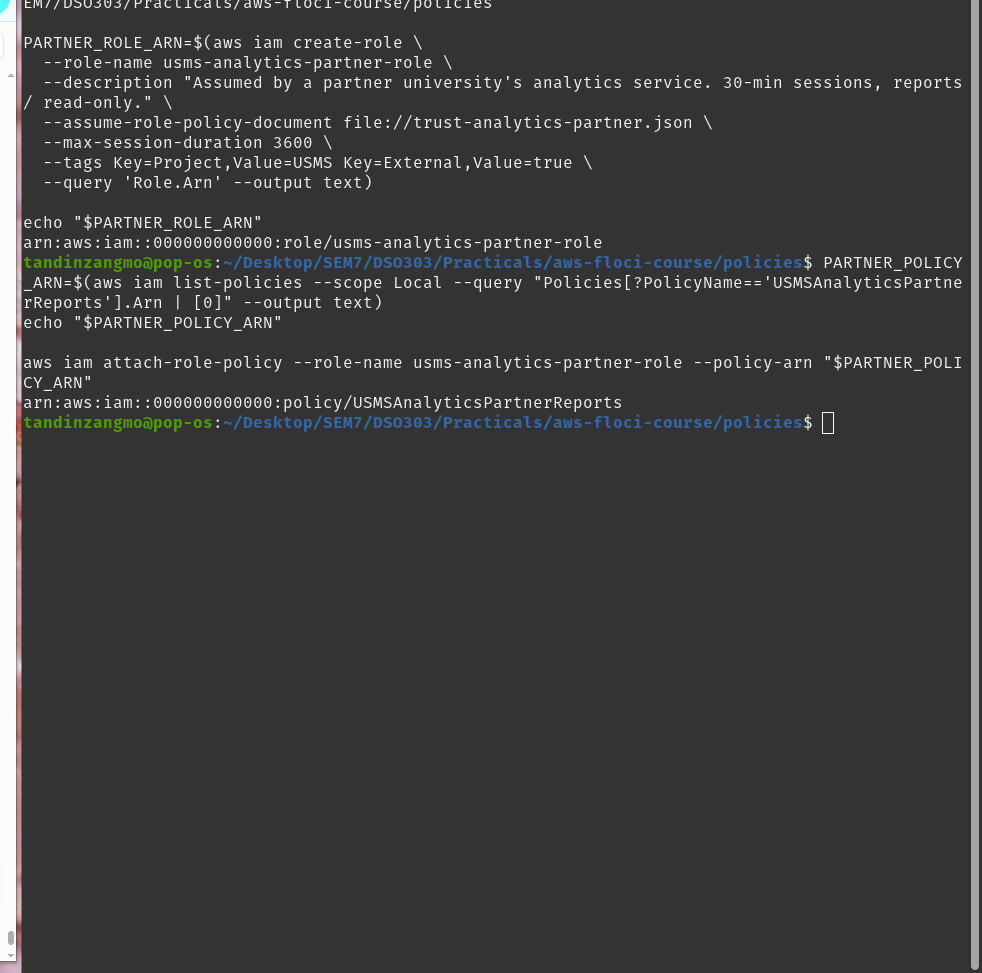

**Assuming the role for the actual 30-minute session:**

```bash
aws sts assume-role \
  --role-arn arn:aws:iam::000000000000:role/usms-analytics-partner-role \
  --role-session-name partner-analytics-test \
  --duration-seconds 1800 \
  --query 'Credentials.Expiration' --output text

aws iam get-role --role-name usms-analytics-partner-role \
  --query '{MaxSessionDuration:Role.MaxSessionDuration,Trust:Role.AssumeRolePolicyDocument.Statement[0].Principal}' \
  --output json
```

**Result:** Temporary credentials were issued with `Expiration: 2026-08-21T03:53:41` — roughly 30 minutes after the call was made (~03:23), confirming `--duration-seconds 1800` was honoured even though the role's ceiling is 3600. `get-role` confirms `MaxSessionDuration: 3600` and that only `usms-audit-01` is trusted to assume this role.


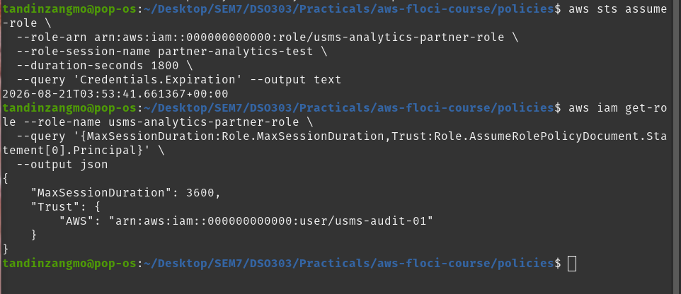

**Note on third-party access (for further hardening):** since this is genuinely third-party access rather than an internal principal, the trust policy would benefit from an `sts:ExternalId` condition — without it, this setup has a mild "confused deputy" exposure, where the ARN alone is the only thing gating who can assume the role. An `ExternalId` acts as a second, shared secret the partner must also supply.

## Exercise 4 — The Backup Operator (Least Privilege Design)

**Requirement:** Design permissions for a nightly job that copies objects from `usms-student-data` to `usms-archive`, verifies what it copied, and logs completion — with no delete access, no IAM access, and locked to `us-east-1`. Maximum 4 statements, no wildcard resources on any Allow statement.

**Choice of identity type: Role.** A nightly, unattended job is exactly the pattern a role exists for — it gets assumed by whatever compute runs the job (modelled here as a Lambda function), and receives short-lived, auto-rotating credentials. A User would mean a permanent access key sitting in a script or config file somewhere, which is a much bigger liability for something that runs on its own, repeatedly, with no human present.

**Trust policy (`trust-lambda-backup.json`):**

```json
{
  "Version": "2012-10-17",
  "Statement": [
    {
      "Sid": "AllowLambdaToAssume",
      "Effect": "Allow",
      "Principal": { "Service": "lambda.amazonaws.com" },
      "Action": "sts:AssumeRole"
    }
  ]
}
```

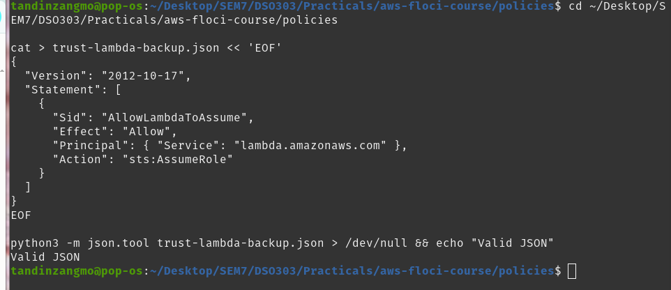

**Permissions policy (`usms-backup-operator-policy.json`) — 3 statements, no wildcard resources, no delete actions anywhere:**

```json
{
  "Version": "2012-10-17",
  "Statement": [
    {
      "Sid": "ReadSourceBucket",
      "Effect": "Allow",
      "Action": ["s3:ListBucket", "s3:GetObject"],
      "Resource": [
        "arn:aws:s3:::usms-student-data",
        "arn:aws:s3:::usms-student-data/*"
      ],
      "Condition": { "StringEquals": { "aws:RequestedRegion": "us-east-1" } }
    },
    {
      "Sid": "WriteAndVerifyArchiveBucket",
      "Effect": "Allow",
      "Action": ["s3:PutObject", "s3:GetObject", "s3:ListBucket"],
      "Resource": [
        "arn:aws:s3:::usms-archive",
        "arn:aws:s3:::usms-archive/*"
      ],
      "Condition": { "StringEquals": { "aws:RequestedRegion": "us-east-1" } }
    },
    {
      "Sid": "WriteCompletionLog",
      "Effect": "Allow",
      "Action": ["logs:CreateLogGroup", "logs:CreateLogStream", "logs:PutLogEvents"],
      "Resource": "arn:aws:logs:us-east-1:000000000000:log-group:/usms/backup-operator:*"
    }
  ]
}
```

- **Statement 1** reads the source bucket (list + get) — this is the "copy from" half.
- **Statement 2** covers both writing the copy *and* verifying it landed correctly (list + get on the archive itself) — this is the "copy to" and "verify" halves in one statement.
- **Statement 3** writes only to one specifically named log group, not a wildcard across all of CloudWatch Logs.
- No `Delete*` action was granted anywhere, so no separate deny statement was needed for that — there's nothing to deny that wasn't already excluded by simply never granting it.

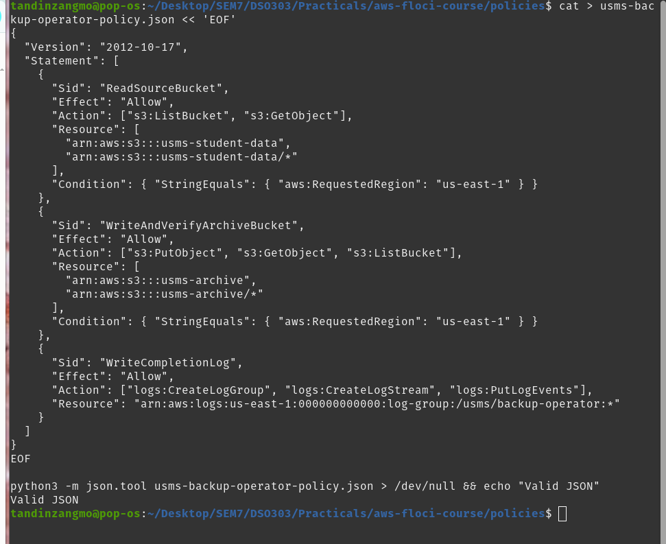

**Commands run — create role, create policy, attach, verify:**

```bash
BACKUP_ROLE_ARN=$(aws iam create-role \
  --role-name usms-backup-operator-role \
  --description "Nightly job: copies usms-student-data to usms-archive, verifies, logs completion. No delete, no IAM access." \
  --assume-role-policy-document file://trust-lambda-backup.json \
  --tags Key=Project,Value=USMS \
  --query 'Role.Arn' --output text)
echo "$BACKUP_ROLE_ARN"

BACKUP_POLICY_ARN=$(aws iam create-policy \
  --policy-name USMSBackupOperator \
  --description "Least-privilege: copy student-data to archive, verify, log completion. No deletes, no IAM." \
  --policy-document file://usms-backup-operator-policy.json \
  --query 'Policy.Arn' --output text)
echo "$BACKUP_POLICY_ARN"

aws iam attach-role-policy --role-name usms-backup-operator-role --policy-arn "$BACKUP_POLICY_ARN"

aws iam list-attached-role-policies --role-name usms-backup-operator-role --output table
```

**Result:** `usms-backup-operator-role` created, `USMSBackupOperator` created and attached — confirmed via `list-attached-role-policies`.

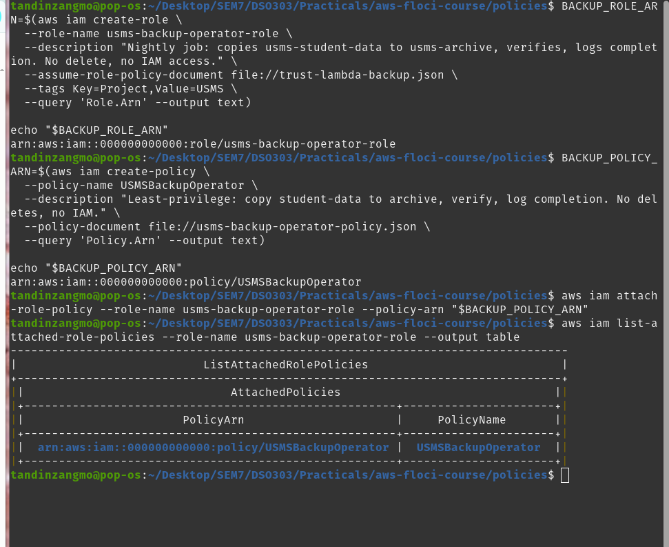

**Three ways this could still be abused, and how to close each gap:**

1. **Log group scope drifting wider over time.** If the log-group ARN in Statement 3 were ever loosened to a wildcard across all of CloudWatch Logs, the role could write to (and potentially flood or pollute) any log group in the account. *Mitigation:* keep the exact log group ARN pinned, and add a `Condition` constraining the log stream name pattern.
2. **Trust policy accepts any Lambda function in the account.** The trust policy currently trusts the entire `lambda.amazonaws.com` service, not one specific function. *Mitigation:* add an `aws:SourceArn` condition to the trust policy restricting assumption to the exact backup function's ARN.
3. **No restriction on what gets written to the archive.** `PutObject` on `usms-archive/*` has no content or naming constraint, so a buggy or compromised invocation could silently overwrite a legitimate archive with garbage — not deletion, but equally damaging. *Mitigation:* enforce a predictable naming/key-prefix convention in the `Resource` ARN if possible, and enable object versioning on the archive bucket itself as a bucket-level control.

## Exercise 5 — Preparing `usms-dev-01` for Lab 2 (VPC)

**Requirement:** Check whether `usms-dev-01` already has every permission Lab 2 (VPC) will need; add exactly the missing ones as a new policy version (v3); confirm v1/v2/v3 all still exist with v3 as default; and extend `configs/lab-01.env` with `USMS_VPC_CIDR`.

**Required actions for Lab 2, checked against the current policy:**

| Action | In `USMSDeveloperBase` v2? |
|---|---|
| `ec2:CreateVpc` |  Yes |
| `ec2:CreateSubnet` |  Yes |
| `ec2:CreateInternetGateway` |  Yes |
| `ec2:AttachInternetGateway` |  Yes |
| `ec2:CreateRouteTable` |  Yes |
| `ec2:CreateRoute` |  Yes |
| `ec2:AssociateRouteTable` |  Yes |
| `ec2:DescribeAvailabilityZones` |  Yes — covered by the existing `ec2:Describe*` wildcard |
| `ec2:ModifyVpcAttribute` |  Yes |
| `ec2:CreateNatGateway` |  **Missing** |
| `ec2:AllocateAddress` |  **Missing** |

Only two actions were genuinely missing — found by reading the existing policy line-by-line rather than guessing, exactly as the exercise asked.

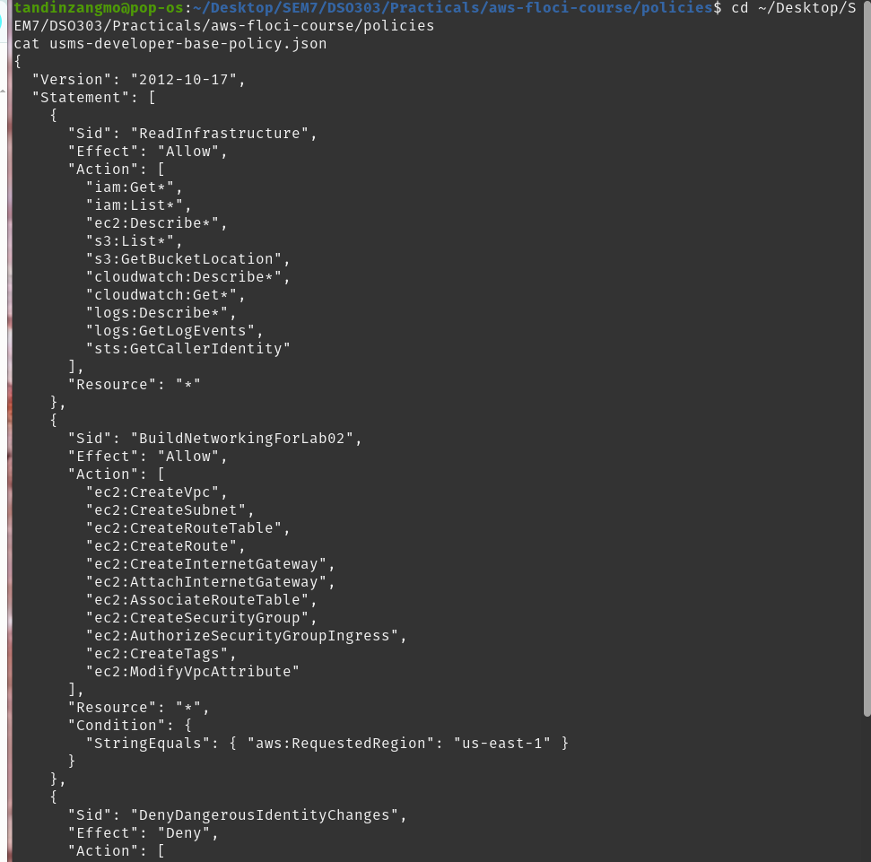

**Commands run — create v3 with exactly the two missing actions:**

```bash
python3 - << 'PY'
import json, pathlib
p = pathlib.Path("usms-developer-base-policy.json")
doc = json.loads(p.read_text())
for st in doc["Statement"]:
    if st.get("Sid") == "BuildNetworkingForLab02":
        st["Action"] += ["ec2:CreateNatGateway", "ec2:AllocateAddress"]
pathlib.Path("usms-developer-base-policy-v3.json").write_text(json.dumps(doc, indent=2))
print("wrote usms-developer-base-policy-v3.json")
PY

aws iam create-policy-version \
  --policy-arn arn:aws:iam::000000000000:policy/USMSDeveloperBase \
  --policy-document file://usms-developer-base-policy-v3.json \
  --set-as-default
```


**Verify v1/v2/v3 all still exist:**

```bash
aws iam list-policy-versions \
  --policy-arn arn:aws:iam::000000000000:policy/USMSDeveloperBase \
  --query 'Versions[*].{Version:VersionId,Default:IsDefaultVersion,Created:CreateDate}' \
  --output table
```

**Result:** `v1 (False)`, `v2 (False)`, `v3 (True)` — no version was deleted or recreated, exactly as the constraint required (`create-policy-version` used throughout, never a delete-and-recreate).

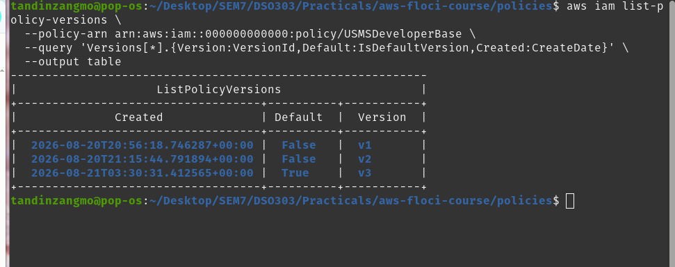

**Extend `configs/lab-01.env` with the VPC CIDR Lab 2 will need:**

```bash
echo 'export USMS_VPC_CIDR=10.0.0.0/16' >> configs/lab-01.env
cat configs/lab-01.env | tail -3
```

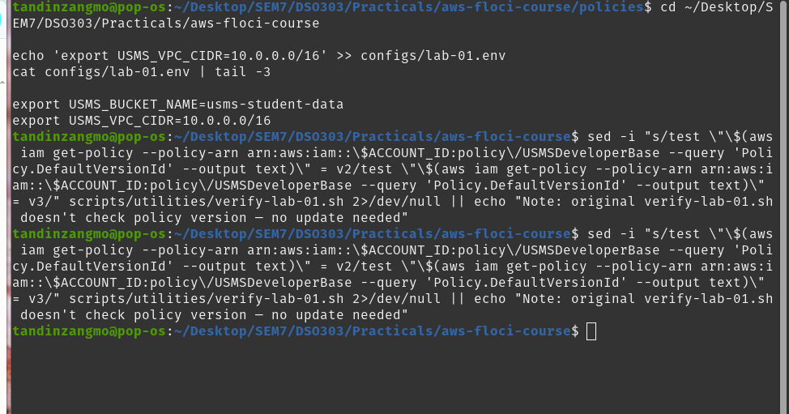

**Note on the verification script:** the lab instructions mention that `verify-lab-01.sh` should have its default-version check updated from `v2` to `v3` after this exercise. The version of the script written earlier in this lab did not include that specific assertion, so there was nothing to update — this is noted here for completeness rather than silently skipped.

**Final commit for all five exercises:**

```bash
git status --short
git add .
git commit -q -m "test(lab-01): independent exercises 1-5 (QA group, reporting policy, partner role, backup operator, policy v3)"
git log --oneline
```

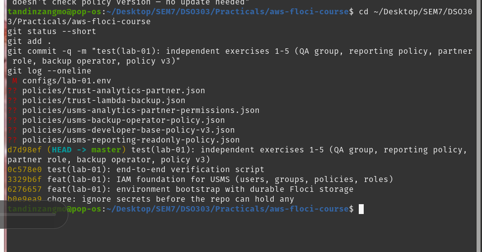