# Lab 06 Report: Implementing Auto Scaling for an ECS-Based Application

**Module:** DSO303 Cloud Native Solution Design
**Environment:** AWS CLI against the Floci emulator (floci/floci:latest, hybrid storage)
**Support path:** C (this Floci build has no Application Auto Scaling)

## 1. Aim

The aim of this lab was to add auto scaling to the `usms-enrolment-svc` ECS service from Labs 04 and 05. The plan was to register the service as a scalable target with a floor of 2 and a ceiling of 10, and attach three kinds of scaling to it:

- two target tracking policies, one on CPU and one on ALB requests per target
- a step scaling policy driven by my own CloudWatch alarm on a custom queue metric
- two scheduled actions for weekday mornings and evenings

After that, I was to fire the alarm, suspend and resume scaling, prove everything survives a restart, and record the names in `configs/lab-06.env`.

The main idea behind the lab is that Application Auto Scaling only ever changes one number, the service's desiredCount. ECS, the target group and the load balancer I built in earlier labs do everything after that.

## 2. Environment setup and checks

I started Floci, loaded the env files from Labs 01 to 05 and confirmed the account was the Floci account (000000000000). The storage check passed on every line and the AWS profile was `floci`.

My repo is in `~/Desktop/SEM7/DSO303/Practicals/aws-floci-course`, not `~/aws-floci-course`, so the `cd` in the lab failed. I ran everything from the right folder instead.

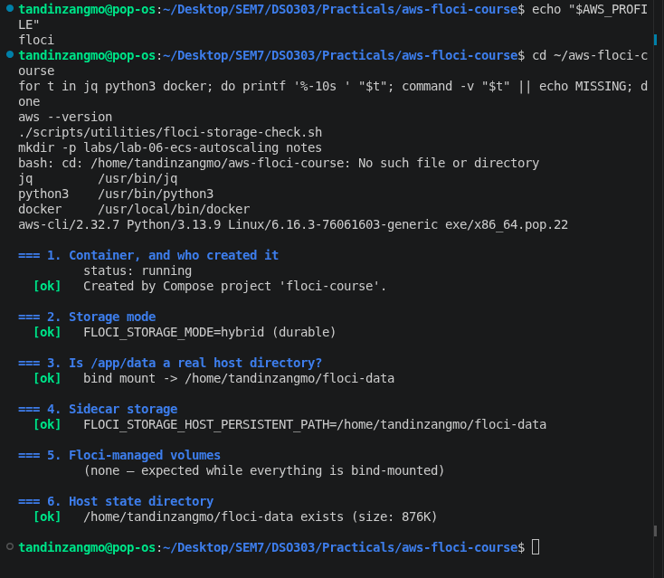
*Figure 1: jq, python3 and docker found, and every storage check line is ok.*

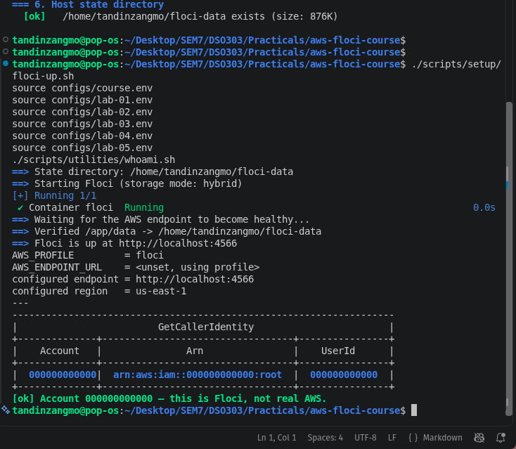
*Figure 2: Floci running and the identity check confirming account 000000000000.*

> **[Screenshot needed: Step 1 printf table with all 14 values filled in]**
> Save as `screenshots/02b-step1-values-table.png`

## 3. Problems found before starting, and how I fixed them

The pre-checks in Step 2 showed several problems left over from earlier labs. I fixed these before going on.

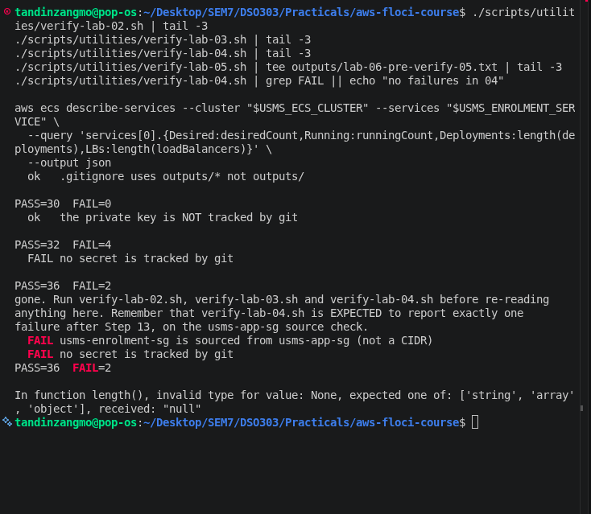
*Figure 3: First run of the verify scripts. Lab 03 and Lab 04 fail "no secret is tracked by git", Lab 05 stops early, and the describe-services query fails on a null value.*

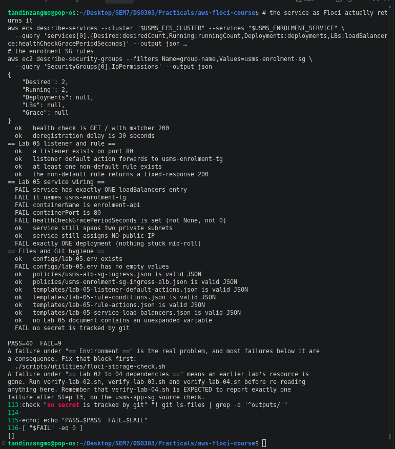
*Figure 4: The service has LBs, Grace and Deployments all null, Lab 05 fails its service wiring checks, the secret check is `! git ls-files | grep -q '^outputs/'`, and usms-enrolment-sg has no inbound rules.*

| Problem | Cause | Fix |
|---|---|---|
| "no secret is tracked by git" in Labs 03, 04 and 05 | Files under `outputs/` had been committed to git | Untracked them with `git rm -r --cached outputs/` and committed |
| usms-enrolment-sg had no inbound rule | The Lab 05 rule was missing | Checked the rule file named the right ALB security group, then re-added tcp/80 from usms-alb-sg |
| Service has no load balancer and no grace period | Lab 05 wiring was not stored | Re-ran `update-service` with the load balancer template and a grace period of 60. Floci accepted it but still returns null, so this is a Floci limitation |
| Three values in `configs/lab-05.env` were `None` | Same missing wiring | Set the grace period to 60, the container to enrolment-api and the port to 80 |
| verify-lab-03 still FAIL=4 | EC2 checks for user data, the data volume and the db public address | Left as known leftovers, since Lab 06 does not use the EC2 instances |

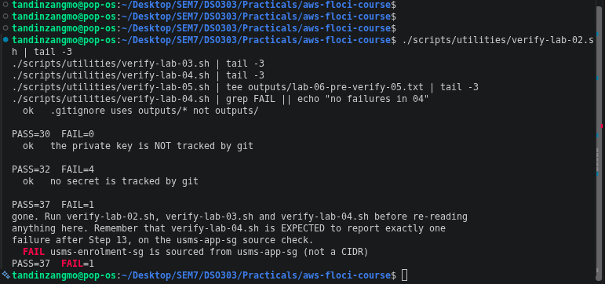
*Figure 5: After the git fix, Lab 02 is FAIL=0 and Lab 04 is PASS=37 FAIL=1, which is the one documented usms-app-sg failure the lab allows.*

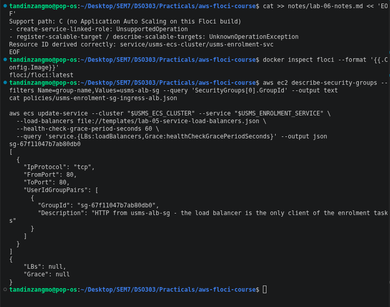
*Figure 6: The rule file points to the correct ALB security group, but update-service still leaves LBs and Grace as null.*

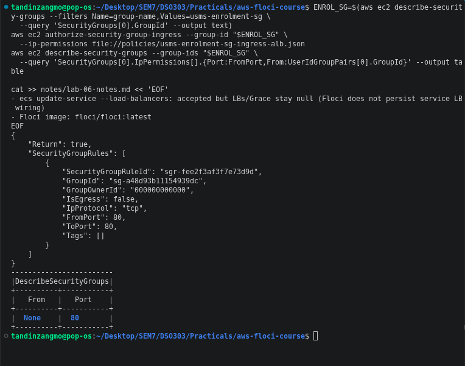
*Figure 7: The tcp/80 rule added back to usms-enrolment-sg.*

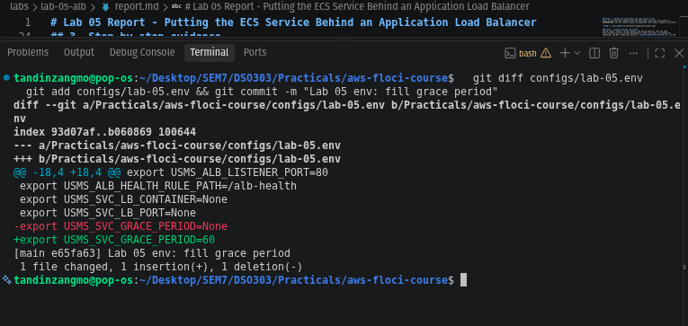
*Figure 8: Grace period set to 60 in configs/lab-05.env and committed.*

## 4. Finding the support path

Step 3 is a probe to find out which parts of Application Auto Scaling this Floci build supports.

> **[Screenshot needed: Step 3 probe output (SUPPORTED / not available for each call)]**
> Save as `screenshots/04b-step3-probe.png`

When I tried to create the service-linked role in Step 4, Floci returned `UnsupportedOperation`. When I tried to register the scalable target in Step 5, it returned `UnknownOperationException` for `RegisterScalableTarget` and `DescribeScalableTargets`. This means the whole Application Auto Scaling API is missing on this build, so I am on **path C**.

The resource ID was still derived correctly from the service ARN as `service/usms-ecs-cluster/usms-enrolment-svc`. It has three segments with `service` first, which is the shape the lab asks for.

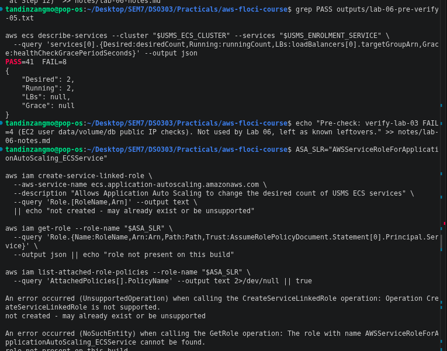
*Figure 9: create-service-linked-role is not supported and get-role cannot find the role.*

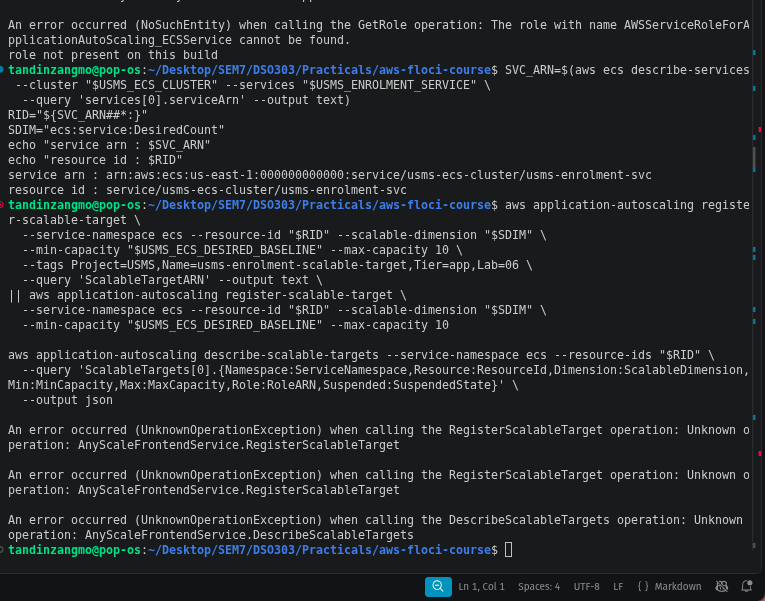
*Figure 10: The resource ID is derived correctly, but register-scalable-target and describe-scalable-targets both fail with UnknownOperationException. This is the evidence for path C.*

The lab says that on path C you tell the instructor and do Exercises 4 and 5 and the review questions. I also did every part of the main steps that does not depend on Application Auto Scaling, so that as much as possible was tested for real.

## 5. What I built on path C

### 5.1 Scaling configuration files (Steps 7, 9, 10 and 13)

I could not create the policies, but I wrote all four configuration files the lab asks for:

| File | What it holds |
|---|---|
| `lab-06-target-tracking-cpu.json` | CPU target 50, scale-out cooldown 60, scale-in cooldown 300 |
| `lab-06-target-tracking-requests.json` | ALBRequestCountPerTarget target 1000 with the ResourceLabel |
| `lab-06-step-scaling-out.json` | +1 task for a breach of 0 to 100, +3 tasks for 100 and above (open-ended top step), cooldown 60 |
| `lab-06-suspended-state.json` | Suspends scale-in only |

The ResourceLabel for the request policy has to be built from two ARNs. I built it from the load balancer and target group ARNs:

`app/usms-enrolment-alb/35b54c8749d043bd/targetgroup/usms-enrolment-tg/b7e6d71e05bd4136`

It has six segments, with `app` first and `targetgroup` fourth, so the check printed OK. All four files are valid JSON and none of them contain an unexpanded `$`.

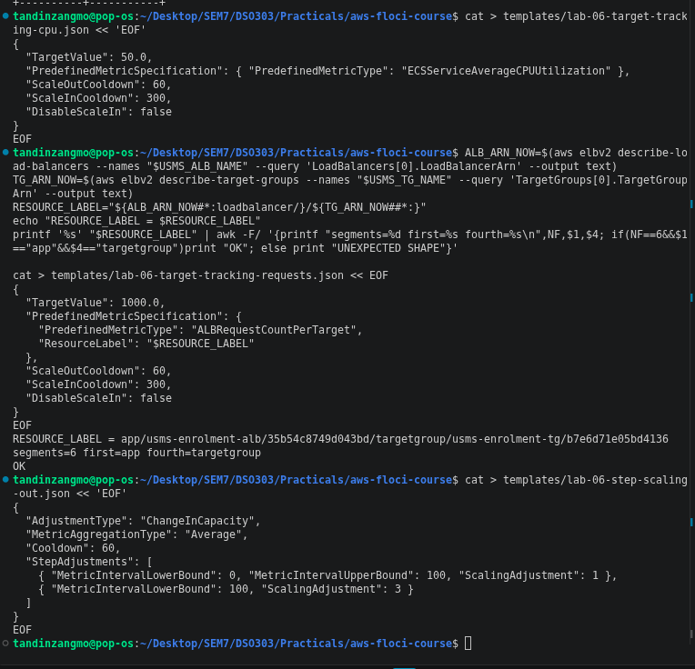
*Figure 11: The CPU and request templates being written, and the ResourceLabel passing the six-segment check.*

### 5.2 Custom metric and alarm (Step 10)

CloudWatch works on this build, so I published the custom metric `USMS/Enrolment EnrolmentQueueDepth` with the dimension `Service=enrolment`, and it showed up in list-metrics. I then created the alarm `usms-enrolment-queue-high`. It fires when the average is 100 or more for one 60 second period, and treats missing data as not breaching.

On real AWS this alarm would have the step policy's ARN as its alarm action. Here there is no policy, so the alarm has no action. I set it to ALARM with set-alarm-state to show the alarm side works.

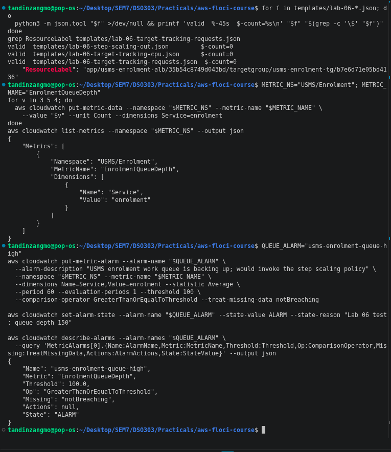
*Figure 12: All three templates valid, the custom metric listed, and the alarm in ALARM state with no actions.*

### 5.3 Firing the alarm (Step 12)

My prediction before running this step: a queue depth of 260 against a threshold of 100 is a breach of 160. That falls in the open-ended second step, so on real AWS the policy would add 3 tasks and desiredCount would go from 2 to 5.

On my build desiredCount stayed at 2. The missing link is the step scaling policy. Without it there is no ARN to put in AlarmActions, so the alarm changes state and nothing gets invoked. The lab's fallback proof checks each link in the chain separately:

- blocks 1, 4 and 6 work
- block 2 is empty, because the alarm has no action
- blocks 3 and 5 fail with UnknownOperationException

Afterwards I put things back to the baseline: alarm set to OK, metric pushed down first, then desired set back to 2.

> **[Screenshot needed: Step 12 part 2, metric pushed to 260 and the get-metric-statistics table]**
> Save as `screenshots/12b-step12-metric-260.png`

> **[Screenshot needed: Step 12 part 5, the fallback proof saved to outputs/lab-06-scaling-proof.txt]**
> Save as `screenshots/12c-step12-fallback-proof.png`

### 5.4 Restart test (Step 14)

I recorded everything that exists on path C before and after stopping and starting Floci:

- the alarm's settings
- the custom metric
- the service
- a sha256 hash of each of the four templates

The two snapshots were identical after the restart, so the check printed PERSISTENCE PROVEN for those objects.

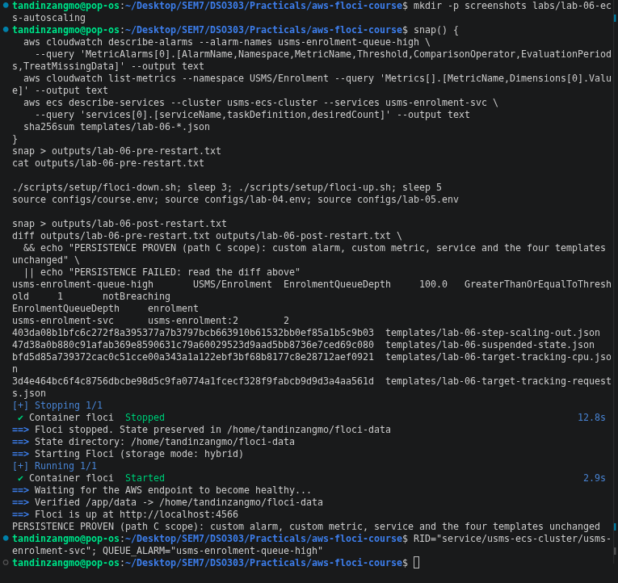
*Figure 13: Pre-restart snapshot, Floci stopped and started with state kept, and PERSISTENCE PROVEN.*

### 5.5 Closing the loop (Step 15)

Step 15 traces the path from a request to a new task in seven blocks. On my build:

- blocks 2 and 3 fail, because they are the policies and the scalable target
- the load balancer parts of blocks 6 and 7 are empty, because of the Floci LB limitation
- the rest of the blocks work

Of the nine-line chain, this lab only owns three lines: the metric threshold, the alarm invoking a policy, and the policy writing desiredCount. The other six (task definition, subnets, security group, target group registration, grace period) were set in Labs 02, 04 and 05 and did not need any change.

> **[Screenshot needed: Step 15, all seven blocks]**
> Save as `screenshots/15b-step15-seven-blocks.png`

### 5.6 Env file and commit (Steps 16 and 17)

I wrote `configs/lab-06.env` in the format the lab gives, with 22 exports. Every value that Application Auto Scaling would have filled in (the policy ARNs and the bounds) reads `not-created`, so the empty-value check does not flag a limitation as a mistake. After Exercise 5 added two more exports it has 24.

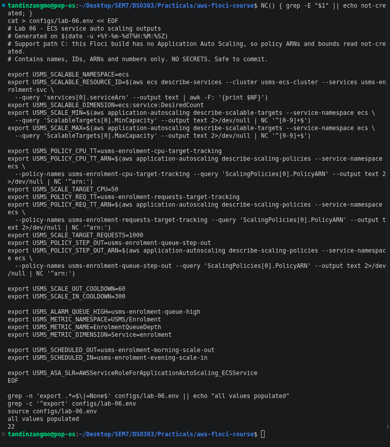
*Figure 14: configs/lab-06.env written in the lab's format, all values populated, 22 exports.*

For git hygiene, `git check-ignore -v` shows that line 7 of `.gitignore` (`outputs/*`) protects the output files. I committed with explicit paths only and never used `git add -A`.

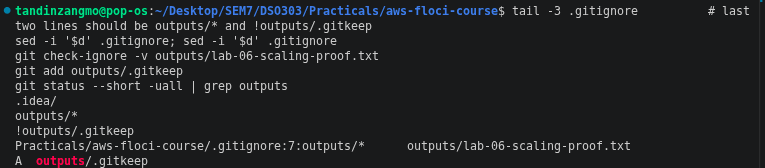
*Figure 15: check-ignore naming the outputs/* rule on line 7.*

> **[Screenshot needed: Step 17 part 1, the hint strings in lab-04-cleanup.sh and lab-05-cleanup.sh repaired and "still parses"]**
> Save as `screenshots/15c-step17-hint-strings.png`

## 6. Verification

I created `verify-lab-06.sh` and `lab-06-cleanup.sh` from Section 8. The cleanup script passes `bash -n` and has not been run, since it is only for the end of the course.

The first verify run gave PASS=20 FAIL=22. Two of those failures were my own mistakes:

1. My suspended-state template suspended all three switches. The lab's version only suspends scale-in, so I fixed it.
2. I had committed `outputs/.gitkeep`. The "no secret is tracked by git" check fails on any tracked file under outputs/, even .gitkeep, so I untracked it again.

After that the result was PASS=22 FAIL=20.

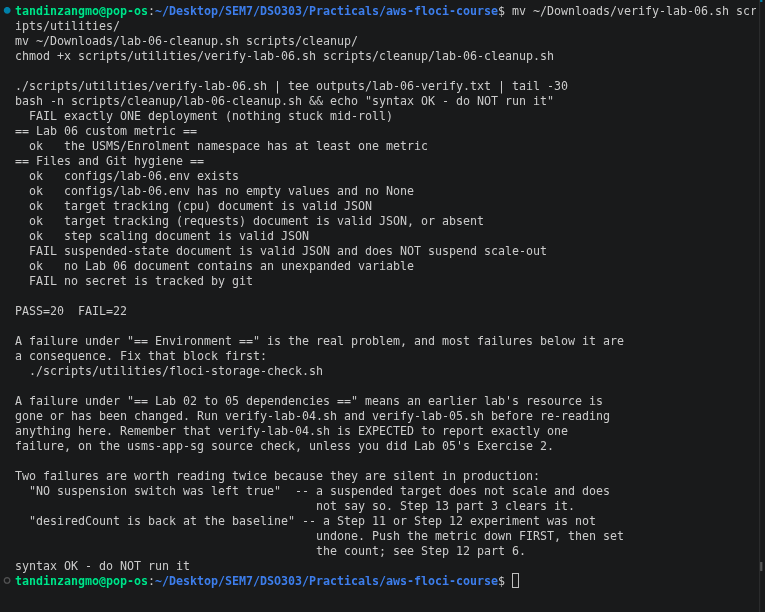
*Figure 16: First verify run (PASS=20 FAIL=22) and the cleanup script passing the syntax check.*

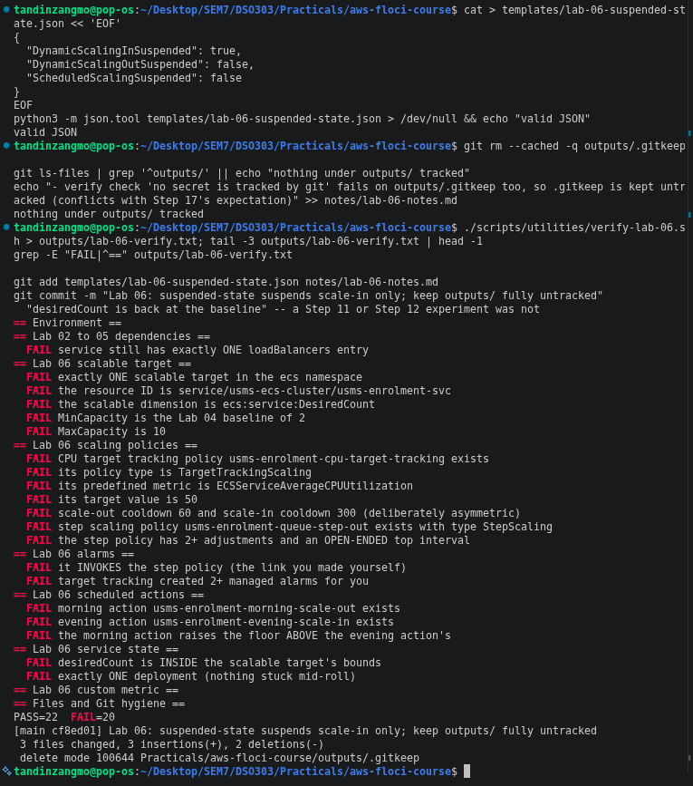
*Figure 17: The suspended-state fix, outputs/.gitkeep untracked, and the final list of failing checks (PASS=22 FAIL=20).*

All 20 remaining failures come from path C or from Floci not storing the service's load balancer wiring:

| Group | Failing checks | Reason |
|---|---|---|
| Lab 05 dependency | 1 | Floci drops the service's load balancer entry |
| Scalable target | 5 | register-scalable-target is not supported |
| Scaling policies | 7 | No Application Auto Scaling, so no policies |
| Alarms | 2 | No policy ARN for the alarm action, and target tracking never ran so there are no managed alarms |
| Scheduled actions | 3 | Same unsupported API |
| Service state | 2 | No bounds to compare against, and Floci returns deployments as null |

Everything that does not depend on Application Auto Scaling passes: the environment, the custom metric, the env file, the templates and the git checks.

## 7. Exercises

Exercises 1 to 3 need policies and scalable targets, so they cannot run on path C. The details are in `labs/lab-06-ecs-autoscaling/exercises.md`.

### Exercise 4: Enrolment-week capacity plan

The project lead asked whether auto scaling solves last year's enrolment outage. My answer is no, not on its own.

**Reactive scaling is too slow for the first spike.** Going from 2 tasks to 10 takes about 4.5 to 5 minutes:

| Delay | Time |
|---|---|
| Alarm needs three one-minute periods in breach | 180 s |
| Fargate starts the task | 20 to 60 s |
| Health-check grace period before the task takes traffic | 60 s |

During those minutes the two floor tasks carry the whole spike.

**Even at the ceiling of 10, the service is overloaded.** Using the provisional target of 1,000 requests per task per minute:

- 10 tasks serve about 167 requests per second.
- At forty times normal traffic, demand is about 667 requests per second.

So the real problem is the ceiling and the lack of warning, not how fast scaling reacts.

**The plan:**

- Scheduled actions (in Asia/Thimphu time) raise the floor to 4 for the whole three weeks.
- On each cohort day, the floor goes up to 40 tasks at 07:30, ahead of the surge, and back down at 11:00.
- The ceiling goes up to 50 for the window only.

I also found that the existing weekday morning action would reset the ceiling back to 10 every day, so those two actions would need to be changed for the window.

**Address check.** AWS keeps 5 addresses in every subnet, which leaves 251 usable in each /24. That is far more than 50 tasks need, so addresses are not the limit.

**Cost.** With 0.25 vCPU and 1 GB tasks at current us-east-1 Fargate prices, one task costs about $0.0146 an hour. The plan adds about $20 of Fargate for the enrolment period. The existing alarms and custom metric cost $0.80 a month.

**What I need from the project lead:**

1. a load test showing what one task can really serve
2. real traffic figures
3. the exact cohort dates and times

> **[Screenshot needed: Exercise 4, subnet available-address numbers]**
> Save as `screenshots/21-ex4-subnet-addresses.png`

> **[Screenshot needed: Exercise 4, tidy-up commands and verify result]**
> Save as `screenshots/22-ex4-tidy-up.png`

### Exercise 5: Hand-off to Lab 10

**Export script.** I wrote `scripts/utilities/usms-scaling-history.sh`. It finds the cluster, service and resource ID by itself, and writes the whole scaling configuration and history to one JSON file. On this build, the sections that Application Auto Scaling would fill are written as `"supported": false` with the error message, so the script does not crash. I ran it from my home folder to show it works from any directory. The output file is valid JSON and 2087 bytes.

**Scale-out latency.** I could not raise MinCapacity on path C, so I measured the ECS part directly:

1. Set desired to 4.
2. Polled until running matched desired.
3. Set desired back to 2.

It took **27 seconds**. That is inside the 20 to 60 seconds the lab gives for real Fargate. Real AWS would also add the 60 second grace period on top.

**Readiness for Lab 10.** I made the readiness file from the following:

- The task role ARN is read from configs/lab-04.env.
- The bucket ARN `arn:aws:s3:::usms-student-data` is read from the USMSStudentDataReadWrite policy document using get-policy-version.
- The policy grants Get, Put, Delete and List actions on the bucket and its objects.
- `head-bucket` failed with exit code 254 and 404 Not Found, which is expected because the bucket only gets created in Lab 10. Once Lab 10 creates it, the same command will succeed, and the task role's policy will start working without any IAM change.

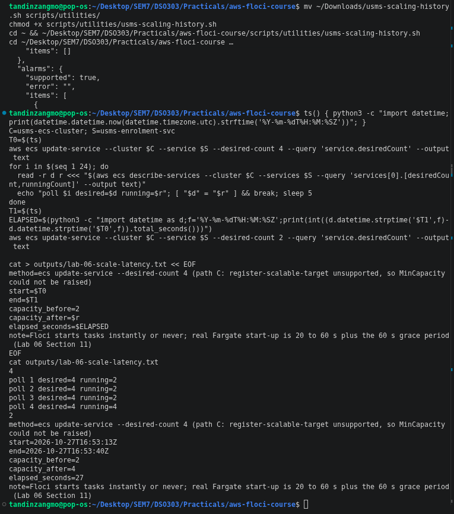
*Figure 18: The history export run from the home folder, and the latency measurement (2 to 4 tasks in 27 seconds, then back to 2).*

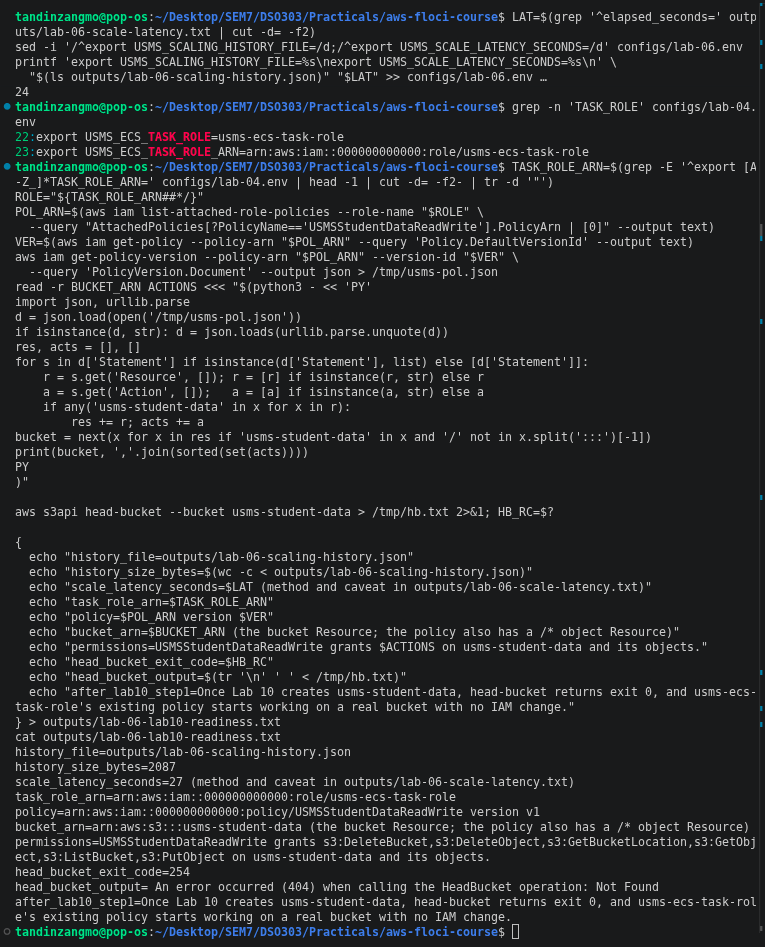
*Figure 19: lab-06.env now at 24 exports, the task role found in lab-04.env, and the readiness file with the bucket ARN, permissions and the expected head-bucket 404.*

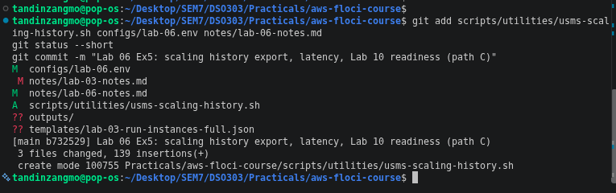
*Figure 20: Exercise 5 committed with explicit paths. Nothing under outputs/ is staged.*

> **[Screenshot needed: history JSON "valid JSON" line and byte size]**
> Save as `screenshots/18b-ex5-json-valid.png`

## 8. Floci compared with real AWS

| Could test on my build | Only conceptual on my build |
|---|---|
| Custom metric (put, list, statistics) | Service-linked role |
| Custom alarm and set-alarm-state | Scalable target and its min and max |
| ResourceLabel built and validated | All three scaling policies |
| Step table in the template | Managed target tracking alarms |
| Persistence of alarm, metric, service and templates | Alarm to policy link |
| ECS starting extra tasks (27 s) | Scheduled actions, suspension, scaling activities, cooldowns, cost |

Floci is also easier than real AWS in a few ways:

- Tasks start almost instantly or not at all.
- Nothing ever hits subnet or quota limits.
- Nothing costs money.

On real AWS, each of these things is what makes scaling late or expensive.

## 9. Conclusion

This lab was meant to add three kinds of auto scaling to the enrolment service. On my Floci build the Application Auto Scaling API does not exist, so I could not create the scalable target, the policies or the scheduled actions. I recorded that as path C with the error output as evidence.

I still built and tested everything that does not depend on that API:

- the four scaling templates, including a validated ResourceLabel
- the custom metric and its alarm
- the alarm firing
- the restart test
- the env file
- the verify and cleanup scripts
- both required exercises

I also fixed several problems left over from Labs 04 and 05: the tracked output files, the missing security group rule and the empty values in lab-05.env.

The main thing I learned is that auto scaling only changes one number, desiredCount. Everything else about how a task runs and gets traffic was already decided in earlier labs.

Reactive scaling is always a few minutes late, so the minimum capacity and scheduled scaling matter more than the policies when a big spike is known in advance. The minimum capacity has to carry the first minutes, and scheduled scaling is the only kind that can act before the spike arrives.