# Lab 07 Exercises

All work was done on support Path A, in namespace usms, on a single-node k3s cluster started by Floci. Screenshots are in labs/lab-07-eks/screenshots/ and are shown under each exercise.

## Exercise 1 - A fourth microservice (usms-timetable)

**What I did**

I wrote manifests/lab-07/70-timetable.yaml with three objects in one file: a ConfigMap (usms-timetable-conf) holding the nginx template, a Deployment with 1 replica, and a ClusterIP Service on port 80. I based it on 30-results.yaml. It uses the same label scheme (app, project, tier), declares CPU and memory requests (50m / 32Mi) and limits, and has a readiness probe on /healthz. The JSON response includes the service name, the pod name from the downward API, and the campus and version from usms-app-config.

I validated it first with `kubectl apply --dry-run=client`, then applied it.

**Result**

- `kubectl get deploy,svc -n usms` showed 4 Deployments and 4 Services. usms-timetable was 1/1 with ClusterIP 10.43.159.27.
- A busybox pod fetching http://usms-timetable.usms.svc.cluster.local/ got back:
  `{"service":"usms-timetable","pod":"usms-timetable-cf6b9c8fb-gmr76","campus":"rtc","version":"1.0.0"}`

*Writing 70-timetable.yaml*

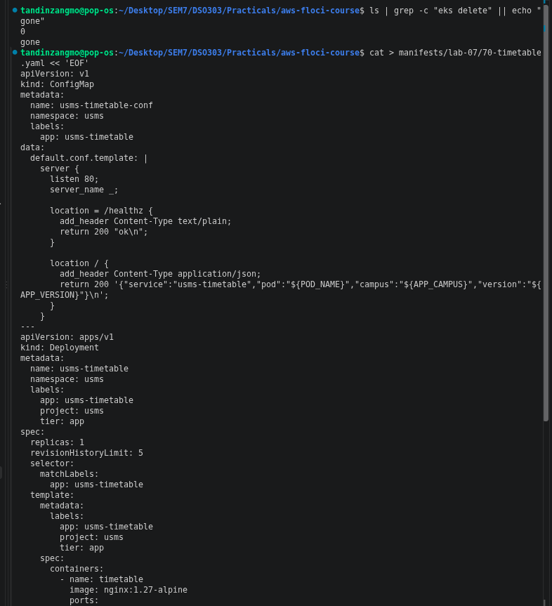

*Dry run, apply, four Deployments and Services, and the timetable JSON*

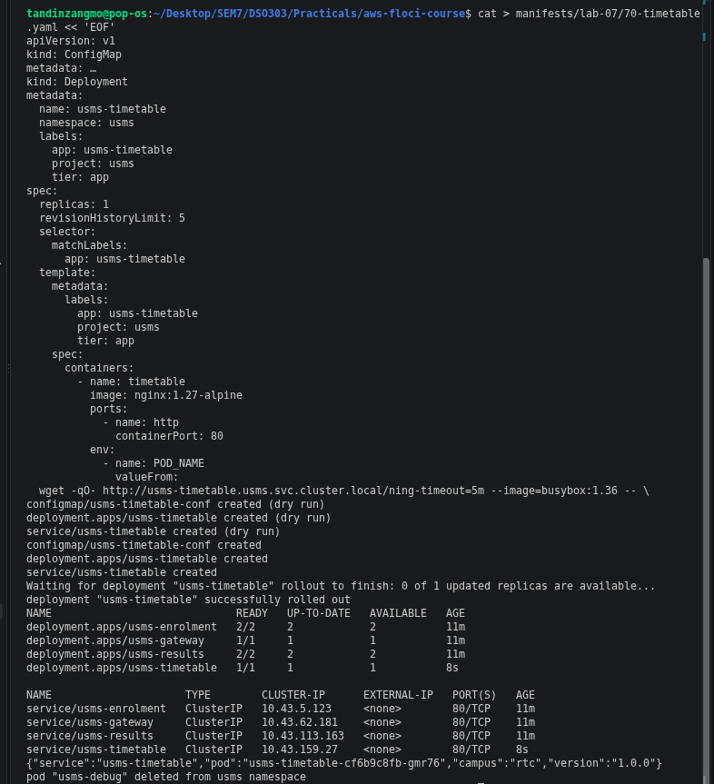

## Exercise 2 - Route the gateway to usms-timetable

**What I did**

I edited manifests/lab-07/40-gateway.yaml to add a `location /timetable/` block that proxies to http://usms-timetable.usms.svc.cluster.local/, and added /timetable/ to the routes list in the root response. grep showed five location blocks afterwards.

Order of commands:
1. `kubectl rollout history deployment/usms-gateway` showed revision 1 only.
2. `kubectl apply -f manifests/lab-07/40-gateway.yaml` printed `configmap/usms-gateway-conf configured` but `deployment.apps/usms-gateway unchanged`.
3. Fetching the gateway root still listed only /enrolment/ and /results/. The running pod had not picked up the change.
4. `kubectl rollout restart deployment/usms-gateway`
5. History then showed revisions 1 and 2. A new ReplicaSet usms-gateway-57cb6b7dd8 had 1 pod and the old one usms-gateway-58854c9ffd was at 0.

**Why rollout restart**

Changing a ConfigMap does not restart the pods using it, and kubectl apply only rolls a Deployment when the pod template changes. Here only the ConfigMap changed, so the template was the same and apply did nothing to the Deployment. `kubectl rollout restart` adds a timestamp annotation to the pod template, which is a template change, so it creates a new ReplicaSet. The other option from Step 18 (annotating the Deployment) only touches the Deployment's own metadata, so it does not roll.

**Result**

One command through the gateway returned three JSON responses, from usms-enrolment, usms-results and usms-timetable. /enrolment/ and /results/ still worked.

*Gateway manifest updated and applied, but the running pod still lists two routes*

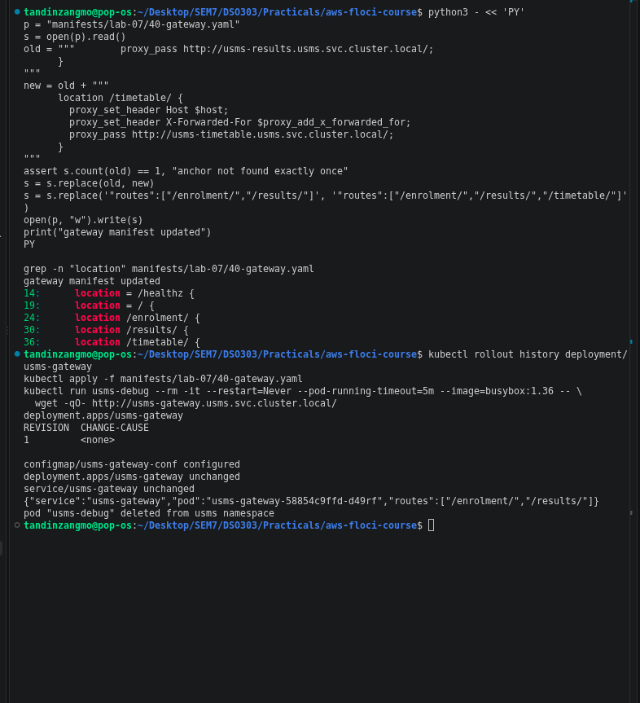

*rollout restart, revision 2, new ReplicaSet and three services answering*

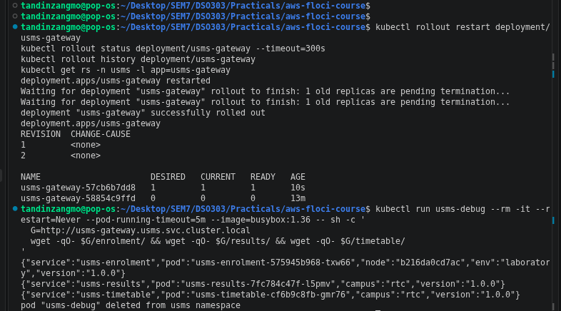

## Exercise 3 - Find the misconfiguration

I saved the given manifest as labs/lab-07-eks/ex3-broken.yaml and applied it unchanged. kubectl accepted it.

**Diagnosis, in the order I ran it**

1. `kubectl get endpoints usms-broken` showed `<none>`. The Service was not sending traffic anywhere.
2. `kubectl get pods -l app=usms-broken` showed both pods as `0/1 Running`. The containers were up but not Ready.
3. `kubectl describe pod -l app=usms-broken` showed `Readiness probe failed: HTTP probe failed with statuscode: 404`, repeating (x14 over 63s).
4. `kubectl get svc usms-broken -o jsonpath='{.spec.selector}'` showed `{"app":"usms-broken","version":"v2"}`.
   `kubectl get pods -l app=usms-broken --show-labels` showed the pods had `version=v1`.
   `kubectl get pods -l app=usms-broken,version=v2` returned `No resources found`.

**The two faults**

- Fault 1: the readiness probe checks /healthz, but the base nginx image has no /healthz page and returns 404. The pods never became Ready, so they were never added to the Service. Our own services only have /healthz because their ConfigMap template defines it.
- Fault 2: the Service selector asks for version v2, but the pod template labels the pods version v1. Even a Ready pod would not match. kubectl does not complain about this because a Service selector is never checked against existing pods.

**Fix**

The lab says the fix changes exactly one line but also that there are two independent faults, so I read it as one line per fault. I copied the file to ex3-fixed.yaml and changed:
- `path: /healthz` to `path: /` in the readiness probe
- `version: v2` to `version: v1` in the Service selector

diff showed exactly those two lines changed. After applying, both pods were 1/1 and `kubectl get endpoints usms-broken` showed two endpoints (10.42.0.27:80 and 10.42.0.28:80). Fixing only one of the two would still leave the Service with no endpoints.

I deleted usms-broken afterwards, which left 6 healthy pods.

*Broken manifest applied: no endpoints, pods 0/1*

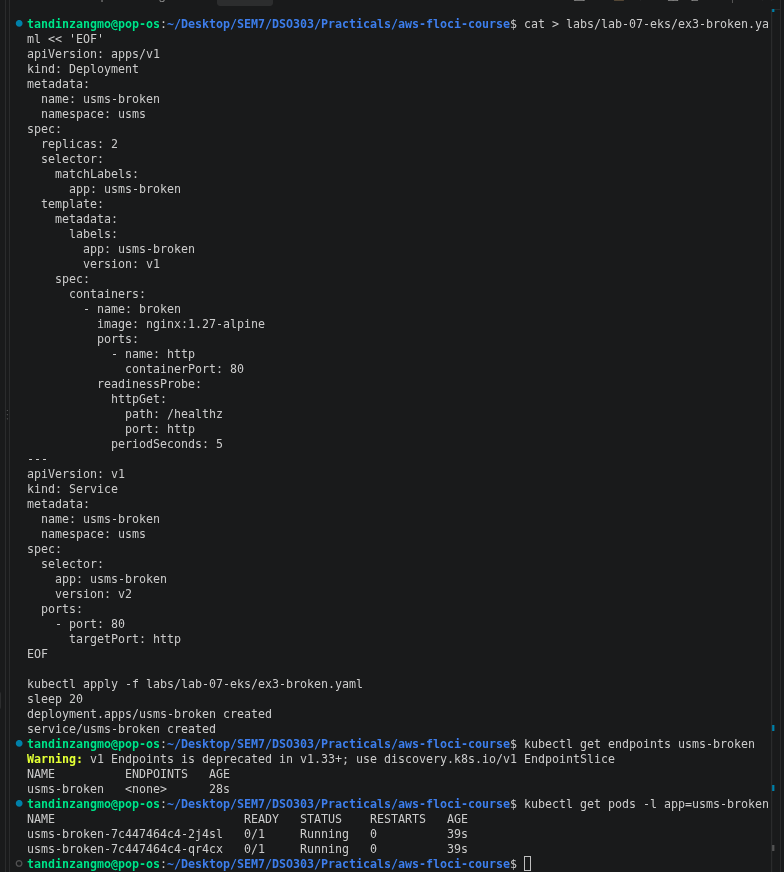

*Readiness 404, selector v2 vs labels v1, the two-line diff and two endpoints after the fix*

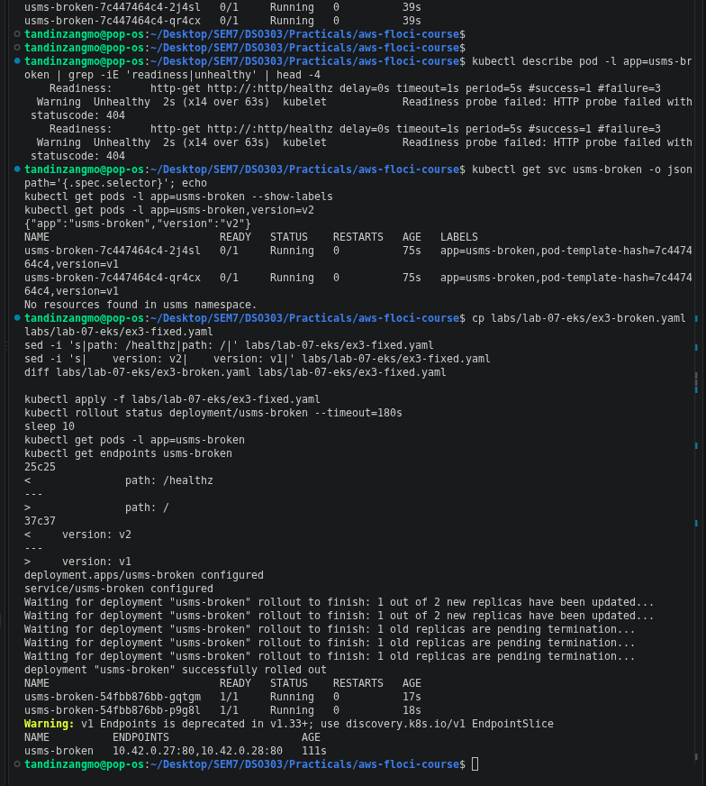

*usms-broken deleted, back to six healthy pods*

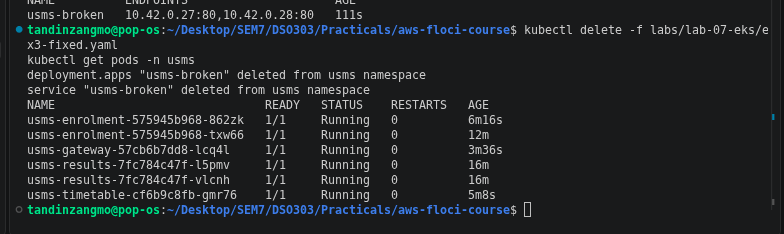

## Exercise 4 - Survive a node going away

**What I changed**

- In manifests/lab-07/20-enrolment.yaml I added a topologySpreadConstraint to the pod template: maxSkew 1, topologyKey kubernetes.io/hostname, whenUnsatisfiable ScheduleAnyway, matching app: usms-enrolment.
- I added a new object, manifests/lab-07/25-enrolment-pdb.yaml, a PodDisruptionBudget with minAvailable 1 for app: usms-enrolment.
- No new Deployment. I checked that the Secret env vars were still in the pod after re-applying.

**Why each one**

The brief has three requirements and I used a different tool for each.

"Must not have all its capacity on one node." The topology spread constraint tells the scheduler to keep the number of enrolment pods per node within 1 of each other, so with two nodes the two replicas go to different nodes. I used ScheduleAnyway, which makes it advisory. If the scheduler cannot spread the pods, it still places them instead of leaving one Pending. For a service that students need during registration, I would rather have two pods on one node than one pod running and one stuck. DoNotSchedule would be the strict version. I chose spread constraints over podAntiAffinity because required anti-affinity would block the second pod completely on a one-node cluster, and the preferred version does roughly the same thing as the spread constraint in a less readable way.

"Must never drop below one healthy pod during a voluntary disruption such as a node drain." This is what a PodDisruptionBudget is for, and it is enforced. The eviction API refuses any eviction that would take the number of ready matching pods below minAvailable. It only covers voluntary disruptions (drains, upgrades, node group scaling in). It does not stop a node from crashing, which is why the spread constraint is needed as well.

"Must be able to say, from the cluster itself, which node each pod is on." `kubectl get pods -o wide` shows the NODE column straight from the API. The enrolment pods also put their node name in every response through the NODE_NAME downward API variable, so the service reports it too.

**Demonstration**

My cluster has only one schedulable node (b216da0cd7ac), even though the node group says desired 2. So the spread constraint could not actually separate the pods, and both stayed on the same node. Because it is ScheduleAnyway, that did not block anything. With two nodes I would have shown the pods landing on different nodes in `-o wide`, then drained one node and shown the pod on the other node carrying all the traffic.

What I could demonstrate was the PDB:
1. `kubectl get pdb` showed usms-enrolment-pdb with MIN AVAILABLE 1 and ALLOWED DISRUPTIONS 1.
2. In a second terminal I ran a busybox loop calling /enrolment/ through the gateway once a second and printing which pod answered.
3. I ran `kubectl drain b216da0cd7ac --pod-selector=app=usms-enrolment --ignore-daemonsets --delete-emptydir-data --timeout=60s`.
4. The node was cordoned. Pod usms-enrolment-6b48588dd-txtxj was evicted. Its replacement could not be scheduled because the only node was cordoned, so it stayed Pending.
5. Every attempt to evict the second pod, usms-enrolment-6b48588dd-5rs54, failed with `Cannot evict pod as it would violate the pod's disruption budget`, retrying every 5 seconds until the timeout.
6. The traffic loop never printed REQUEST FAILED. Before the drain both pod names appeared; after the eviction every response came from 5rs54.
7. `kubectl uncordon b216da0cd7ac` let the Pending pod schedule (usms-enrolment-6b48588dd-5cgl6). Back to 6 Running pods and ALLOWED DISRUPTIONS 1.

So on one node the cluster kept the service up during a drain by refusing to evict the last pod. On two nodes the same PDB would let the drain finish once the replacement was Ready on the other node.

*Spread constraint added to 20-enrolment.yaml and the PDB manifest*

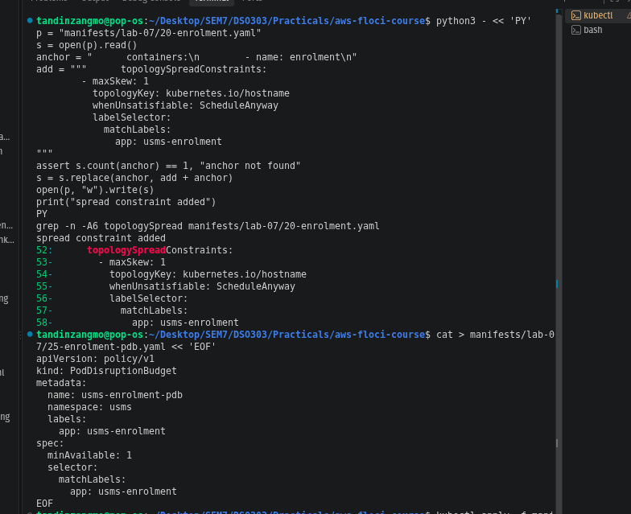

*PDB created, both pods on node b216da0cd7ac, Secret env still present*

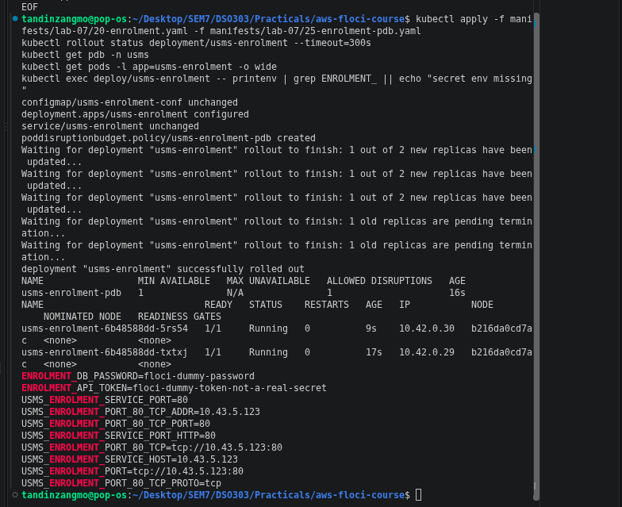

*Traffic loop through the gateway, no failed requests*

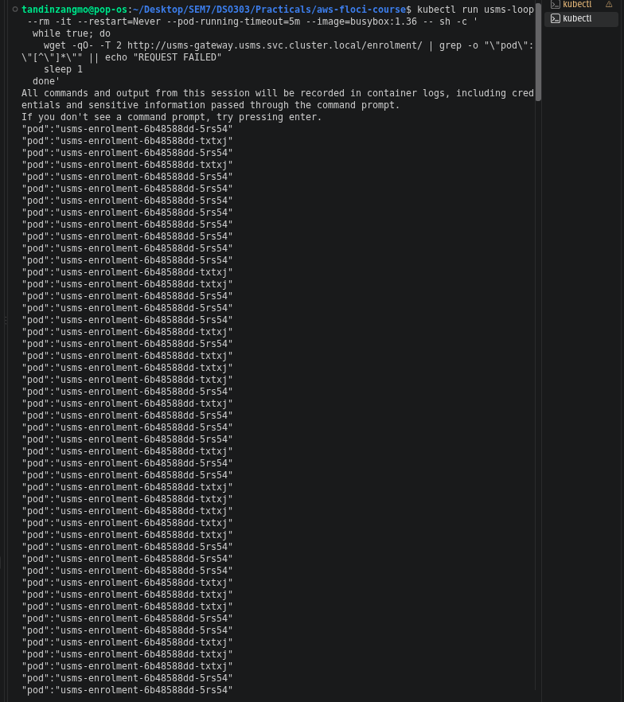

*Drain evicts one pod, then is refused by the disruption budget*

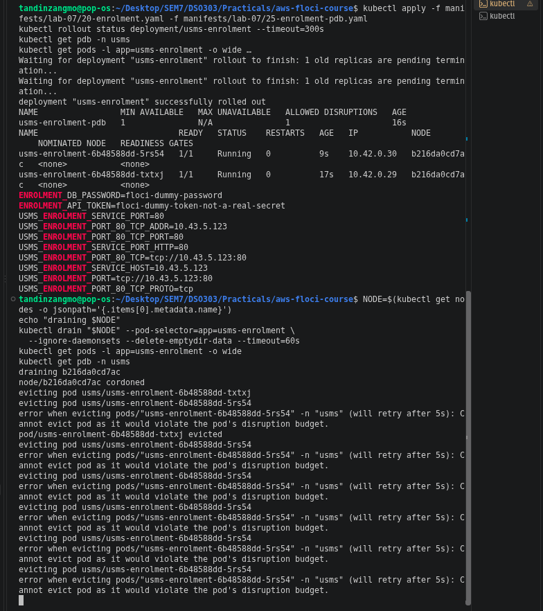

*After uncordon: six Running pods, ALLOWED DISRUPTIONS 1*

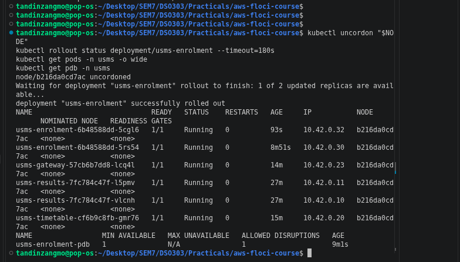

## Exercise 5 - Prepare what Lab 08 needs

**Part 1 - CPU baseline** (outputs/lab-07-cpu-baseline.txt)

`kubectl get --raw /apis/metrics.k8s.io/v1beta1` worked, so the metrics API is present and kubectl top works on this build (metrics-server came with k3s). Both enrolment pods were idle:
- usms-enrolment-6b48588dd-5cgl6: 1m CPU, which is 2.0% of the 50m request, 13Mi memory
- usms-enrolment-6b48588dd-5rs54: 1m CPU, which is 2.0% of the 50m request, 12Mi memory

This is the number Lab 08's HPA will divide by. At 2% the HPA would scale down to minReplicas.

**Part 2 - Lab 01's policy** (outputs/lab-07-lab06-readiness.txt)

All of this was read from the API, not from Lab 1's document:
- Policy ARN: arn:aws:iam::000000000000:policy/USMSStudentDataReadWrite, default version v1
- Roles carrying it: usms-ec2-app-role, usms-ecs-task-role, usms-eks-node-role. list-entities-for-policy is unsupported on Floci, so I looped over every role and checked its attached policies.
- Resources in the policy document, from get-policy then get-policy-version:
  - bucket ARN: arn:aws:s3:::usms-student-data
  - object ARN: arn:aws:s3:::usms-student-data/*
- head-bucket on usms-student-data failed, so the bucket does not exist yet. Lab 10 creates it.

The bucket ARN and object ARN are different entries because bucket-level actions like ListBucket apply to the bucket ARN, while object actions like GetObject and PutObject apply to the object ARN. A policy with only one of them would allow half the operations.

Both files are git-ignored. `git check-ignore -v` named `.gitignore:7:outputs/*` for each.

**Part 3** is in notes/lab-07-notes.md under "Exercise 5 Part 3".

*Metrics API present and the CPU baseline*

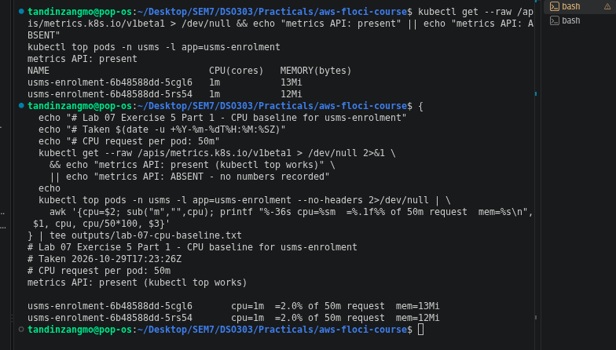

*USMSStudentDataReadWrite holders, bucket and object ARNs, bucket missing*

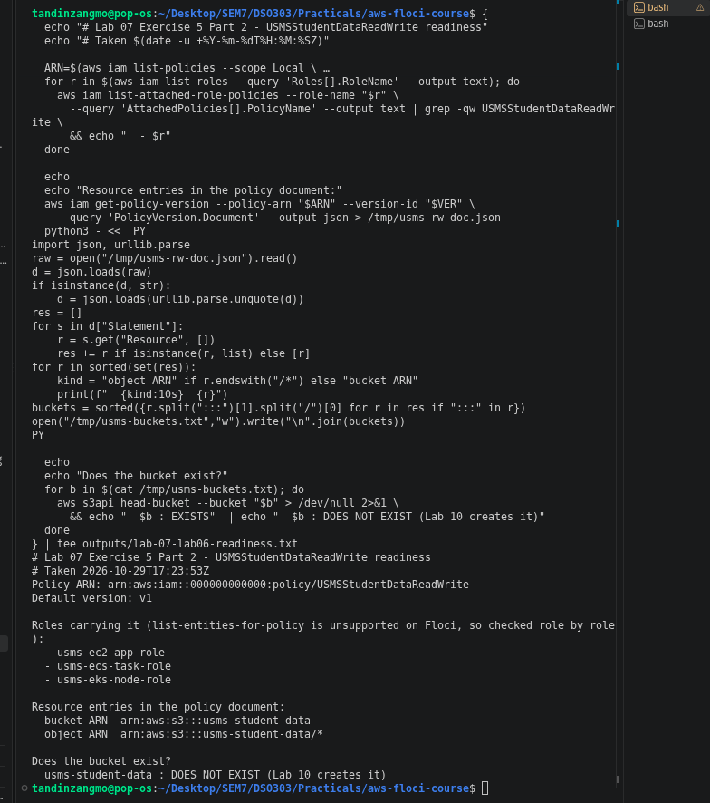

*Both outputs files git-ignored*

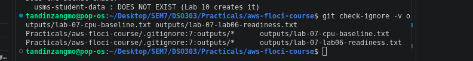