# Lab 07 Report - Deploying a Microservices Application on Amazon EKS

## Aim

The aim of this lab was to create an EKS cluster and managed node group inside the Lab 02 VPC, deploy three USMS microservices (usms-gateway, usms-enrolment and usms-results) with kubectl, and then test service discovery, rolling updates, rollback, failure diagnosis, Secrets and persistence across a restart. Everything was done against the Floci emulator on my own machine.

## Environment and support path

Floci was running in hybrid storage mode, the account was 000000000000, verify-lab-02.sh gave FAIL=0 and all four Lab 02 subnets were present. The support probe returned PATH A, which means the aws eks API worked, so I used aws eks for the AWS side and kubectl for the Kubernetes side. k3d was not installed, which is fine on Path A.

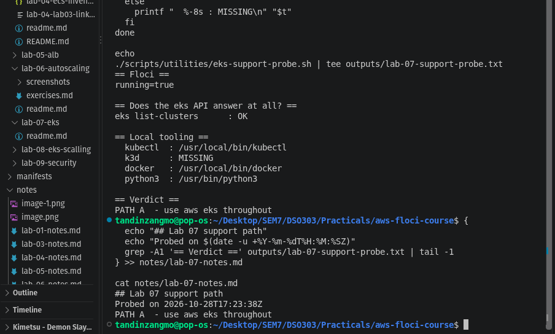

## IAM roles and security group

I wrote two trust policies and two local permission policies (stand-ins for the AWS managed EKS policies) and created:

- usms-eks-cluster-role, trusting eks.amazonaws.com, with USMSEKSClusterPolicy
- usms-eks-node-role, trusting ec2.amazonaws.com, with USMSEKSNodePolicy and Lab 01's USMSStudentDataReadWrite
- usms-eks-cluster-sg in usms-vpc, allowing TCP 443 from 10.0.0.0/16 only

Floci does not support list-entities-for-policy, so I checked the holders of USMSStudentDataReadWrite by looping over every role. It is now on three roles: usms-ec2-app-role, usms-ecs-task-role and usms-eks-node-role.

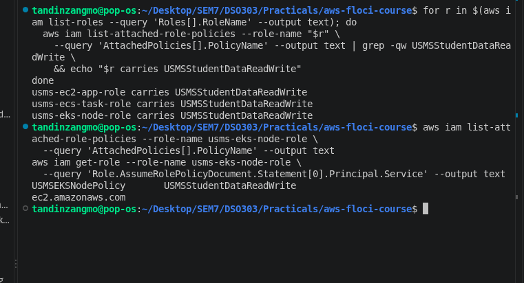

## Cluster and node group

The cluster was created while holding the assumed usms-developer-role credentials, using a request body in templates/lab-07-create-cluster.json. It covers all four subnets and carries the `_lb_ports_` tag (8081,8082) that Lab 08 needs. The first create-cluster call timed out because Floci was still downloading the k3s image, so I added `--cli-read-timeout 600`.

The cluster became ACTIVE. The OIDC issuer came back as None, which means IRSA cannot be completed on this build.

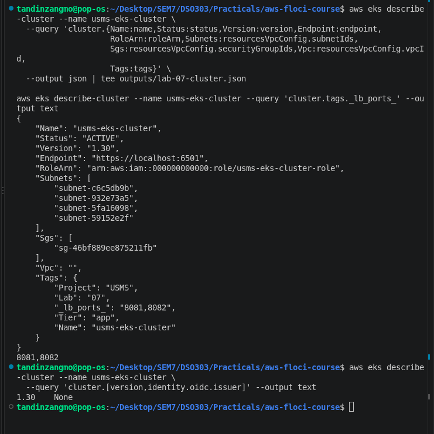

The node group usms-eks-nodes was created in the two private subnets only, with min 2, max 4 and desired 2.

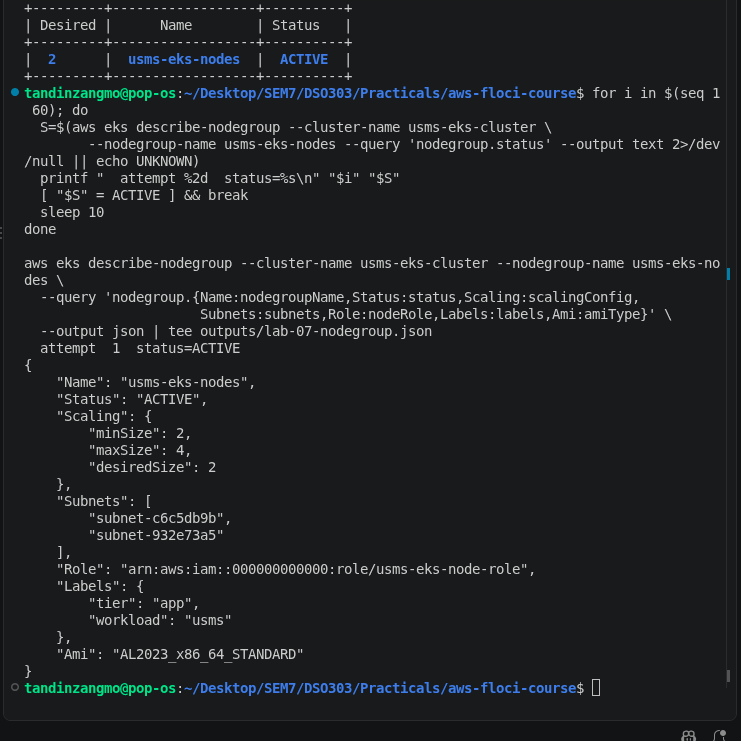

When I first ran kubectl, the connection to the API server was refused. Floci's logs showed the k3s container had been removed when I stopped Floci the night before. I deleted and recreated the cluster, and after that kubectl reached the API server and one node was Ready. Only one node existed even though the node group asks for two, and it was running v1.34.1+k3s1 rather than the 1.30 I requested.

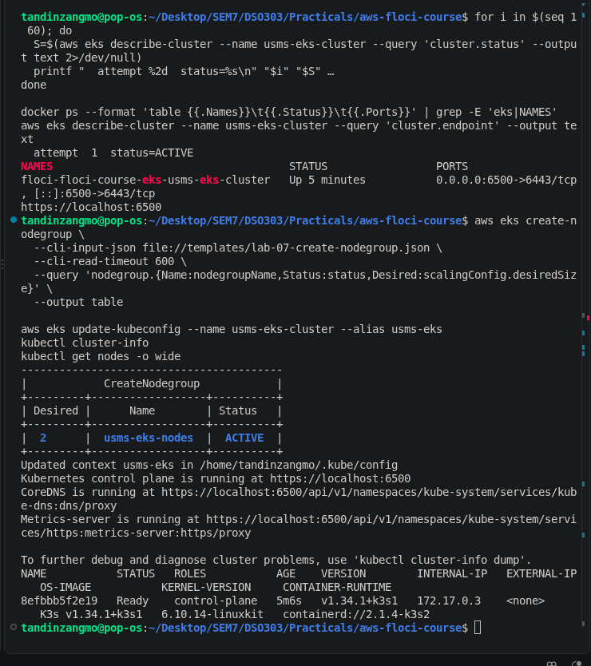

## Deploying the microservices

All objects live in namespace usms and were applied from numbered manifests in manifests/lab-07/. usms-enrolment has 2 replicas, a 50m CPU request, separate readiness and liveness probes, and a maxUnavailable 0 / maxSurge 1 update strategy. usms-results has 2 replicas with the default strategy, and usms-gateway is an nginx reverse proxy with 1 replica.

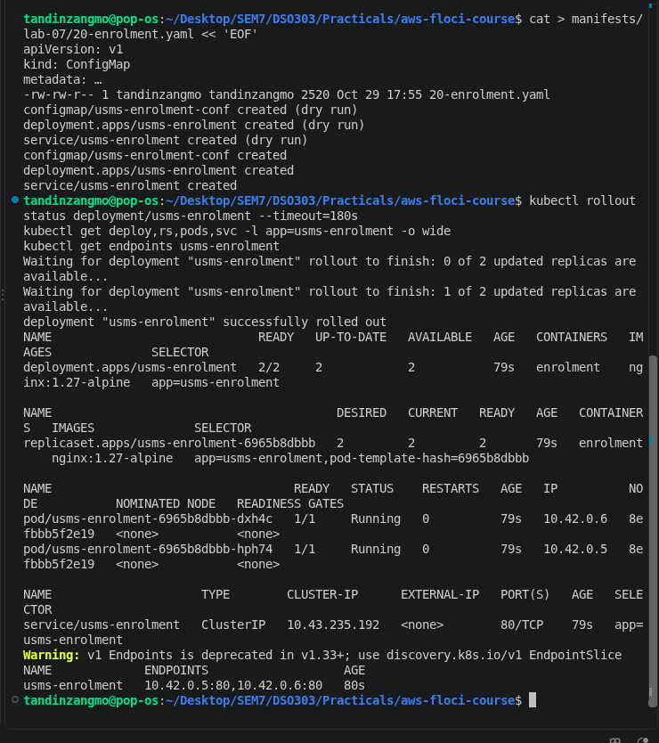

## Service discovery

From inside a busybox pod, the Service names resolved to their ClusterIPs (for example usms-enrolment to 10.43.235.192), and requests through the gateway reached both backends. The gateway configuration contains only DNS names and no IP addresses.

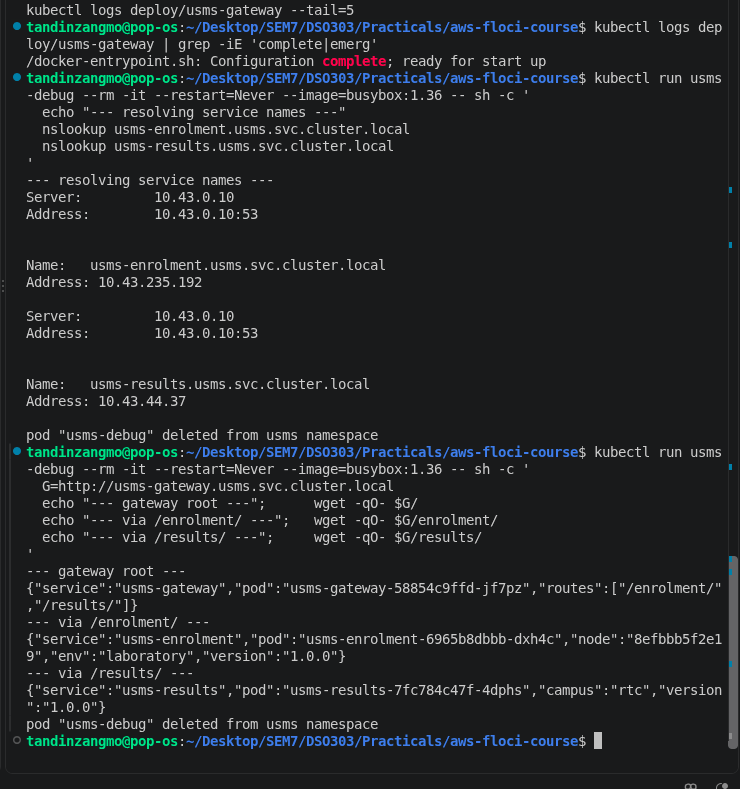

Twelve requests through the gateway were answered by two different enrolment pods (5 and 7). When I deleted one pod, the ReplicaSet created a replacement within 2 seconds and requests kept working.

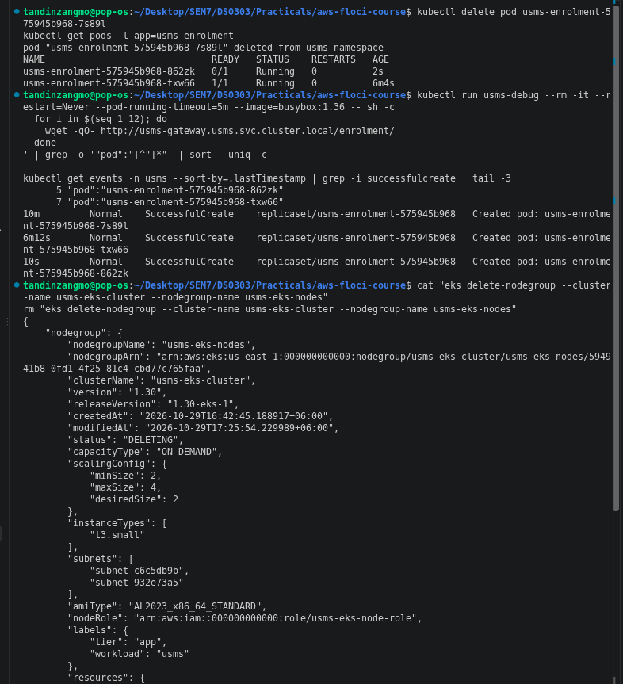

## ConfigMap and Secret

I generated the Secret into outputs/, which is git-ignored, instead of committing it. Decoding it with `base64 -d` gave back the token straight away, which shows that a Secret is only encoded, not encrypted. Inside the container the values were plain text.

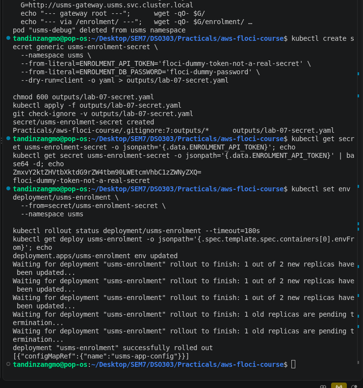

## Rolling update and rollback

Changing APP_VERSION in the ConfigMap did not change the running pods until I ran `kubectl rollout restart`, which created a new ReplicaSet. After `kubectl rollout undo` the pods still reported 1.1.0, because undo only reverts the pod template and the ConfigMap is a separate object. I restored the ConfigMap to 1.0.0 afterwards.

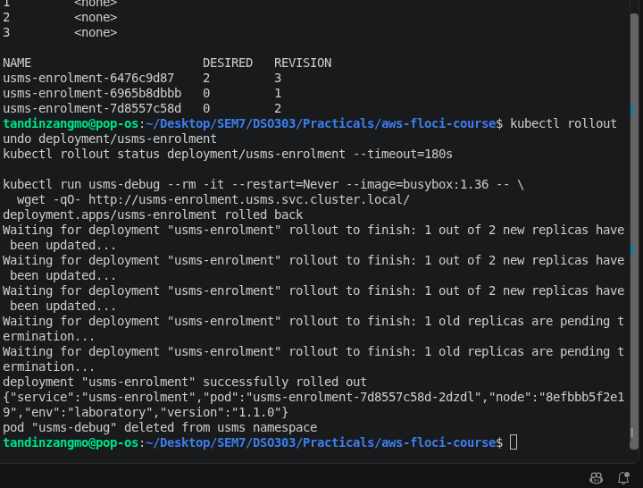

## Failure diagnosis

I caused three failures on purpose and diagnosed each with kubectl describe first:

- ImagePullBackOff: a bad image tag on usms-results. The new pod failed to pull while both old pods kept running.
- Pending / FailedScheduling: a pod requesting 64 CPU and 256Gi, which no node could fit.
- CrashLoopBackOff: a container that exits with code 1. Here logs was useful because the container did start.

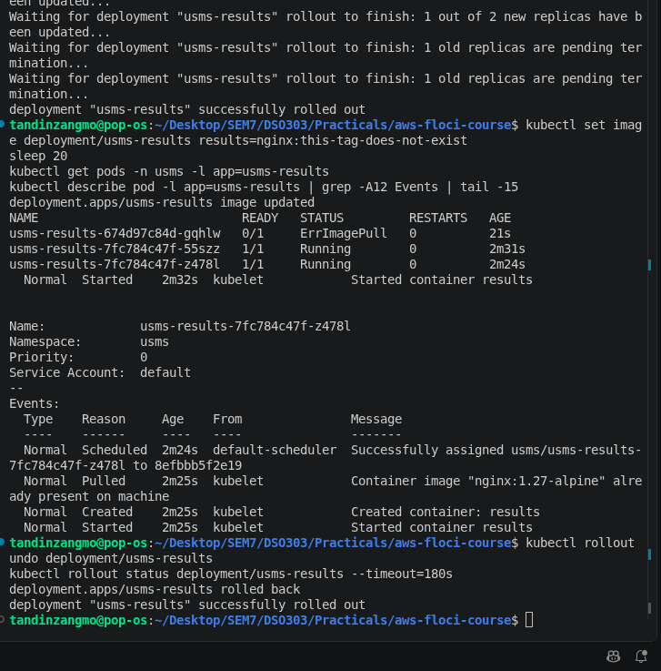

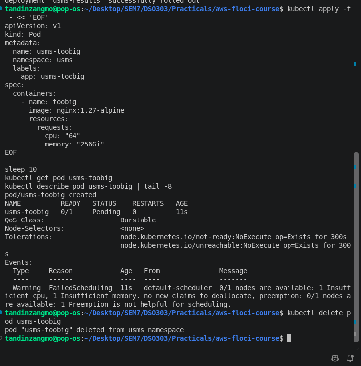

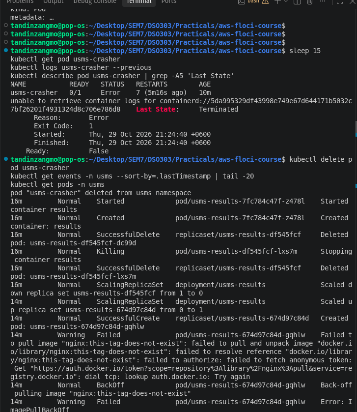

## Restart test

After stopping and starting Floci, the cluster and node group records were still there and ACTIVE, but the whole Kubernetes side was gone. Floci removes the k3s container on shutdown and does not start it again. So persistence was proven for the AWS side only, not for the Kubernetes side.

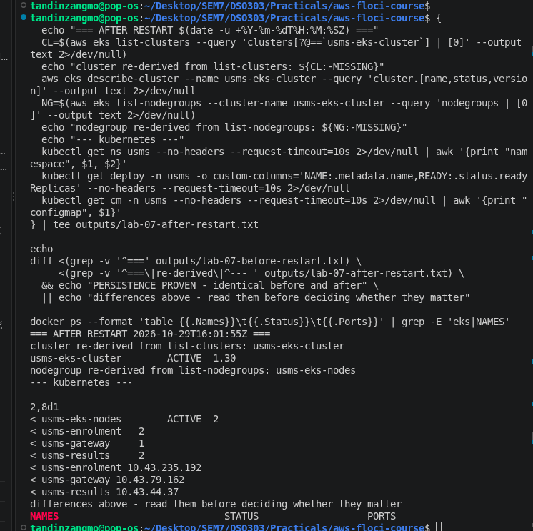

I recreated the cluster from the same templates, and `kubectl apply -f manifests/lab-07/` brought back the namespace, ConfigMaps, Deployments, Services and ServiceAccount in one command.

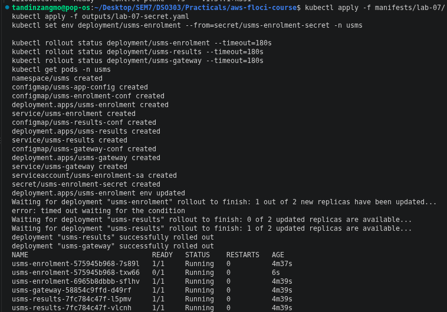

## Verification

configs/lab-07.env was generated with 21 exports and no empty values. verify-lab-07.sh passed every check, and the smoke test through the gateway returned JSON from all three services. The cleanup script was written and syntax checked but not run, since Lab 08 needs the cluster.

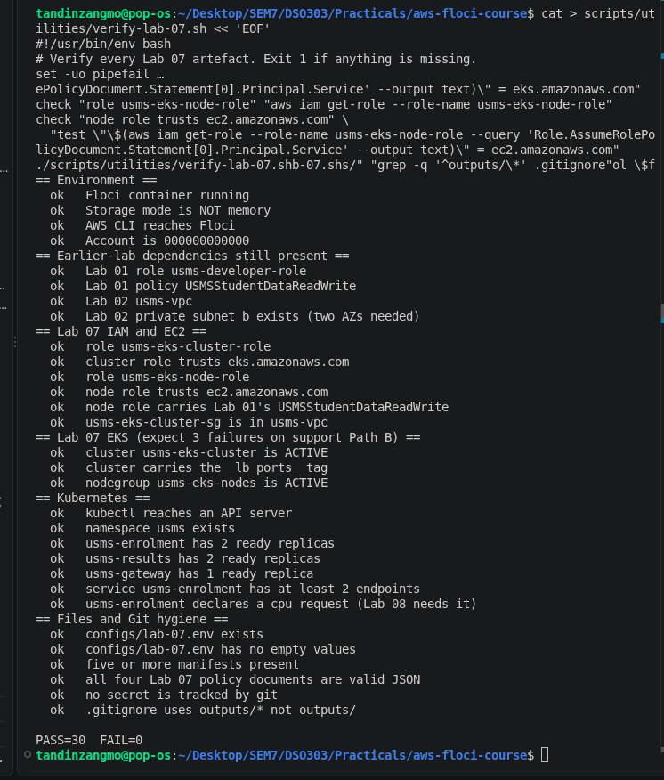

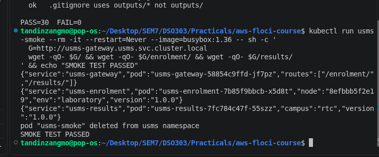

## Floci limitations noticed

- IAM policies are stored but not enforced.
- list-entities-for-policy is not supported.
- describe-cluster returned an empty VPC ID.
- No OIDC issuer, so IRSA is conceptual only.
- The node group creates only one real node, and instance type and AMI have no effect.
- The k3s cluster does not survive a Floci restart.

## Conclusion

The lab showed how EKS splits into a control plane that AWS runs and a data plane that I run, each with its own IAM role. On the Kubernetes side, Deployments, Services, DNS discovery, rollouts and failure diagnosis all worked the same as they would on real EKS. The most useful lesson was from the restart test: because everything was kept as declarative manifests, the whole application came back with one command. For USMS itself I would still pick ECS with Fargate, since it needs less to run for a small team with a quiet, seasonal workload.