# Lab 08 Report - EKS Scaling and Service Exposure

## Aim

The aim of this lab was to scale the Lab 07 USMS microservices by hand, by manifest and with a HorizontalPodAutoscaler, to change the node group's scaling from the AWS side, and to use requests, QoS classes, a nodeSelector and PodDisruptionBudgets. The second half climbed the exposure ladder (port-forward, NodePort, LoadBalancer, Ingress) and compared it with Lab 05's ALB. Everything was done against the Floci emulator on my own machine, on support Path A.

## Getting the cluster back

When I started, kubectl got connection refused on localhost:6500. Floci had been restarted overnight and the k3s container behind usms-eks-cluster had exited. `docker start` brought it up for a moment, but it then died with `failed to get list of links` and the API server kept returning ServiceUnavailable. I deleted and recreated the cluster and node group from `templates/lab-07-create-*.json`, which is the same recovery as Lab 07. This time k3s reused its data, so the namespace, Deployments, Services, ConfigMaps and Secret all came back without re-applying anything.

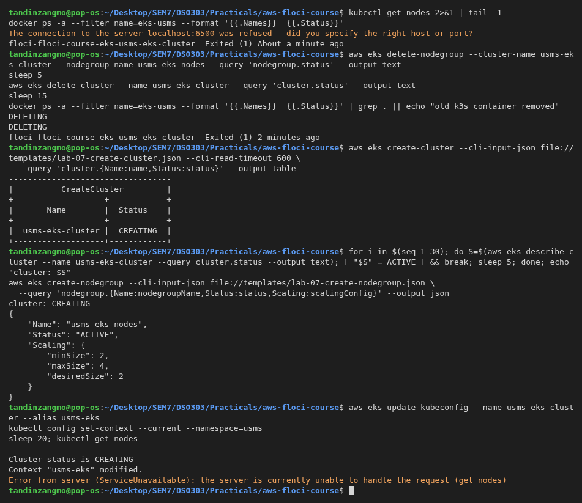

The new k3s container registered a new node (4d3eabe280a6), and the old node object (b216da0cd7ac) stayed NotReady with the pods still bound to it. I deleted the old node object, and the pods rescheduled onto the new node. The two DSO202 kind clusters were also running and pushing the load average to about 37 with swap full, so I stopped them, as in Lab 07. One of them was also holding host port 30080, which this lab uses.

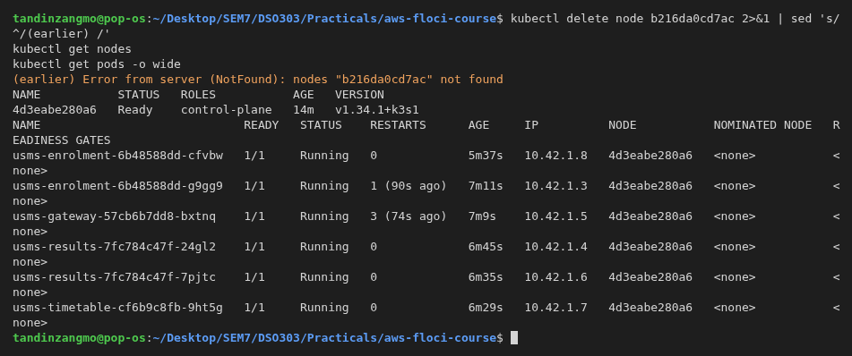

## Step 1 and 2 - Prerequisites and baseline

usms-enrolment still declares a CPU request of `{"cpu":"50m","memory":"32Mi"}`, which the HPA divides by. The cluster still has the `_lb_ports_=8081,8082` tag.

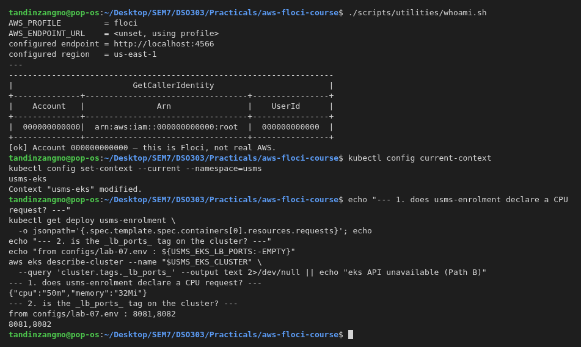

verify-lab-07.sh gave PASS=29 FAIL=1. The one failure is "no secret is tracked by git". That is a false positive, because the check matches `outputs/.gitkeep`, which is tracked on purpose.

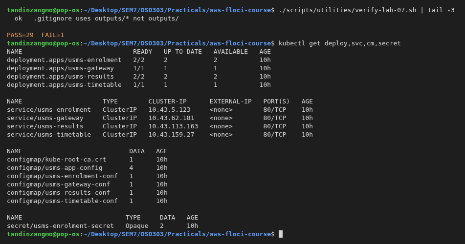

The baseline went to outputs/lab-08-baseline.txt: enrolment 2/2, gateway 1/1, results 2/2, timetable 1/1 (from Lab 07 Exercise 1), every Service ClusterIP with no external address, and one Ready node with 16 CPUs.

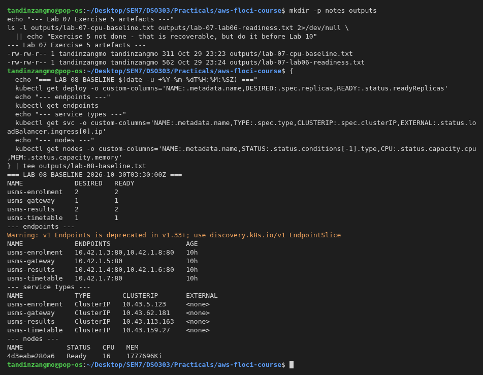

## Step 3 - The four dimensions

Step 3 is written up in notes/lab-08-notes.md.

## Step 4 - Scaling by hand

`kubectl scale --replicas=5` only changed spec.replicas. The same ReplicaSet (usms-enrolment-6b48588dd) went from 2 to 5 and no new ReplicaSet appeared, so no rollout happened. The endpoint list grew to five.

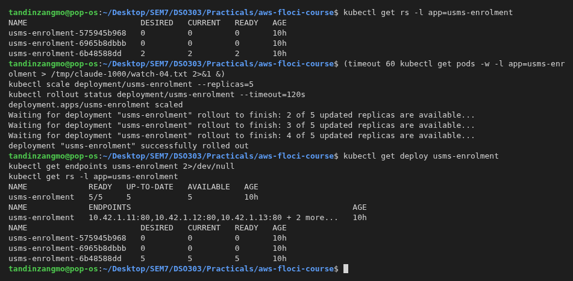

Forty requests through the gateway were answered by all five pods (10, 8, 8, 7, 7). The gateway did not need to be restarted or reconfigured. The watcher showed the new pods going Pending, then ContainerCreating, then Running 0/1, and only becoming 1/1 (ready, and added to the endpoints) about 7 seconds later, once the readiness probe passed. When I scaled back to 2, the extra pods went to Terminating.

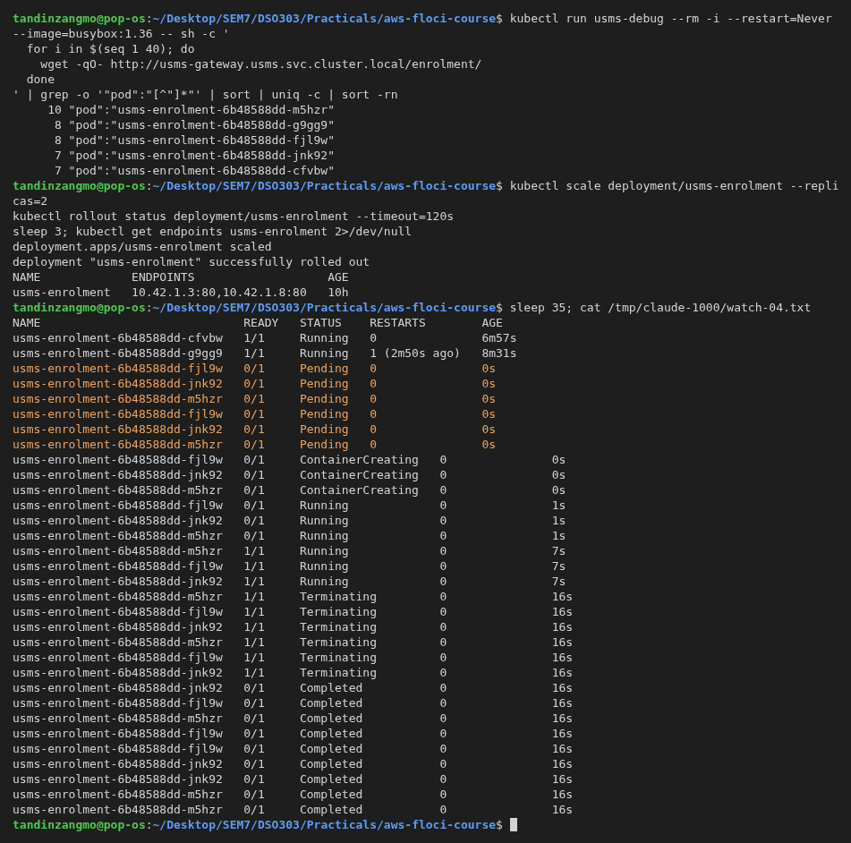

## Step 5 - Configuration drift

I scaled to 6, but the manifest still said `replicas: 2` (line 35). Applying the unchanged manifest silently brought it back to 2.

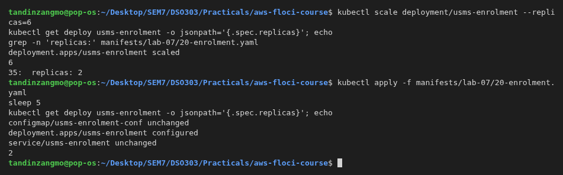

After changing the file to 3, `kubectl diff` showed `- replicas: 2 / + replicas: 3` and exited with 1. That exit code means "there is a difference", not an error. I then restored the file to 2, applied it, and removed the .bak files.

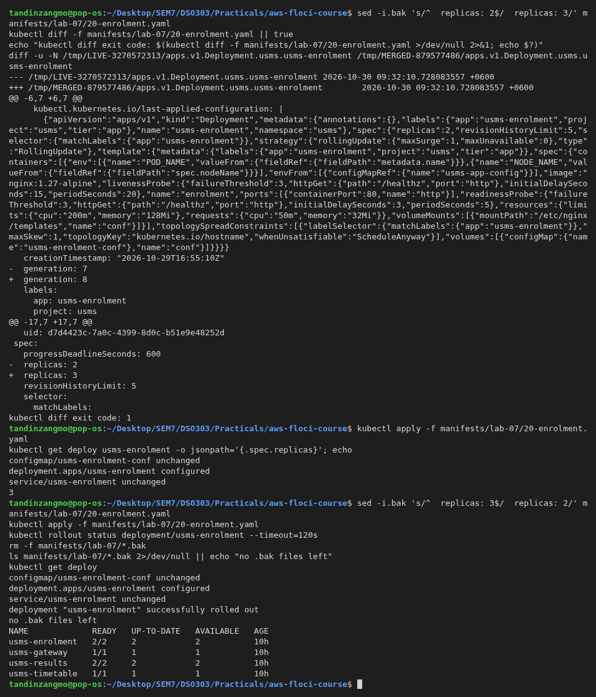

## Step 6 - Requests, limits and QoS

All pods are Burstable (50m request, 200m limit). The node's Capacity and Allocatable were the same here (16 CPU), and the allocated requests were 500m (3%). The HPA's 50% target means 25m per pod on average, not 50% of a node and not 50% of the limit.

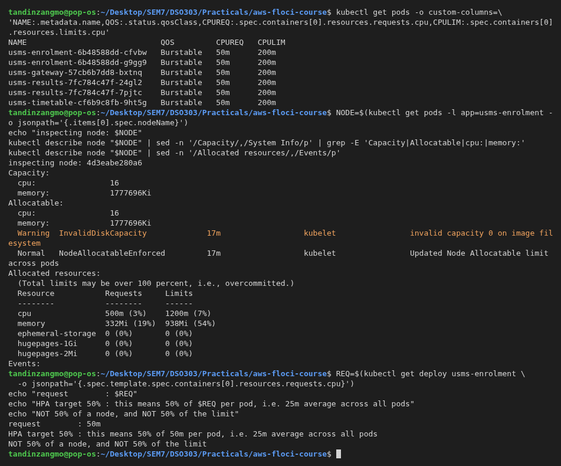

For the "your turn" task, I set the gateway's requests equal to its limits (200m/128Mi). The QoS class went Burstable → Guaranteed, and the pod was **replaced**, not changed in place. Setting it back made it Burstable again, with another new pod.

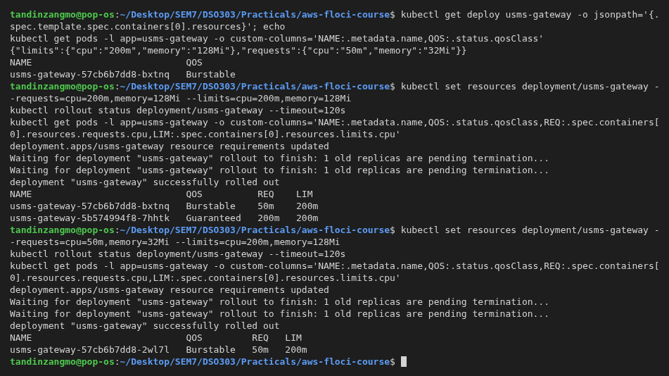

## Step 7 - Metrics pipeline

k3s ships metrics-server, so the metrics API was AVAILABLE and `kubectl top` worked. Idle enrolment pods used about 1m, which is 2% of the 50m request.

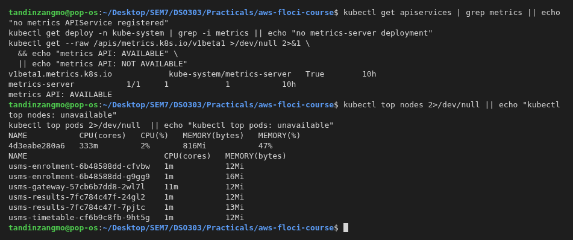

## Step 8 - HorizontalPodAutoscaler

I created usms-enrolment-hpa as an autoscaling/v2 manifest: min 2, max 8, 50% CPU, scale up immediately (Percent 100 / Pods 2 per 15 s, selectPolicy Max), and scale down after a 300 s window at 1 pod per 60 s (selectPolicy Min). It showed `<unknown>/50%` for the first second and then `2%/50%`. The conditions were ScalingActive True / ValidMetricFound.

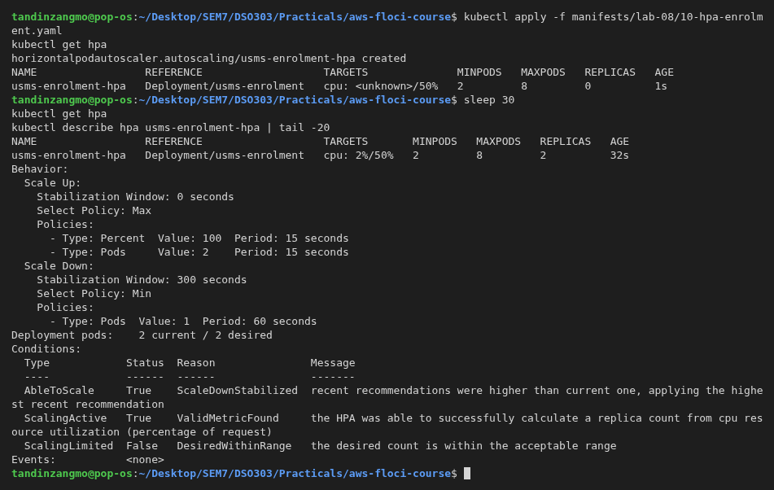

## Step 9 - Load and the autoscaler responding

I wrote scripts/utilities/hpa-watch.sh and applied usms-loadgen (3 busybox pods looping wget on /enrolment/).

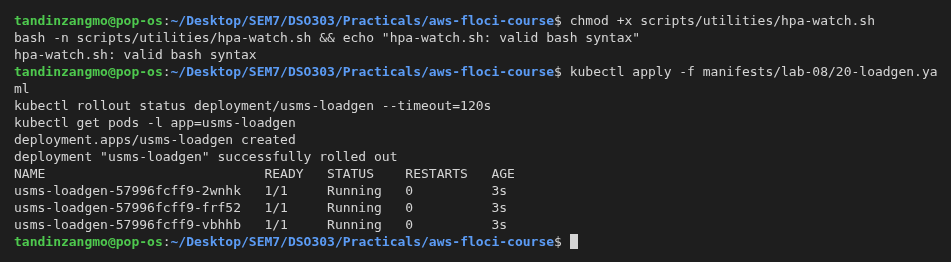

CPU rose from 2% to 43% and then 58%, and the HPA scaled from 2 to 3: ceil(2 × 58 / 50) = ceil(2.32) = 3. CPU then settled at about 20–30%, so it did not go further. My machine could not drive more load, because the gateway and the load generators themselves took most of the CPU. After I scaled usms-loadgen to 0, CPU dropped to 2% within seconds, but the replicas stayed at 3 for the 300 s stabilisation window. Then the HPA scaled back to 2.

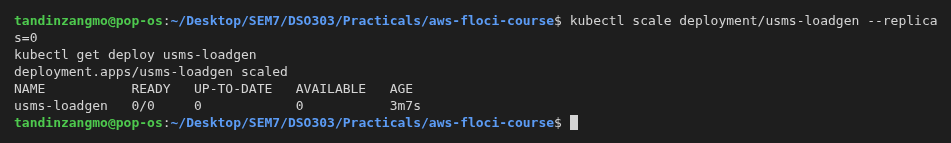

The HPA events, quoted:

- `New size: 3; reason: cpu resource utilization (percentage of request) above target`
- `New size: 2; reason: All metrics below target`

There was also a short `FailedGetResourceMetric ... did not receive metrics for targeted pods (pods might be unready)` while new pods were starting.

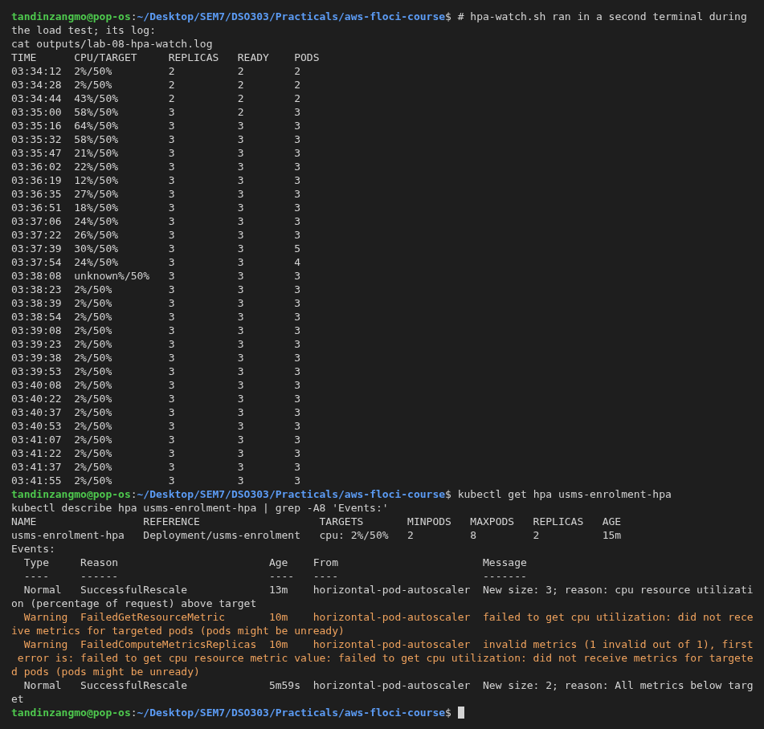

## Step 10 - Node group scaling from the AWS side

describe-nodegroup showed min 2 / max 4 / desired 2, t3.small, the two private subnets, and the labels workload=usms and tier=app. `update-nodegroup-config --scaling-config minSize=2,maxSize=6,desiredSize=3` failed with `An error occurred (400) ... InvalidArgument`. This is the known Floci 2.0.1 issue, so the node group stayed at 2/4/2 and no third node appeared. On real AWS this call returns an asynchronous Update object, and the Auto Scaling group launches a third instance.

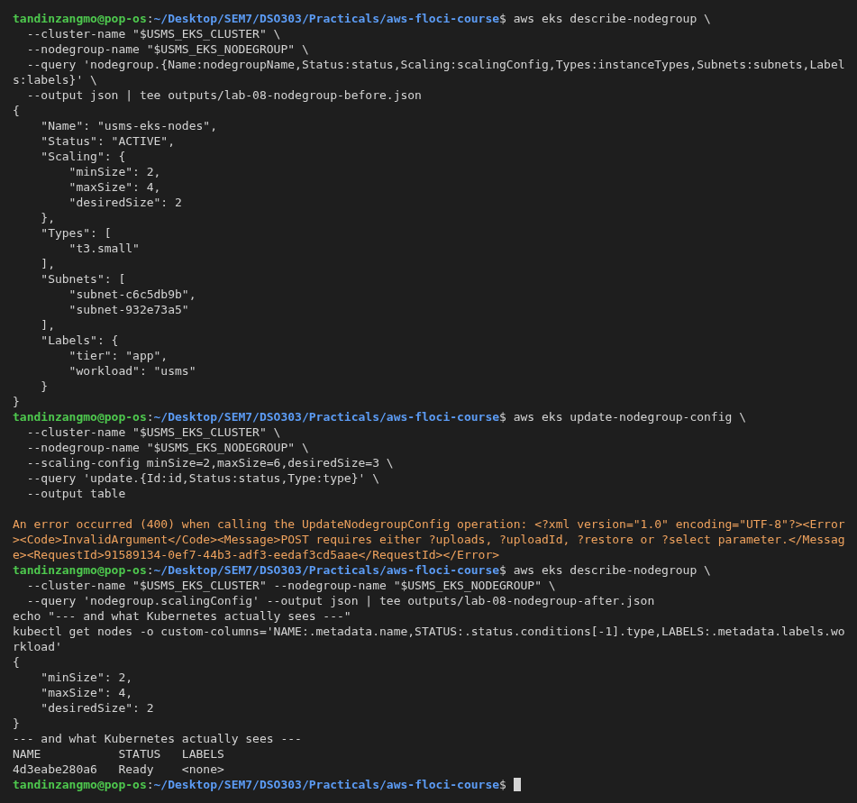

## Step 11 - Cluster Autoscaler, Karpenter and nodeSelector

Neither autoscaler is installed. Both need IRSA, which this cluster cannot do (the OIDC issuer is None), and a real Auto Scaling group. The node group's labels did not reach the k3s node, so I added workload=usms and tier=app by hand and patched usms-enrolment with `nodeSelector: workload=usms`.

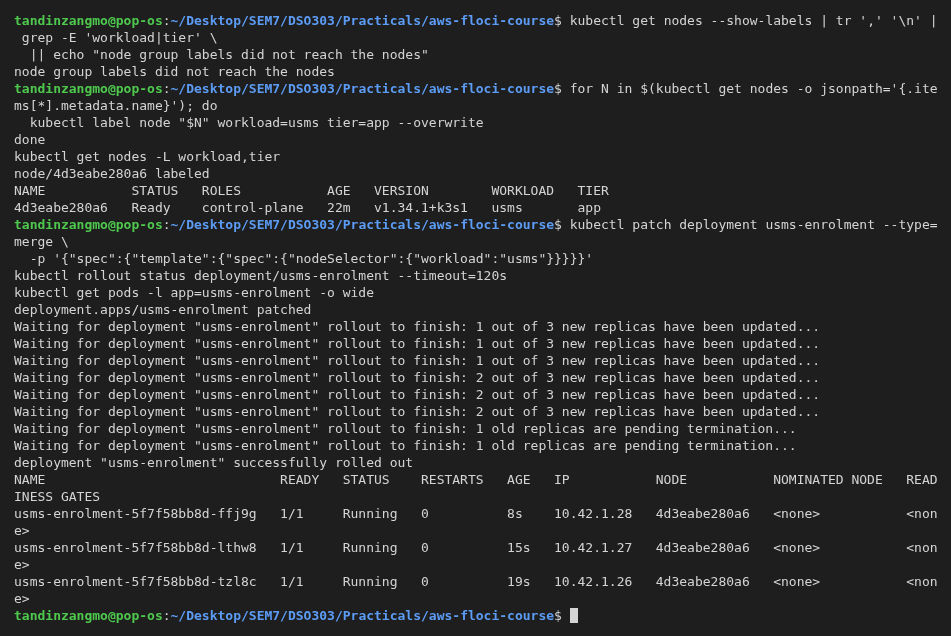

With `workload=nonexistent`, the new pod stayed **Pending**, and the three old pods kept running because of maxUnavailable 0. Stuck is better than broken. I set it back to usms and added the nodeSelector to manifests/lab-07/20-enrolment.yaml. The only remaining kubectl diff was replicas, which the HPA now owns.

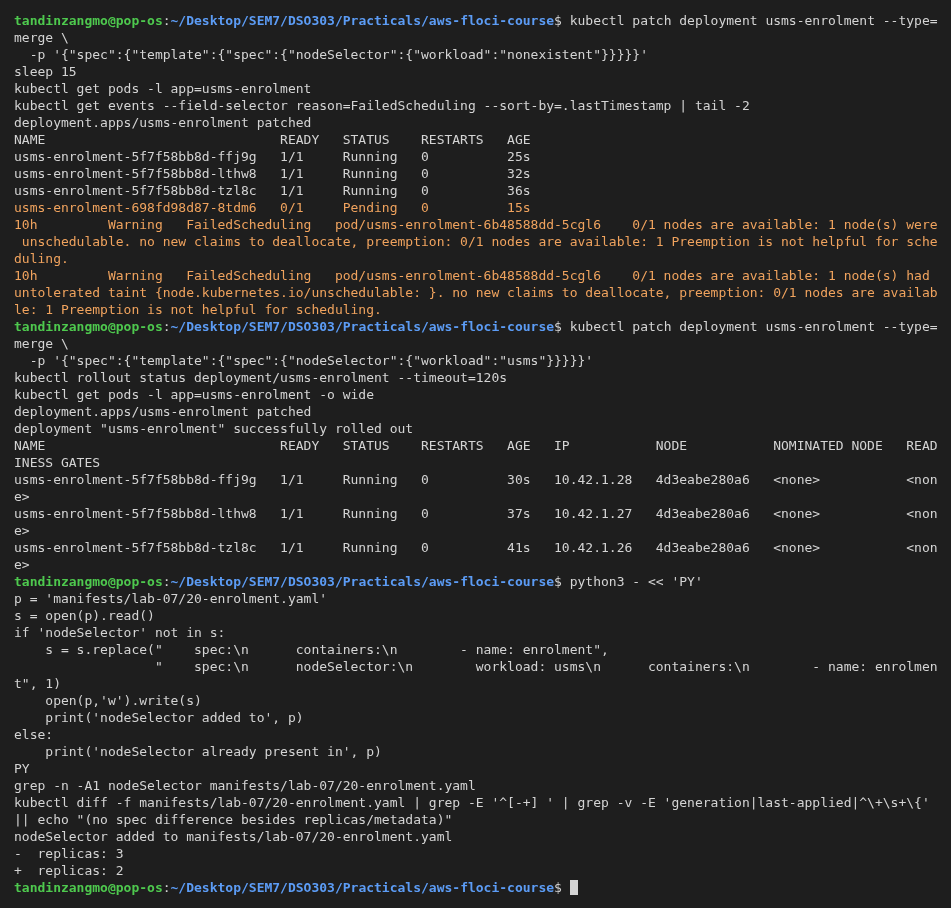

## Step 12 - PodDisruptionBudgets

usms-gateway-pdb (minAvailable 1) showed ALLOWED DISRUPTIONS 0, and usms-enrolment-pdb (maxUnavailable 1, replacing Lab 07's minAvailable version) showed 1. An eviction through the API was refused with `TooManyRequests: Cannot evict pod as it would violate the pod's disruption budget`, but a plain `kubectl delete pod` went straight through. A client-side dry-run drain listed every pod it would evict.

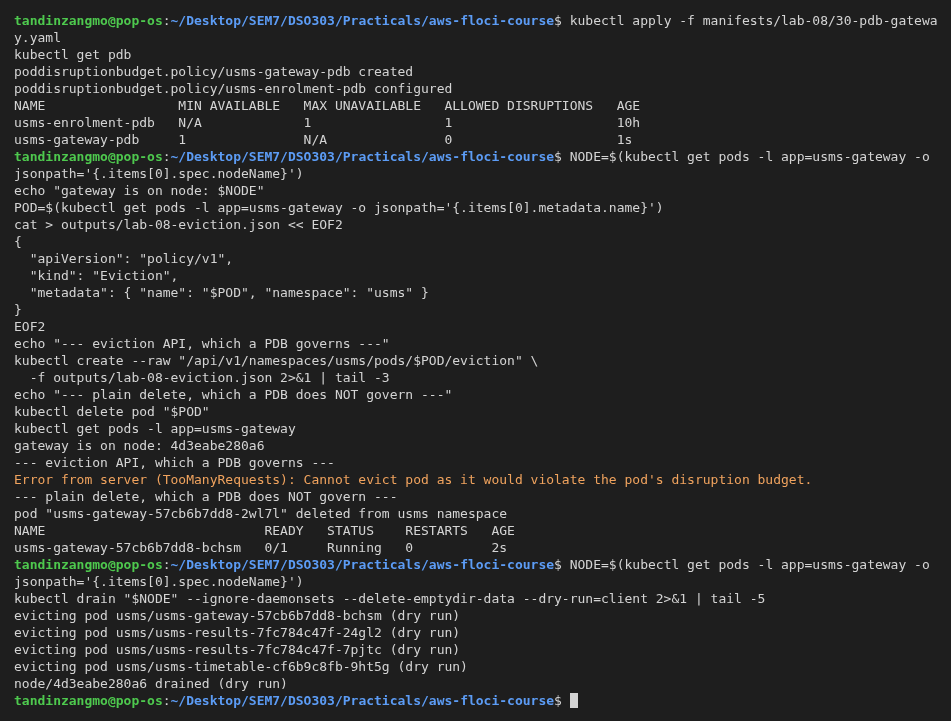

## Step 13 - ClusterIP and port-forward

curl to the gateway's ClusterIP (10.43.62.181) from my machine failed, as expected. Through `kubectl port-forward svc/usms-gateway 18080:80`, /, /enrolment/ and /results/ all returned JSON. A port-forward is one tunnel to one pod through the API server, and it only lasts while the command runs.

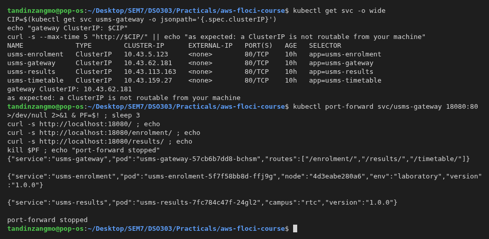

## Step 14 - NodePort

usms-results-np was created as `80:30080/TCP`, as a second Service on the same pods. From inside the cluster, node IP 172.17.0.3:30080 answered. There is only one node, so "every node answers" could only be shown for that one. From my machine, localhost:30080 failed (curl exit 7), because the k3s container only publishes 6443→6500. This is a Floci limitation. The port-forward fallback proved the Service works, but not that the NodePort can be reached from outside.

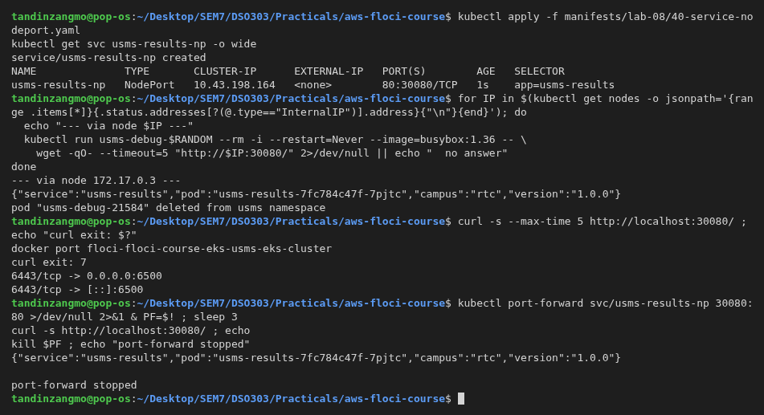

## Step 15 - LoadBalancer

I re-applied a full Service manifest (not a patch) that makes usms-gateway type LoadBalancer with the three AWS annotations. It was `<pending>` at first. Within 45 s, k3s's built-in service load balancer (svclb pod) gave it EXTERNAL-IP 172.17.0.3, and a request to that IP from inside the cluster returned the gateway's JSON. localhost:8081 and 8082 did not answer, because the k3s container was not created with those ports published. The ladder on one line:

`type=LoadBalancer  clusterIP=10.43.62.181  nodePort=30094  external=172.17.0.3`

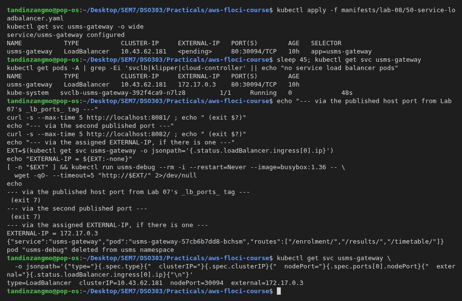

## Step 16 - Ingress

This cluster has no IngressClass and no ingress controller (Floci starts k3s with `--disable traefik`). usms-portal-ingress was stored with three Prefix paths (/enrolment → usms-enrolment, /results → usms-results, / → usms-gateway) and all five alb.ingress.kubernetes.io annotations, but it got no CLASS and no ADDRESS. This is a Conceptual result. On EKS, the AWS Load Balancer Controller would do what I did by hand in Lab 05: create-load-balancer, then create-target-group --target-type ip (one per backend Service), then create-listener, then create-rule (one per path).

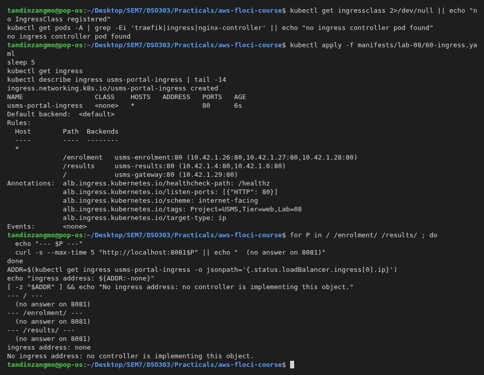

## Step 17 - ECS and EKS side by side

The ECS describe-services and scalable-target queries returned empty. The Lab 06 service (Path C) is not running on this Floci build. The EKS side showed the HPA, the LoadBalancer and NodePort Services, the Ingress and both PDBs. The comparison tables are in notes/lab-08-notes.md.

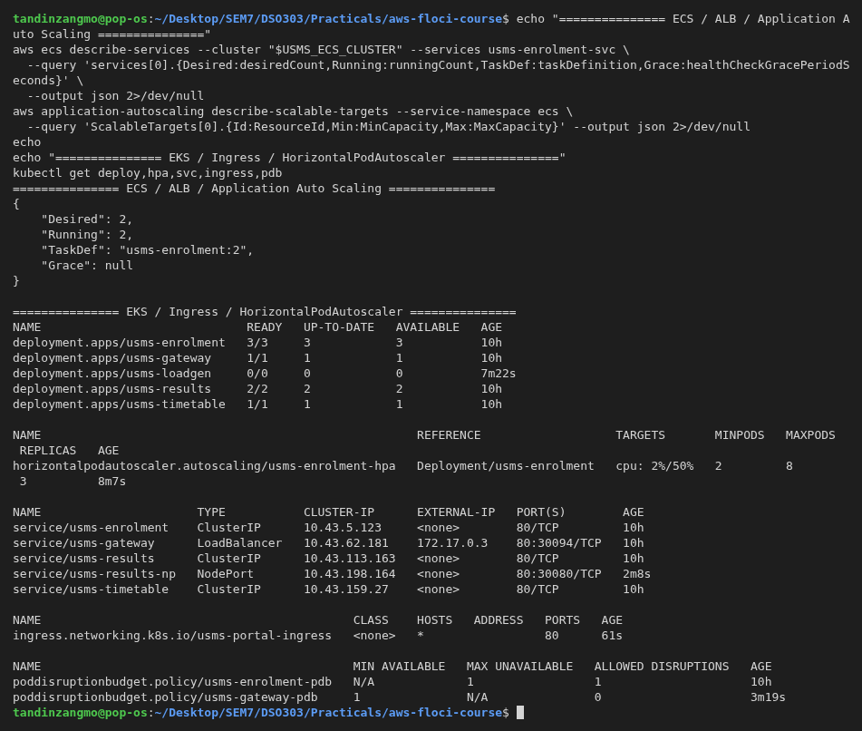

## Step 18 - Persistence

I recorded the scaling and exposure configuration to outputs/lab-08-before-restart.txt. I did **not** stop and start Floci again. Earlier in this session I saw that the k3s container does not survive a Floci restart (the Floci limitation), and recovering it means recreating the cluster. Persistence is proven for the AWS side (the cluster and node group records survived the overnight restart) and through the declarative manifests in manifests/lab-08/. It is not proven for the live Kubernetes state.

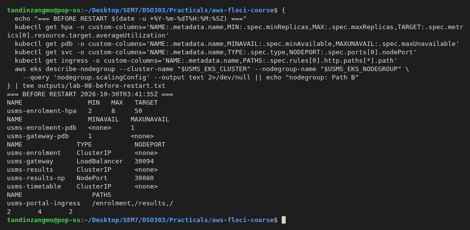

> **[Placeholder]** Add a screenshot here if you run the Floci stop/start and the after-restart diff yourself.

## Step 19 - configs/lab-08.env

All 19 exports were generated from live lookups. USMS_INGRESS_CLASS is empty, which is expected because there is no controller. The node group values are 2/4/2 because the update failed.

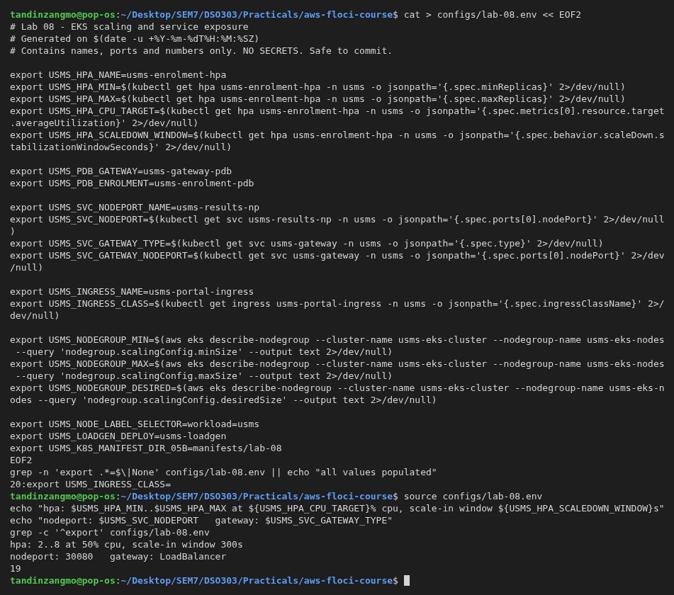

## Exercises

- Exercise 1: usms-results-hpa (min 2, max 6, 60%, scale-in window 180 s, at most 2 pods per 30 s) passed a dry run and reports 2%/60%.
- Exercise 2: I scaled the gateway to 2 replicas in manifests/lab-07/40-gateway.yaml. ALLOWED DISRUPTIONS became 1, and kubectl diff was clean. Both pods are on the only node, so on a real cluster I would add a topologySpreadConstraint. Applying 40-gateway.yaml also put usms-gateway back to ClusterIP, because that file declares the Service too. I had to re-apply 50-service-loadbalancer.yaml, which is Step 5's drift lesson again.
- Exercise 5: outputs/lab-08-scaling-evidence.json passes `python3 -m json.tool` and is git-ignored.

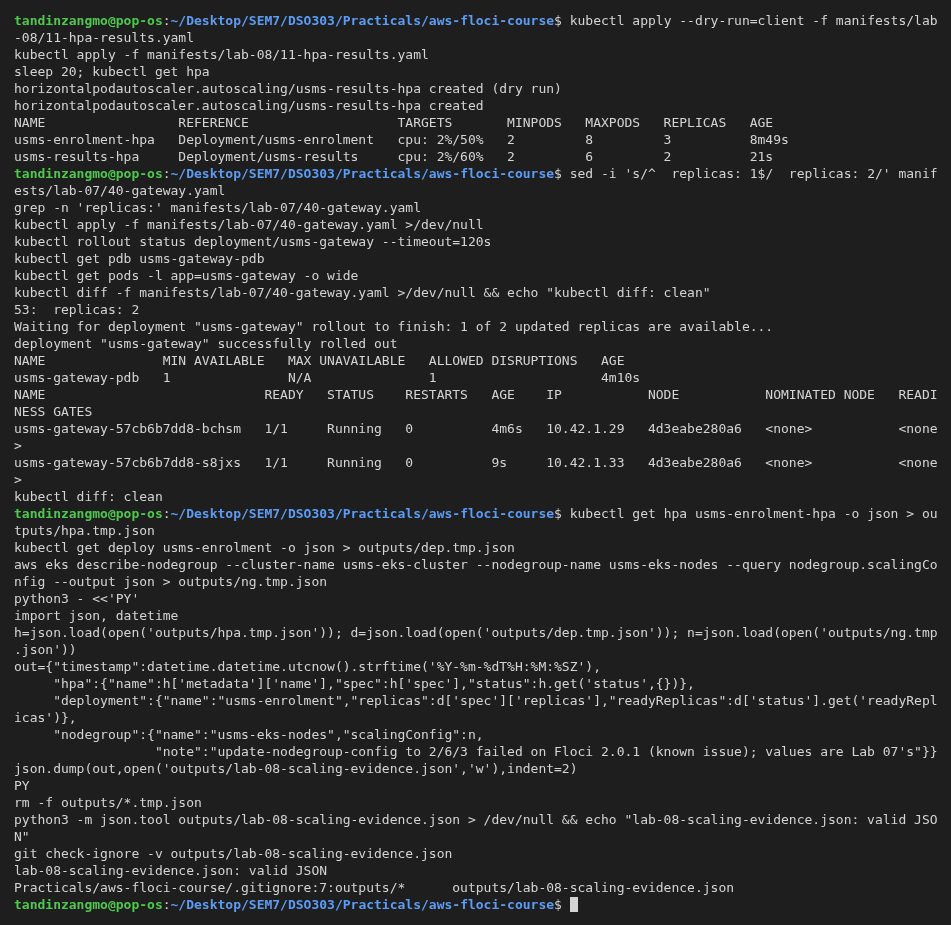

> **[Placeholder]** Exercise 3 (usms-reports diagnosis) screenshot.
>
> **[Placeholder]** Exercise 4 (expose results) screenshot.

## Verification and cleanup

verify-lab-08.sh first gave PASS=31 FAIL=3: two failures came from the gateway being reverted by Exercise 2, and one from the node group. The smoke test passed, and the cleanup script was syntax-checked but not run. In my copy of verify-lab-08.sh, I made the git check ignore outputs/.gitkeep.

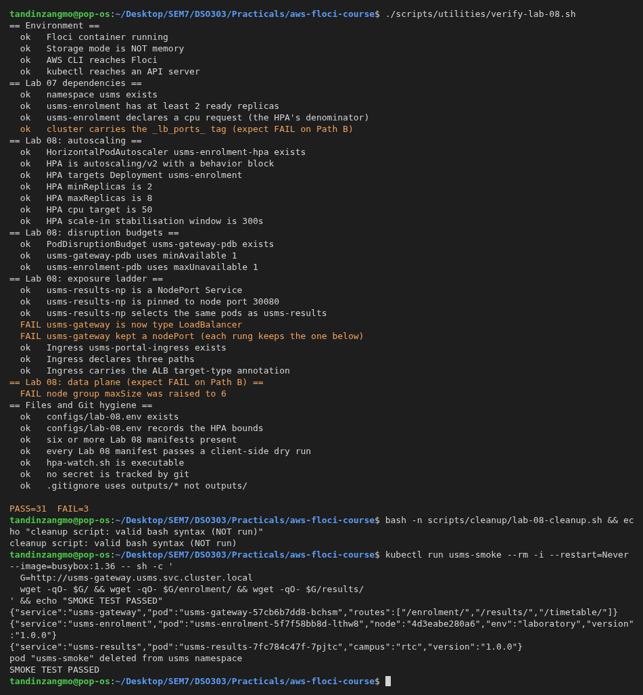

After re-applying the LoadBalancer manifest: **PASS=33 FAIL=1**. The only failure is "node group maxSize was raised to 6", which is the Floci update-nodegroup-config limitation.

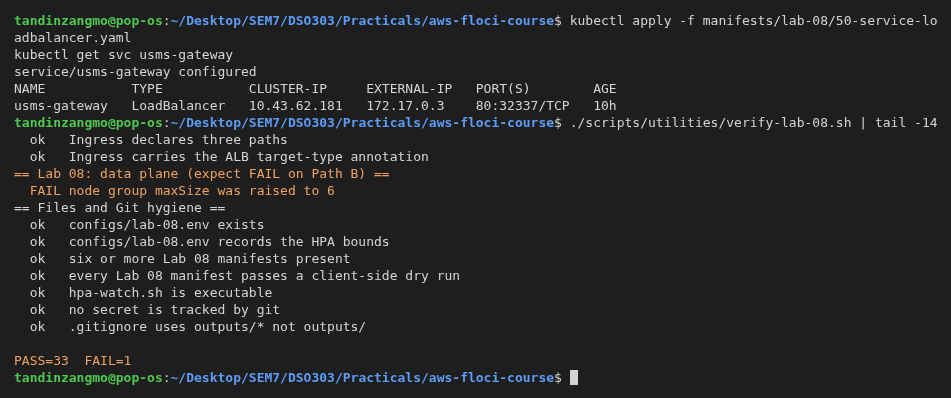

usms-loadgen was deleted, no node is cordoned, and `git check-ignore -v` names `.gitignore:7:outputs/*`.

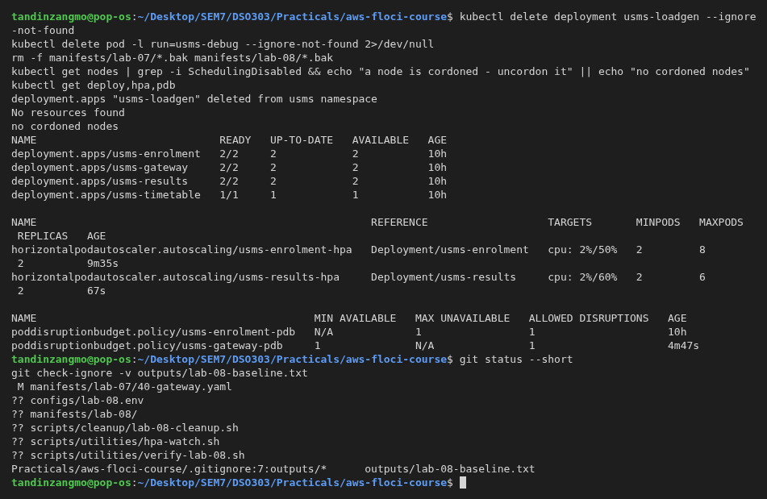

## Floci vs real AWS

| Claim | Status |
| --- | --- |
| kubectl scale, drift, kubectl diff, QoS, HPA 2 → 3 → 2, nodeSelector, PDB vs eviction | Observed |
| LoadBalancer external IP (k3s svclb, not an NLB) | Observed locally, AWS annotations not enacted |
| NodePort / _lb_ports_ reachable from the host | Not observed: ports not published by the k3s container |
| update-nodegroup-config 2/6/3 | Failed (Floci 2.0.1 known issue), no third node |
| Ingress routing, AWS Load Balancer Controller, Cluster Autoscaler, Karpenter, cost | Conceptual |
| Kubernetes state surviving a Floci restart | Not on this build: the k3s container has to be recreated |

## Conclusion

Scaling in Kubernetes always comes down to one integer, and the HPA showed this clearly: it scaled 2 → 3 under load, held for five minutes, and then scaled back to 2. The HPA and the node group are separate control loops, and on Floci only the Kubernetes one actually does anything. The exposure ladder showed that each rung keeps the one below it: the LoadBalancer Service still had a clusterIP and a nodePort. The most useful lesson was again drift: applying an older manifest quietly turned my LoadBalancer back into a ClusterIP, so every Service should be declared in exactly one file.
