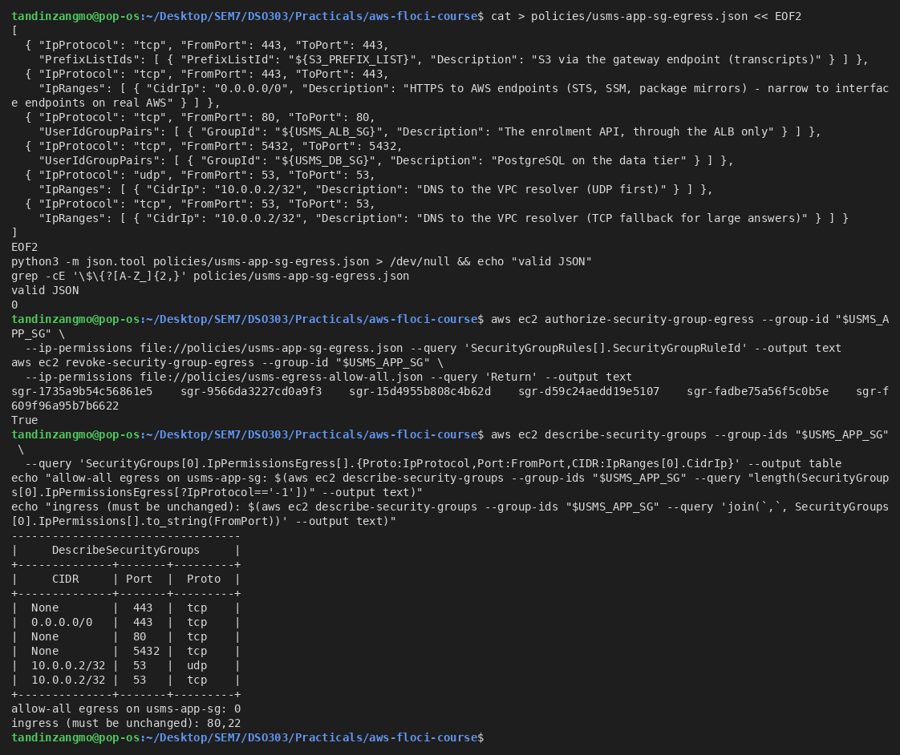
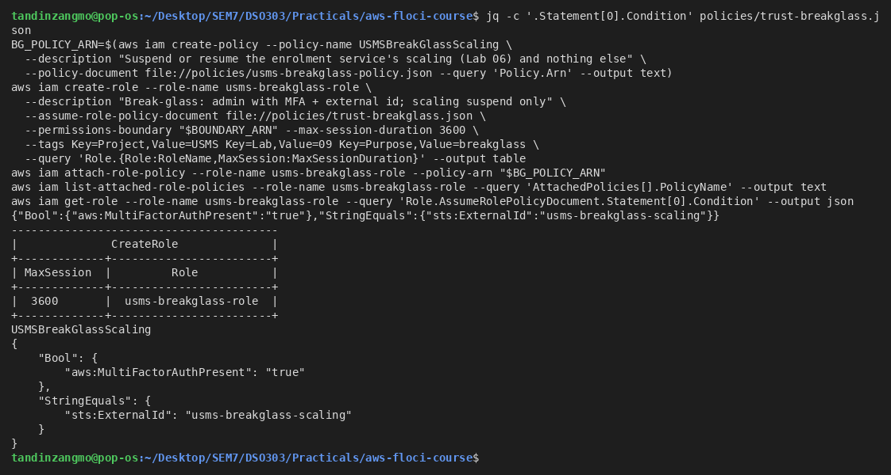
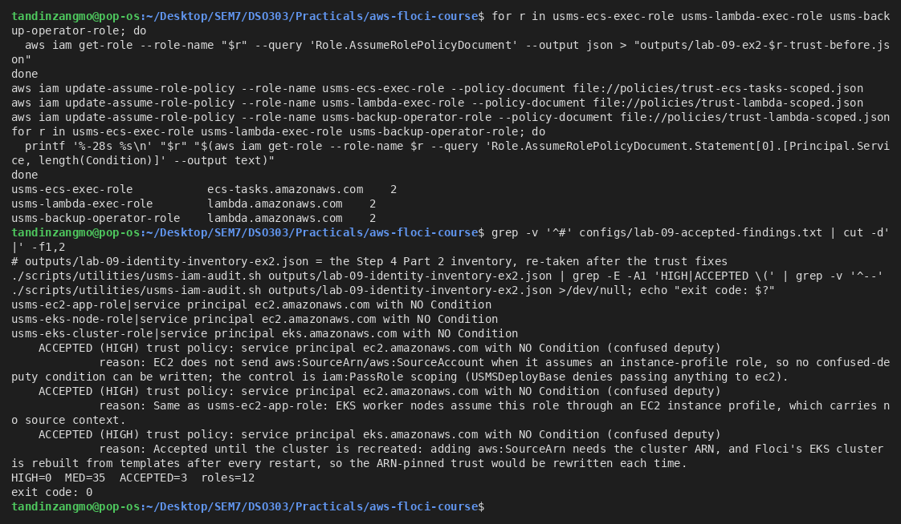
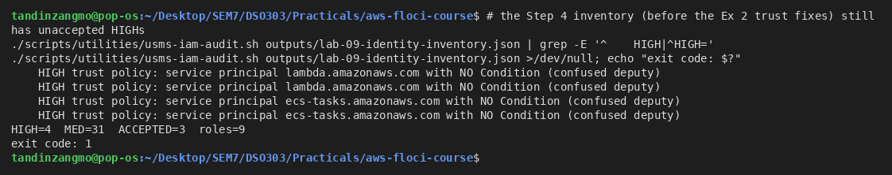
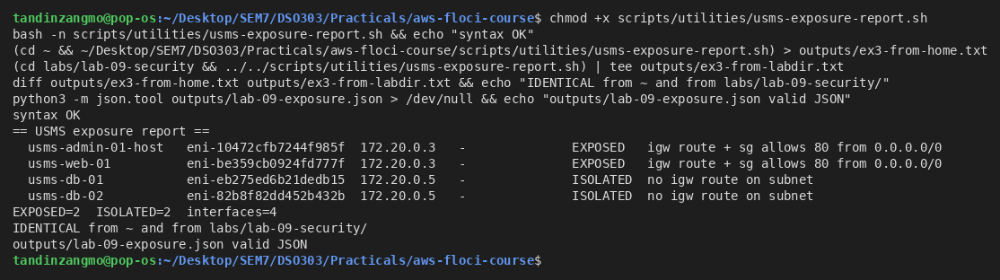
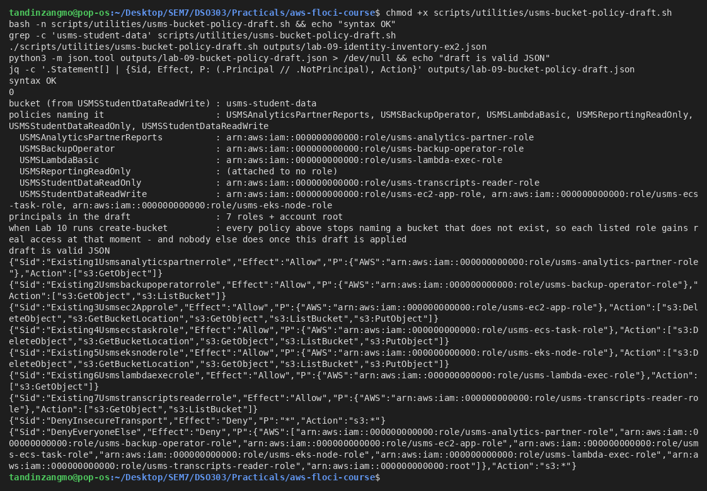
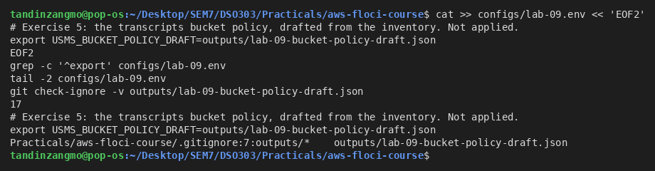

# Lab 09 - Independent Exercises

All five exercises were done against Floci. Screenshots are in `screenshots/`.

---

## Exercise 1 - Basic: egress for the web tier

`policies/usms-app-sg-egress.json` replaces usms-app-sg's default allow-all egress with six written rules. I authorized them first and revoked the default afterwards. Ingress (80 and 22) was not touched.

| Rule | Why the web tier needs it |
|---|---|
| tcp/443 → S3 prefix list `pl-63a5400a` | Transcripts through the Lab 02 gateway endpoint, staying on the AWS network |
| tcp/443 → 0.0.0.0/0 | AWS API endpoints (STS for the role, SSM, package mirrors). On real AWS this would be narrowed to interface endpoints |
| tcp/80 → `usms-alb-sg` | The enrolment API, reached through the load balancer and never directly |
| tcp/5432 → `usms-db-sg` | PostgreSQL on the data tier |
| udp/53 → 10.0.0.2/32 | DNS to the VPC resolver (the VPC base + 2). Queries go over UDP first |
| tcp/53 → 10.0.0.2/32 | DNS falls back to TCP when an answer is truncated (large records, DNSSEC) |

**The metadata service (169.254.169.254)** is link-local. Traffic to it never leaves the instance's network interface into the VPC, so security groups do not apply to it and no egress rule is needed (or possible) to allow or block it. IMDS is controlled with `modify-instance-metadata-options` (Step 11), not with a group.

**Why usms-bastion-sg's egress is different in kind.** Every other group's egress serves an application path, such as a dependency it calls. The bastion's whole purpose is to *initiate* administrative connections (tcp/22) into the VPC. Its egress therefore *is* its function rather than a side effect. It should be tcp/22 to the groups it administers (usms-app-sg, usms-db-sg) and nothing to the internet. A bastion that can reach the internet is the classic way to exfiltrate data from a jump host.

Floci result: 0 allow-all egress on usms-app-sg, ingress unchanged. The group-referenced and prefix-list destinations show as `None` on readback (Floci limitation).

**[Screenshot placeholder: Exercise 1]**


---

## Exercise 2 - Intermediate: break-glass role, and the open trust findings

### Part A - usms-breakglass-role

| Requirement | How it is met |
|---|---|
| Assumable only by usms-admin-01 | `Principal.AWS = arn:aws:iam::000000000000:user/usms-admin-01` (`policies/trust-breakglass.json`) |
| Requires MFA | `Bool aws:MultiFactorAuthPresent = "true"` |
| Requires an external ID | `StringEquals sts:ExternalId = "usms-breakglass-scaling"` |
| Shortest max session | `--max-session-duration 3600` (3600 s is IAM's minimum) |
| Carries a boundary | `--permissions-boundary USMSPermissionsBoundary` (not returned on readback by Floci) |
| Grants only what Lab 06 used | `USMSBreakGlassScaling`: `application-autoscaling:RegisterScalableTarget` (the call that sets `SuspendedState`), `DescribeScalableTargets`, `DescribeScalingActivities`. No wildcard actions |

**AND or OR?** The two conditions are **AND**. Conditions under different operators in one `Condition` block (`Bool` and `StringEquals`) must *all* be true. An MFA session without the external ID fails, and so does the external ID without MFA.

**[Screenshot placeholder: Exercise 2 Part A]**


### Part B - fix or accept the unconditioned service trust

- **Fixed:** `usms-ecs-exec-role` now uses `trust-ecs-tasks-scoped.json`. `usms-lambda-exec-role` and `usms-backup-operator-role` now use `trust-lambda-scoped.json` (`aws:SourceAccount` + `aws:SourceArn arn:aws:lambda:us-east-1:000000000000:function:usms-*`). ECS and Lambda both send these context keys when they assume a role. I kept the old trust documents in `outputs/lab-09-ex2-*-trust-before.json`.
- **Accepted:** `usms-ec2-app-role` and `usms-eks-node-role` cannot be fixed, because EC2 sends no source context when it assumes an instance-profile role. The real control there is `iam:PassRole` scoping, which `USMSDeployBase` already enforces by denying any pass to `ec2.amazonaws.com`. `usms-eks-cluster-role` is accepted for now, because Floci's EKS cluster is rebuilt after every restart and a cluster-ARN pin would need rewriting each time.

The accepted findings live in the committed file `configs/lab-09-accepted-findings.txt` (`role|finding text|reason`). `usms-iam-audit.sh` now reads it, prints matching findings as `ACCEPTED (HIGH)` with the reason, and leaves them out of the HIGH count. It still exits **1** for any HIGH that is not accepted: on the Step 4 inventory it reports HIGH=4 with exit 1, and on the current inventory HIGH=0 ACCEPTED=3 with exit 0.

**[Screenshot placeholder: Exercise 2 Part B - trust fixes and ACCEPTED findings]**


**[Screenshot placeholder: unaccepted HIGH still exits 1]**


---

## Exercise 3 - Problem solving: the exposure report

`scripts/utilities/usms-exposure-report.sh` classifies every network interface in usms-vpc from three things: (1) its subnet's route table (explicit association, else the main table), (2) its public address (the interface's own, else its instance's), and (3) its security groups' ingress. It never reads names: names are printed for humans only. It writes `outputs/lab-09-exposure.json`.

Edge cases it handles:

- **A group missing from the cache** is looked up once by ID. A failed lookup is treated as a group with no rules, so it does not crash the report.
- **No description** falls back to the instance Name tag, then the interface type, then the ENI ID.
- **A subnet with no explicit association** uses the VPC main route table.
- **A lingering interface of a terminated instance** is still classified, and the reason column marks it.
- `set -uo pipefail` without `-e`, justified in a comment: one failed lookup should cost one row, not the whole report.
- A Floci public address of `127.0.0.1` is not treated as public, because it is not `is_global`.

**Verdict for a public interface with no ingress rule (the usms-nat case): EXPOSED.** It has an internet gateway route, so a path exists, and a single `authorize-security-group-ingress` would open it. A review that hides it would hide that one-command risk. The reason column says `igw route + but no internet ingress rule`, so a reader can tell it apart from a real open door.

Result (identical output from `~` and from `labs/lab-09-security/`):

```
usms-admin-01-host  EXPOSED   igw route + sg allows 80 from 0.0.0.0/0
usms-web-01         EXPOSED   igw route + sg allows 80 from 0.0.0.0/0
usms-db-01          ISOLATED  no igw route on subnet
usms-db-02          ISOLATED  no igw route on subnet
```

On Floci the ALB and Fargate tasks have no ENIs in the VPC, so only the four instance interfaces appear.

**[Screenshot placeholder: Exercise 3]**


---

## Exercise 4 - Challenge: security review for the information security officer

### 1. The second front door

`usms-app-sg` admits **tcp/80 from 0.0.0.0/0**. Lab 02 Step 14 opened it so that usms-web-01 could serve directly, before any load balancer existed. Since Lab 05, the public entry point is `usms-enrolment-alb`, but the web server is still reachable on its own public address. An attacker can therefore skip the load balancer and its listener rules and hit the instance directly. That includes scanning for application or OS bugs on a host that has a role (`usms-ec2-app-role`, with read/write on transcripts).

**Recommendation:** put the web tier behind the load balancer. Create a target group for usms-web-01, add a listener rule on the existing HTTP:80 listener, change usms-app-sg's tcp/80 source from `0.0.0.0/0` to `usms-alb-sg`, then release the Elastic IP. **What breaks:** anything that uses the web server's public IP or DNS name directly (bookmarks, health checks, admin scripts), and SSH through that public IP, which is now bastion-only anyway.

*The other side:* the web server is a separate service from the enrolment API, and putting both behind one load balancer couples their availability and adds a cost line. If the web tier only serves static pages, keeping it public but patched with IMDSv2 required is a defensible, smaller change.

Commands (**written, not run**):

1. Create the target group.
   ```bash
   TG=$(aws elbv2 create-target-group --name usms-web-tg --protocol HTTP --port 80 \
     --vpc-id "$USMS_VPC_ID" --target-type instance --health-check-path / \
     --query 'TargetGroups[0].TargetGroupArn' --output text)
   ```
2. Register the instance.
   ```bash
   aws elbv2 register-targets --target-group-arn "$TG" --targets Id="$USMS_WEB_INSTANCE"
   ```
3. Add a listener rule.
   ```bash
   aws elbv2 create-rule --listener-arn "$USMS_ALB_LISTENER_ARN" --priority 20 \
     --conditions Field=path-pattern,Values='/web/*' --actions Type=forward,TargetGroupArn="$TG"
   ```
4. Allow the ALB to reach the web tier.
   ```bash
   aws ec2 authorize-security-group-ingress --group-id "$USMS_APP_SG" \
     --ip-permissions "IpProtocol=tcp,FromPort=80,ToPort=80,UserIdGroupPairs=[{GroupId=$USMS_ALB_SG}]"
   ```
5. Remove the public door.
   > ⚠️ **DANGER - destructive.** This removes the only direct internet path to usms-web-01.
   > Anything that uses its public address stops working immediately.
   > Confirm step 3's rule returns 200 through the ALB *before* running it.
   > Undo: `authorize-security-group-ingress --protocol tcp --port 80 --cidr 0.0.0.0/0`.
   ```bash
   aws ec2 revoke-security-group-ingress --group-id "$USMS_APP_SG" --protocol tcp --port 80 --cidr 0.0.0.0/0
   ```
6. Release the public address.
   > ⚠️ **DANGER - irreversible.** Releasing an Elastic IP gives the address back to AWS.
   > You will never get the same IP again, and DNS records pointing at it will break.
   > Only do this after a quiet period with step 5 in place.
   > Check `aws ec2 describe-addresses` for anything else using it first.
   ```bash
   aws ec2 disassociate-address --allocation-id "$USMS_WEB_EIP_ALLOC" 2>/dev/null; \
   aws ec2 release-address --allocation-id "$USMS_WEB_EIP_ALLOC"
   ```

### 2. What egress control bought

**Prevented** (Steps 13 to 15):

1. **A compromised enrolment task opening a reverse shell or fetching a second-stage tool over a non-HTTPS port** (for example 4444, 22 or 80 to an attacker host). Only tcp/443 leaves the task.
2. **A compromised load balancer path being used to reach anything except the tasks.** The ALB may only initiate tcp/80 to `usms-enrolment-sg`.
3. **A compromised database host making SSH, SMTP or raw TCP connections out** to pivot or send bulk data. Only tcp/443 is allowed, for OS updates.

**Not prevented:**

1. **Exfiltration over HTTPS to an attacker-controlled host.** tcp/443 to 0.0.0.0/0 is still open, and a security group cannot filter by hostname. Control: **AWS Network Firewall** with domain allow-lists (about $0.395 per endpoint-hour + $0.065/GB processed in us-east-1, see https://aws.amazon.com/network-firewall/pricing/), or a forward proxy. Interface VPC endpoints for ECR, Logs and STS would let the 0.0.0.0/0 rule be removed entirely (about $0.01 per endpoint per AZ-hour + $0.01/GB, see https://aws.amazon.com/privatelink/pricing/).
2. **Exfiltration through DNS** (data encoded in queries to the VPC resolver). Control: **Route 53 Resolver DNS Firewall** (about $0.60 per million queries + per-domain-list charges, see https://aws.amazon.com/route53/pricing/).

All the paths above also leave through **usms-nat**, which costs about $0.045 per hour + $0.045/GB processed (https://aws.amazon.com/vpc/pricing/). Egress rules decide what may leave; the NAT gateway is how it leaves and what it costs.

### 3. Who can read or write a transcript

This table comes from `policies/`, `outputs/lab-09-identity-inventory.json` and the Exercise 5 draft (`outputs/lab-09-lab10-readiness.txt`):

| Principal | How it gets access | Read | Write | Granting document |
|---|---|---|---|---|
| usms-ec2-app-role (usms-web-01) | attached managed policy | ✅ | ✅ Put + Delete | USMSStudentDataReadWrite |
| usms-ecs-task-role (enrolment tasks) | attached managed policy | ✅ | ✅ Put + Delete | USMSStudentDataReadWrite |
| usms-eks-node-role (Lab 07 nodes) | attached managed policy | ✅ | ✅ Put + Delete | USMSStudentDataReadWrite |
| usms-transcripts-reader-role | attached managed policy | ✅ | ❌ explicit Deny | USMSStudentDataReadOnly |
| usms-backup-operator-role | attached managed policy | ✅ Get + List | ❌ | USMSBackupOperator |
| usms-analytics-partner-role | attached managed policy | ✅ Get | ❌ | USMSAnalyticsPartnerReports |
| usms-lambda-exec-role | attached managed policy | ✅ Get | ❌ | USMSLambdaBasic |
| (nobody) | USMSReportingReadOnly, attached to nothing | - | - | USMSReportingReadOnly |
| account root / admin users | implicit full access | ✅ | ✅ | the account itself |

**Is the list complete?** On real AWS, I would answer from the resource's side with **IAM Access Analyzer** (an external-access analyzer on the bucket, plus `access-analyzer:ListFindings`), and from the identity side with **`iam get-account-authorization-details`**, which returns every policy and attachment in one call. Neither is available on Floci (Step 3: "not available"), and `list-entities-for-policy` is unsupported too. Instead, I listed every role and every attached policy document (Step 4) and **searched every customer managed policy for the bucket ARN** (Exercise 5). That search is how I found that six policies name the bucket, not the three the lab expected. The list does not cover users and groups with inline policies, which a full `get-account-authorization-details` would.

### 4. Knowing when something changes

| Event | Service that reports it | Cost |
|---|---|---|
| Security group changed | CloudTrail (`AuthorizeSecurityGroup*`, `Revoke*`) → EventBridge rule → SNS | CloudTrail management events, first trail: **free**; EventBridge AWS-service events: **free**; SNS email: first 1,000/month free |
| Policy attached / trust changed | CloudTrail (`AttachRolePolicy`, `UpdateAssumeRolePolicy`, `PutRolePermissionsBoundary`) → EventBridge; **AWS Config** rule history | Config: about $0.003 per configuration item recorded (https://aws.amazon.com/config/pricing/) |
| Unusual assume-role / credential use | **GuardDuty** (anomalous API calls, credential exfiltration findings) | Paid per event volume after a 30-day free trial (https://aws.amazon.com/guardduty/pricing/) |
| New external access to the bucket | **IAM Access Analyzer** external-access findings | External-access analyzer: **free** (https://aws.amazon.com/iam/access-analyzer/pricing/) |

Everything this lab built is **preventive**: it stops a request, but nothing reports the attempt. The rows above are **detective** controls.

**The morning after an incident, in this order:**

1. CloudTrail for the last 24 h, filtered on `iam:*`, `sts:AssumeRole` and `ec2:*SecurityGroup*`: who changed identity or network first.
2. GuardDuty findings for the same window.
3. Config timeline for usms-app-sg, usms-db-sg and the transcripts policies: what each looked like before the change.
4. S3 data events on the bucket (if enabled; they are paid): what was read or written.
5. VPC Flow Logs for usms-nat: where data went.

---

## Exercise 5 - Integration: the transcripts bucket policy draft

`scripts/utilities/usms-bucket-policy-draft.sh` reads the bucket ARN from `USMSStudentDataReadWrite`'s document and strips the `arn:aws:s3:::` prefix with a shell parameter expansion (`${BUCKET_ARN#arn:aws:s3:::}`). It does this rather than using sed, because the prefix is fixed and the expansion can be checked for "nothing was stripped". The script contains the bucket name **0** times. It then pulls every customer managed policy and keeps the ones that name the bucket, maps them to roles from the inventory, and writes `outputs/lab-09-bucket-policy-draft.json` with:

- one **Allow** per role, limited to the s3: actions it already has (its own explicit Denies removed);
- **DenyInsecureTransport**: `Principal "*"`, `aws:SecureTransport = false`;
- **DenyEveryoneElse**: `NotPrincipal` = the 7 role ARNs + the account root.

The script asserts that every `Principal` is an ARN except the insecure-transport Deny, and that both `arn:aws:s3:::usms-student-data` and `.../*` appear in every statement. It works whether or not the bucket exists, applies nothing, and never touches an access key. `configs/lab-09.env` now has **17 exports** (`USMS_BUCKET_POLICY_DRAFT` added).

**Readiness file** (`outputs/lab-09-lab10-readiness.txt`): bucket `usms-student-data`; six policies (USMSAnalyticsPartnerReports, USMSBackupOperator, USMSLambdaBasic, USMSReportingReadOnly, USMSStudentDataReadOnly, USMSStudentDataReadWrite); 7 roles + root. When Lab 10 runs `create-bucket`, every one of those policies starts pointing at a real bucket, so all seven roles gain real access at that moment.

**Contrast with USMSStudentDataReadOnly's Deny:**

- USMSStudentDataReadOnly's Deny is an *identity* policy. It can only stop the actions of the one principal it is attached to (usms-transcripts-reader-role), and only Put/Delete/PutBucketPolicy.
- The bucket policy's DenyEveryoneElse is a *resource* policy. It stops **every** principal that is not on its list, whichever identity policy that principal holds.
- Only the bucket policy applies to a principal in **another account**: an identity policy in our account is never consulted for someone else's principal, while a resource policy on our bucket is always consulted.

> On real AWS, `NotPrincipal` with roles must also list each role's assumed-role session ARN form, or the Deny blocks the role's own sessions. This needs fixing before the S3 lab applies the draft.

**[Screenshot placeholder: Exercise 5 - draft and readiness]**


**[Screenshot placeholder: Exercise 5 - env export]**

