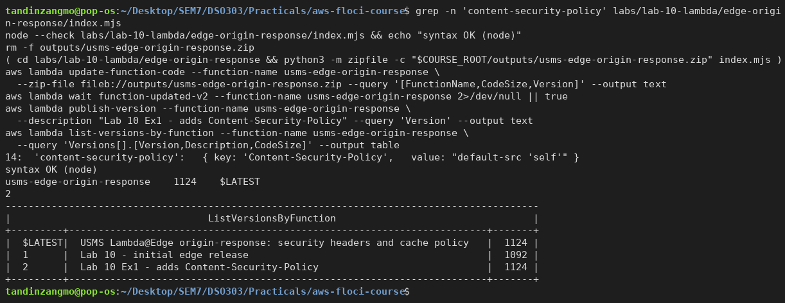
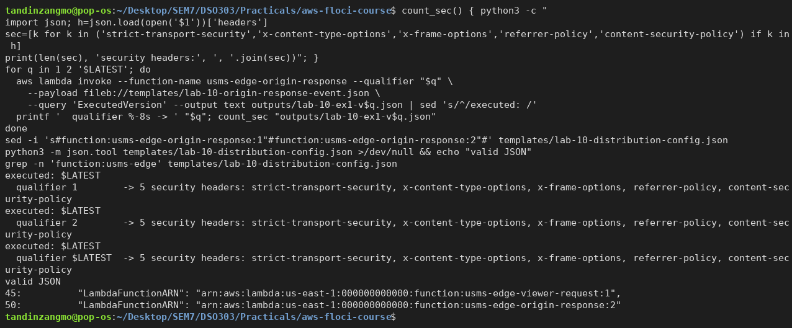
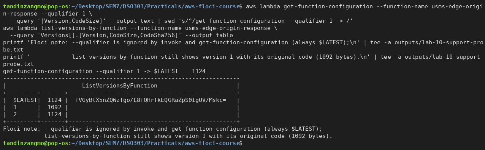
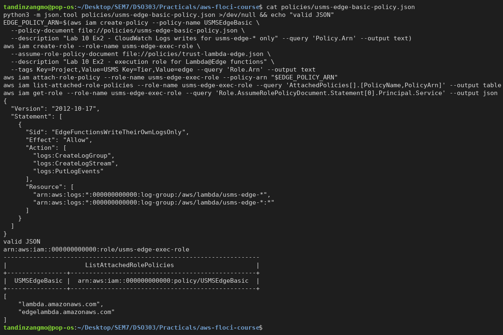
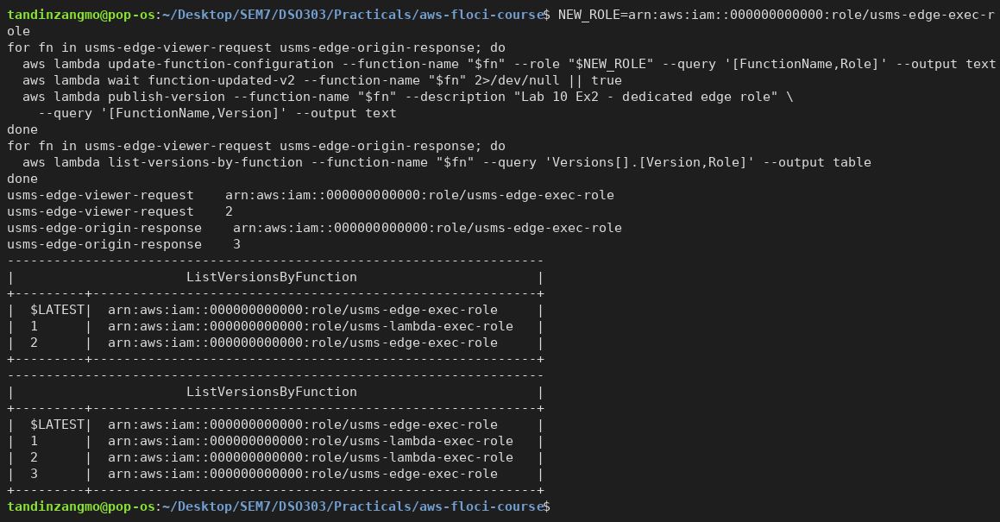
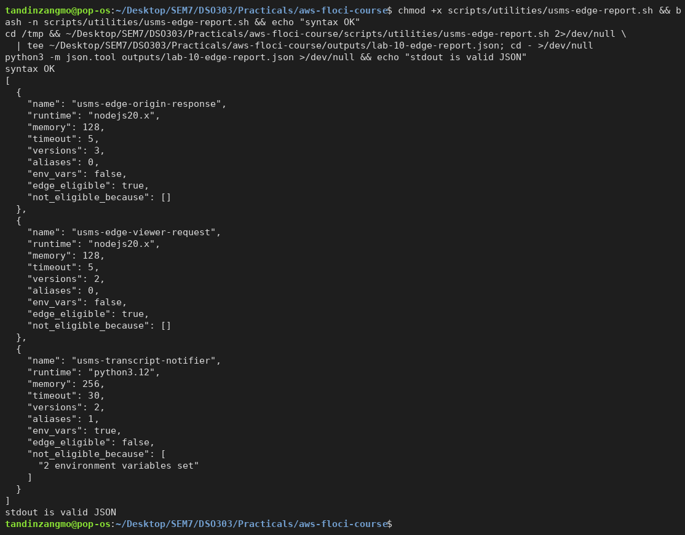
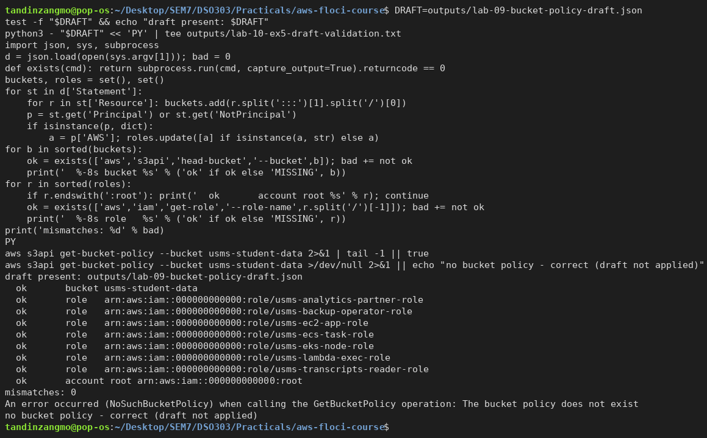
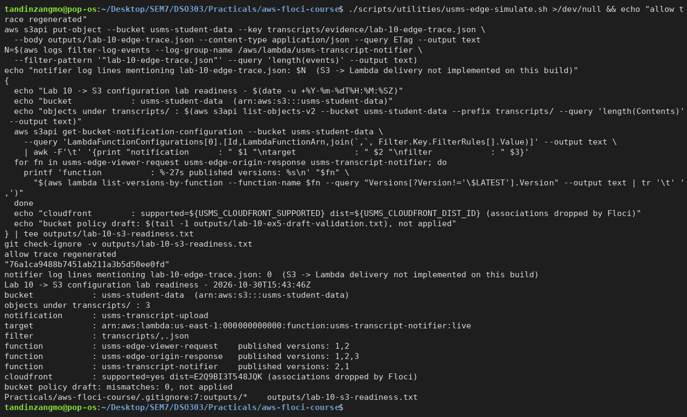

# Lab 10 - Independent Exercises

All five exercises were done against Floci. Screenshots are in `screenshots/`.

---

## Exercise 1 - Basic: extend the security header set

I added `'content-security-policy': { key: 'Content-Security-Policy', value: "default-src 'self'" }` to `SECURITY_HEADERS` in `edge-origin-response/index.mjs`. Then I rebuilt the zip, ran `update-function-code`, and published **version 2** ("Lab 10 Ex1 - adds Content-Security-Policy"). `list-versions-by-function` shows version 1 still at its original **1092 bytes**, while versions 2 and `$LATEST` are 1124 bytes. Updating `$LATEST` did not touch the published version.

`templates/lab-10-distribution-config.json` now associates origin-response with **`usms-edge-origin-response:2`**. It is still valid JSON, and the verify script still passes its association checks.

**Floci limitation:** `invoke --qualifier 1` and `get-function-configuration --qualifier 1` are ignored, and every call reports ExecutedVersion `$LATEST`. All three invocations therefore returned **five** security headers, and I could not show by invoking that version 1 returns four. The proof that version 1 is unchanged is its stored CodeSize. On real AWS, `--qualifier 1` would run the old code and return the original four headers.

```bash
( cd labs/lab-10-lambda/edge-origin-response && python3 -m zipfile -c "$COURSE_ROOT/outputs/usms-edge-origin-response.zip" index.mjs )
aws lambda update-function-code --function-name usms-edge-origin-response --zip-file fileb://outputs/usms-edge-origin-response.zip
aws lambda publish-version --function-name usms-edge-origin-response --description "Lab 10 Ex1 - adds Content-Security-Policy"
aws lambda invoke --function-name usms-edge-origin-response --qualifier 1 --payload fileb://templates/lab-10-origin-response-event.json out.json
```

**[Screenshot placeholder: Exercise 1a - update code and publish version 2]**


**[Screenshot placeholder: Exercise 1b - qualifier 1 / 2 / $LATEST and the config now names :2]**


**[Screenshot placeholder: Exercise 1c - version 1 keeps its original code]**


---

## Exercise 2 - Intermediate: dedicated edge execution role

- `policies/usms-edge-basic-policy.json` grants only `logs:CreateLogGroup`, `logs:CreateLogStream` and `logs:PutLogEvents`, on `log-group:/aws/lambda/usms-edge-*` and `...:*`. It does not include `s3:GetObject`, because neither edge function reads S3. CloudFront fetches the origin.
- I created it as the customer managed policy **`USMSEdgeBasic`**.
- I created **`usms-edge-exec-role`** with `policies/trust-lambda-edge.json` reused unchanged, so it trusts lambda + edgelambda, and attached `USMSEdgeBasic`.
- I repointed both edge functions with `update-function-configuration --role` and published new versions: **viewer-request v2** and **origin-response v3**.
- `usms-lambda-exec-role` was not modified. The notifier still uses it.

**What happened to version 1's role:** nothing. A published version is an immutable snapshot of code **and** configuration, and the execution role is part of the configuration. `list-versions-by-function` shows:

| Function | Version | Role |
|---|---|---|
| viewer-request | 1 | usms-lambda-exec-role |
| viewer-request | 2, $LATEST | usms-edge-exec-role |
| origin-response | 1, 2 | usms-lambda-exec-role |
| origin-response | 3, $LATEST | usms-edge-exec-role |

So rolling the distribution back to `:1` would also bring back the old, broader role. That is a reason to retire old versions once their permissions have been narrowed. The distribution config still names viewer `:1` and origin `:2`; moving it to `:2`/`:3` would be the step that actually puts the narrower role into service at the edge.

**[Screenshot placeholder: Exercise 2a - USMSEdgeBasic and usms-edge-exec-role]**


**[Screenshot placeholder: Exercise 2b - repointed, new versions, role per version]**


---

## Exercise 3 - Problem solving: edge-readiness report

`scripts/utilities/usms-edge-report.sh` finds every `usms-` function with `list-functions` + `starts_with`, so the function list is not hard-coded. It reads each function's configuration, versions and aliases, and builds a single JSON array in Python.

- **Output:** only JSON goes to stdout. The `reading <fn>` diagnostics go to stderr.
- **Robustness:** it resolves the repo root from `${BASH_SOURCE[0]}`, so it runs from any directory; I tested it from `/tmp`. It treats a missing `Environment` key as `{}`, so it doesn't fail under `set -u`.
- **Caps:** a function whose name contains "viewer" uses the 128 MB / 5 s caps; the others use 10240 MB / 30 s.
- **Extra field:** I added `not_eligible_because` so the verdict explains itself.

Result: three objects. Both edge functions are `edge_eligible: true`, and `usms-transcript-notifier` is `false`.

**On "two independent reasons":** under the rules as written, the notifier fails only one: **2 environment variables set**. Its 256 MB and 30 s are within the origin-trigger caps (10240 MB / 30 s). The second real-world reason is outside the rule list. The notifier is only ever invoked through its alias `live`, and CloudFront refuses aliases. Its published versions also carry the env vars, so none of them could be associated. If the notifier were judged against the *viewer* caps, as a function that runs on every request would be, it would also fail on memory (256 > 128) and timeout (30 > 5).

**[Screenshot placeholder: Exercise 3 - edge report run from /tmp]**


---

## Exercise 4 - Challenge: transcript delivery design

This exercise has no commands. The design document is [notes/lab-10-edge-design.md](../../notes/lab-10-edge-design.md).

---

## Exercise 5 - Integration: hand the S3 lab a bucket it can start from

1. **Draft:** `outputs/lab-09-bucket-policy-draft.json` already existed from Lab 09.
2. **Validation:** every Resource names `usms-student-data`, which exists. All seven role principals exist (analytics-partner, backup-operator, ec2-app, ecs-task, eks-node, lambda-exec, transcripts-reader), and so does the account root in the `NotPrincipal`. **Mismatches: 0.**
   - The draft names seven roles, not just the three that carry `USMSStudentDataReadWrite`. Lab 09 Exercise 5 found six policies naming the bucket. I reported this rather than editing the draft.
   - The draft has no statement for `usms-edge-exec-role`. That is correct: edge functions never read the bucket.
3. **Not applied:** `get-bucket-policy` fails with **NoSuchBucketPolicy**.
4. **Upload:** I uploaded the allow trace to `s3://usms-student-data/transcripts/evidence/lab-10-edge-trace.json`. The notifier did not see it (0 log lines), because S3 → Lambda delivery is not implemented on this build (see Step 21). The key matches both filter rules, so on real AWS it would fire.
5. **Readiness file:** `outputs/lab-10-s3-readiness.txt` lists:
   - the bucket and its ARN;
   - **3** objects under `transcripts/`;
   - the notification id, target `...:usms-transcript-notifier:live` and filter `transcripts/,.json`;
   - each function's published versions (viewer 1,2; origin 1,2,3; notifier 1,2);
   - CloudFront supported, distribution `E2Q9BI3T548JQK`, associations dropped by Floci;
   - the draft validation result.

   `git check-ignore -v` names `.gitignore:7 outputs/*`, so the file stays local. The command sequence is re-runnable.

**[Screenshot placeholder: Exercise 5a - draft validated, no bucket policy applied]**


**[Screenshot placeholder: Exercise 5b - trace uploaded, readiness file, git-ignored]**


---

## Keep notes

Kept from the exercises:

- origin-response v2 (CSP) and v3;
- viewer-request v2;
- `usms-edge-exec-role`, `USMSEdgeBasic` and `policies/usms-edge-basic-policy.json`;
- the extra objects `notes/ignore-me.json`, `transcripts/evidence/ignore-me.txt` and `transcripts/evidence/lab-10-edge-trace.json`.

`live` is back on version 1.
