# Lab 10 Report - Edge Functions with AWS Lambda

## Aim

To put USMS transcript delivery behind two Lambda@Edge functions and add a regional function that reacts to uploads:

- a **viewer-request** function that normalises the URI and refuses unauthenticated requests before the cache;
- an **origin-response** function that adds security headers and a cache policy before the object is cached;
- a regional **S3-triggered notifier** with an alias and a scoped resource policy.

On the way, I created the origin bucket `usms-student-data` that `USMSStudentDataReadWrite` has named since Lab 01. Everything was done on Floci. The CloudFront probe answered, so this is **Path A**, but Floci dropped the Lambda associations from the distribution, so the association itself was also checked structurally (Path B).

> Floci runs the function code but has no edge locations, cache or request path, and evaluates no IAM. Everything below is split into what I **observed** (code ran, stored state read back) and what is only **recorded** (rules that real AWS would enforce).

**Repository note:** the lab's source tree is `labs/lab-10-lambda/` (the folder I had already created) instead of the handout's `labs/lab-10-lambda-edge/`. Every command and the verify script use that path.

---

## Steps 1–4 - Environment, identity and support probe

Floci was already running in hybrid mode with the state bind-mounted to `~/floci-data`, and every storage check was `[ok]`. All nine earlier env files were sourced and `whoami.sh` reported account `000000000000`.

`USMS_ROLE_LAMBDA` in `configs/lab-01.env` holds the role **ARN**, not the name. The lab passes it to `--role-name`, so I used `${USMS_ROLE_LAMBDA##*/}` (the name after the last `/`) in the commands and in `verify-lab-10.sh`.

The probe reported **all six services SUPPORTED**, including CloudWatch Logs and CloudFront, so Step 15 took Path A.

**[Screenshot placeholder: Step 1 - Floci up and storage check]**
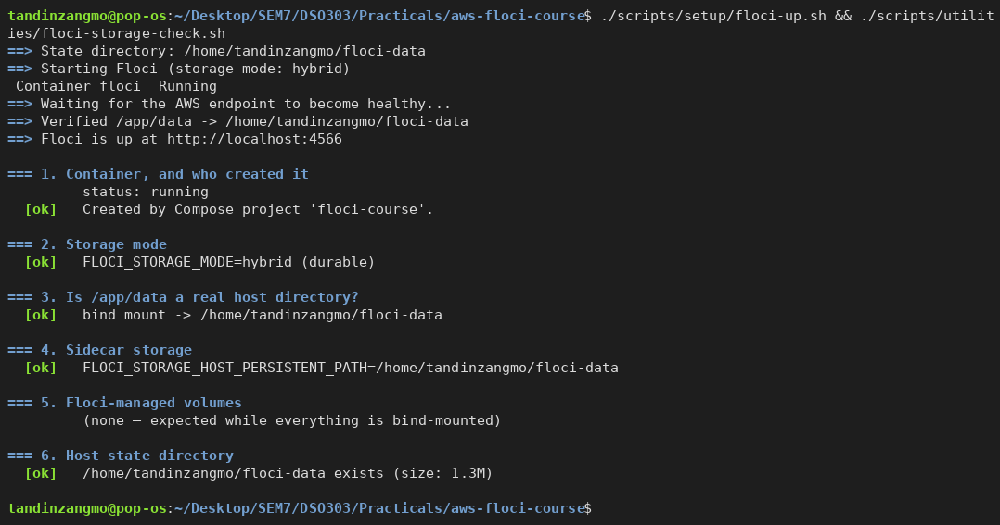

**[Screenshot placeholder: Step 2 - env files and identity]**
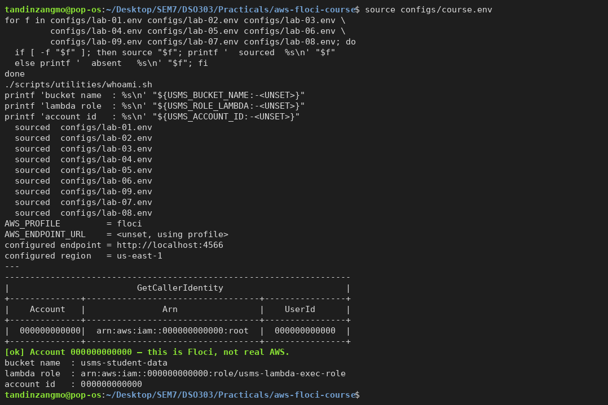

**[Screenshot placeholder: Step 3 - source directories]**
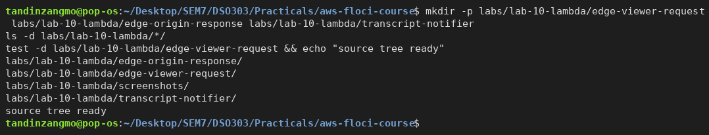

**[Screenshot placeholder: Step 4 - support probe]**
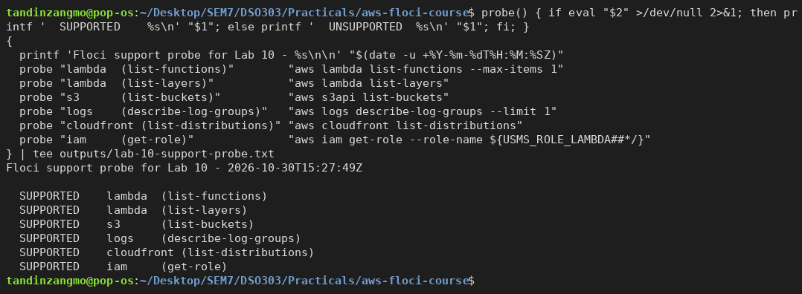

## Step 5 - Origin bucket (Checkpoint 1)

I created `usms-student-data` without a LocationConstraint (us-east-1) and tagged it Project=USMS, Tier=data, Lab=06. `head-bucket` exits 0. `USMSStudentDataReadWrite` now names a bucket that exists: `arn:aws:s3:::usms-student-data` and `.../*`. The bucket ARN appears twice because Lab 09 added a second statement.

**[Screenshot placeholder: Step 5 - bucket, tags and the policy that names it]**
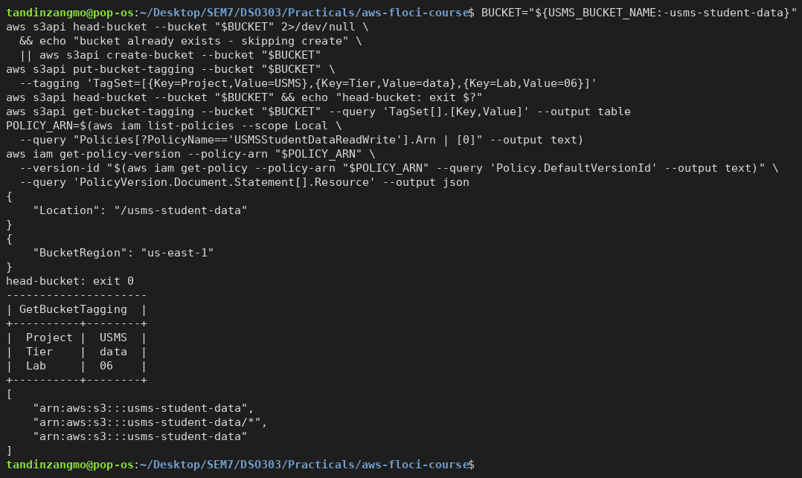

## Step 6 - Execution role trusts lambda and edgelambda (Checkpoint 2)

Before: the trust named only `lambda.amazonaws.com`, with `USMSLambdaBasic` attached. I wrote `policies/trust-lambda-edge.json` with **both** principals and replaced the trust with `update-assume-role-policy`. Readback: principal count **2**, and the `edgelambda.amazonaws.com` lookup returns it.

**Trade-off with Lab 09:** Lab 09 had added `aws:SourceAccount` and `aws:SourceArn` conditions to this role's trust (the confused-deputy fix). `update-assume-role-policy` replaces the whole document, so the lab's file removes those conditions. I saved the previous document to `outputs/lab-10-lambda-trust-before.json`. The Lab 09 IAM audit will flag this role again until the conditions are restored in a form CloudFront replication accepts.

**[Screenshot placeholder: Step 6a - role before]**
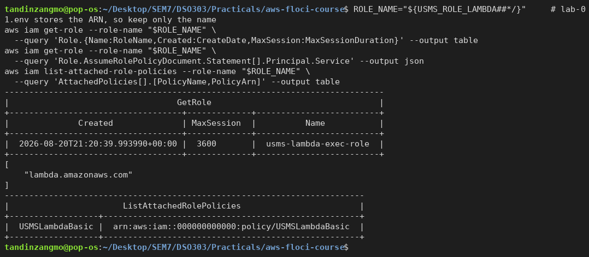

**[Screenshot placeholder: Step 6b - two-principal trust]**
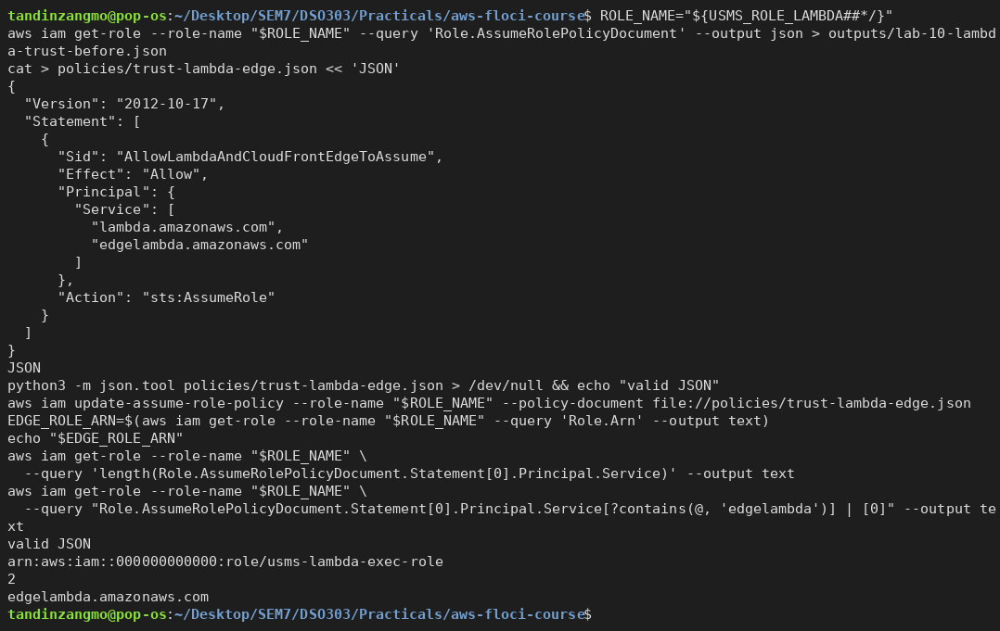

## Steps 7–8 - Viewer-request handler, package and create

`edge-viewer-request/index.mjs` passes `node --check`. It is 55 lines, `studentId` appears 3 times, and the template literal `${studentId.toLowerCase()}` is intact because the heredoc was quoted. The zip holds a single `index.mjs` with no directory prefix.

The function was created as nodejs20.x, `index.handler`, **128 MB, 5 s** (the viewer caps), State **Active**, Version **$LATEST**.

**[Screenshot placeholder: Step 7 - handler checks and zip]**
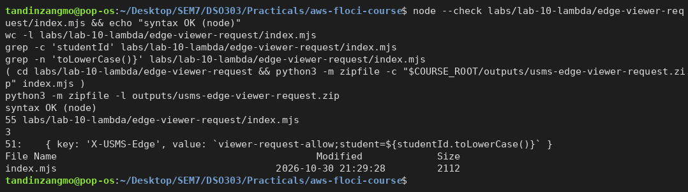

**[Screenshot placeholder: Step 8 - create-function and configuration]**
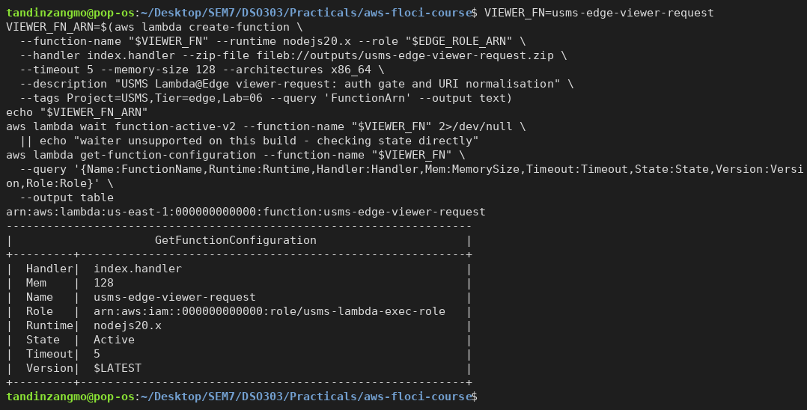

## Step 9 - Invoke with real CloudFront events (Checkpoint 3)

- **Allow:** Status 200, no FunctionError. The function returned the **request**: the URI was lowercased to `/transcripts/2026/stu-00417.json`, and `x-usms-edge: viewer-request-allow;student=stu-00417` was added. The assertion printed `viewer-request allow path: correct`.
- **Deny (Your turn):** I built `templates/lab-10-viewer-request-denied.json` with the `x-usms-student` header removed and requestId `lab06-deny-0001`. The function returned a **response**: status `403`, `cache-control: no-store`, `x-usms-edge: viewer-request-deny`, a JSON body, and no `uri` key, so the origin would never be contacted.

**[Screenshot placeholder: Step 9a - allow path]**
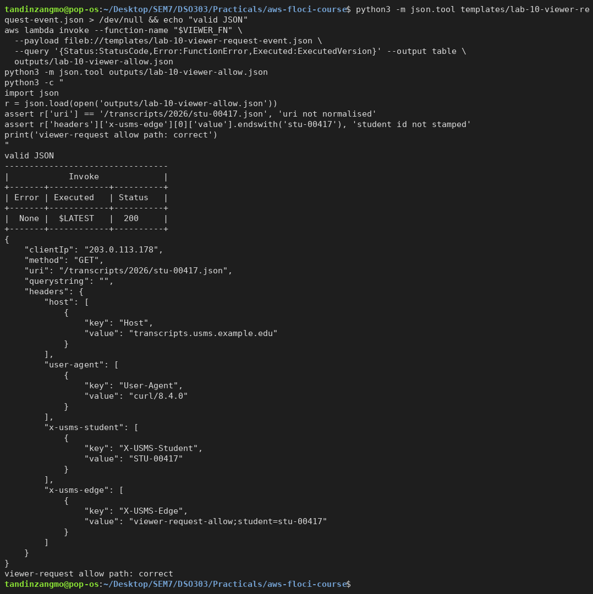

**[Screenshot placeholder: Step 9b - deny path (Your turn)]**
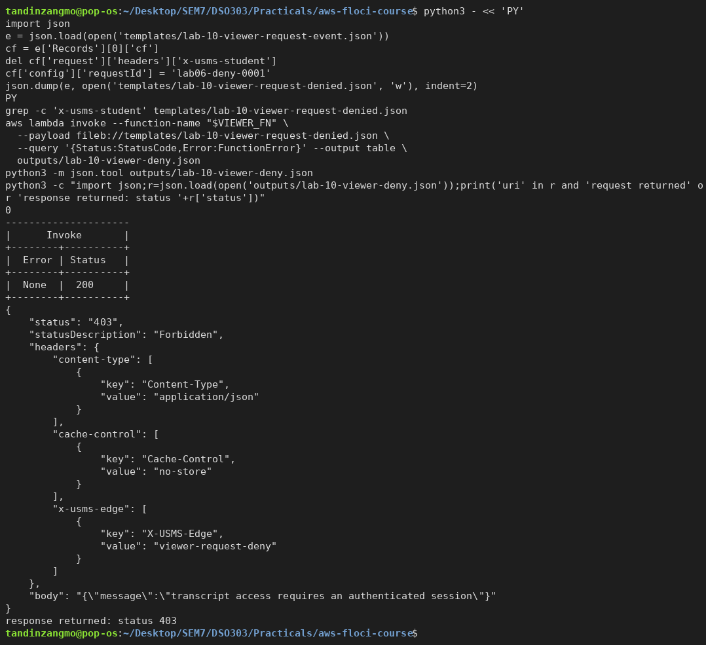

## Step 10 - Logs

**Floci limitation:** `--log-type Tail` returns `LogResult: None`. The log group `/aws/lambda/usms-edge-viewer-request` exists, but its Node.js streams hold no events. I recorded this in `outputs/lab-10-support-probe.txt` and used the returned payloads as evidence. The Python notifier's logs *are* delivered (Step 21).

**[Screenshot placeholder: Step 10 - LogResult None, log group present]**
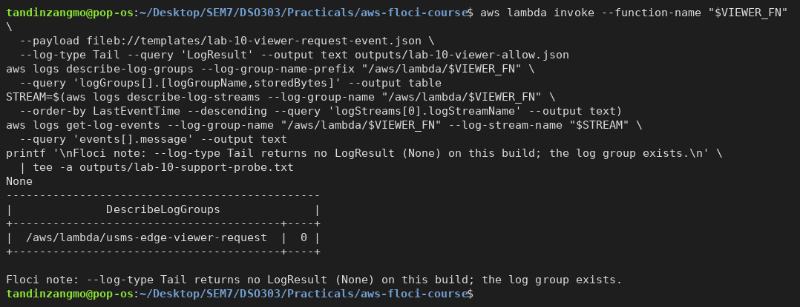

## Step 11 - Publish version 1 (Checkpoint 4)

`publish-version` returned **1**. The qualified ARN `...:function:usms-edge-viewer-request:1` ends in a number, so the edge would accept it. `list-versions-by-function` shows `$LATEST` (mutable) and `1` (immutable).

**[Screenshot placeholder: Step 11 - version 1]**
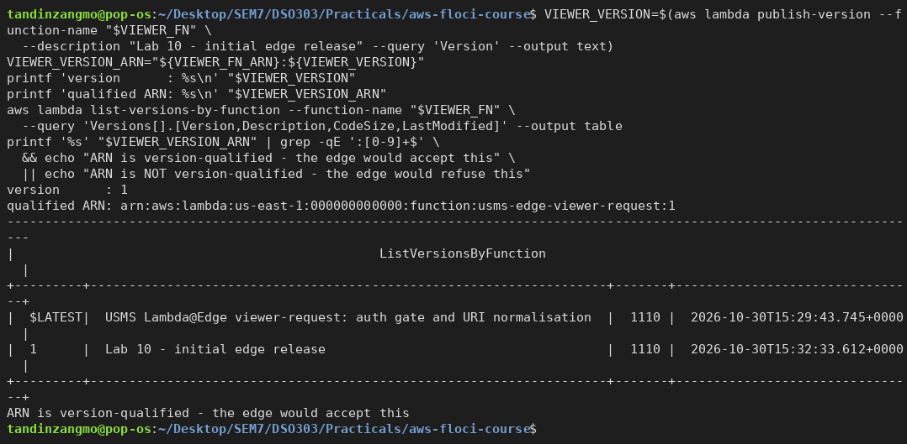

## Steps 12–13 - Origin-response function

`usms-edge-origin-response` was created as nodejs20.x, 128 MB, 5 s, Active. Invoked with the origin-response event, it returned the response with the **four security headers** (HSTS, nosniff, `X-Frame-Options: DENY`, Referrer-Policy) and `cache-control: public, max-age=300, s-maxage=3600`. It also returned `x-usms-edge-chain: viewer-request-allow;student=stu-00417;origin-response`. The origin's `etag`, `server` and `content-type` passed through. Published as version **1**.

**[Screenshot placeholder: Step 12 - create origin-response]**
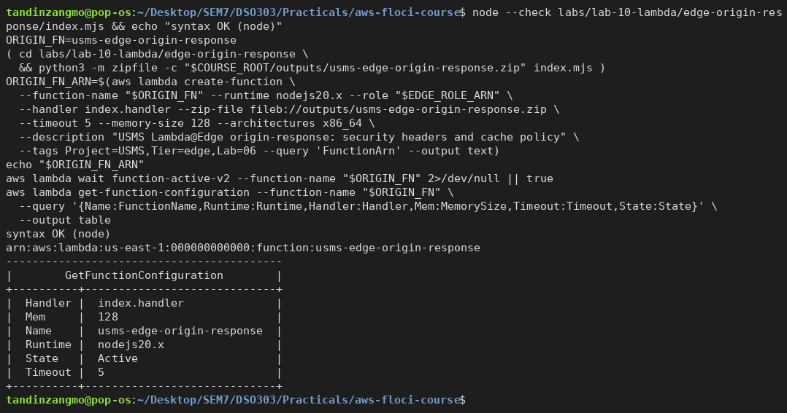

**[Screenshot placeholder: Step 13 - invoke and publish]**
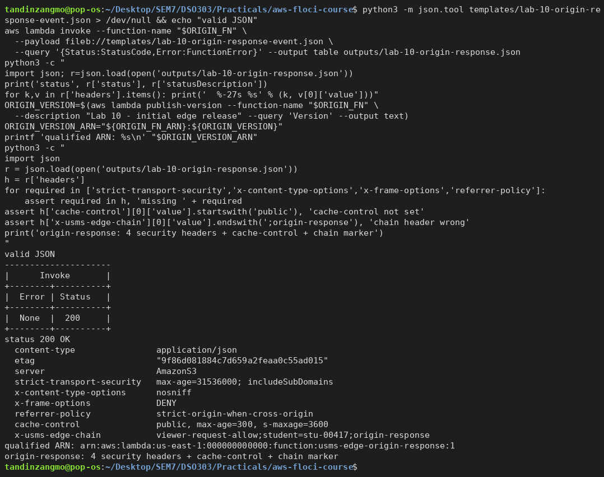

## Step 14 - Edge restrictions (Checkpoint 5)

The deliberate mistake: `update-function-configuration --environment` set two variables on the viewer function, and the call **succeeded**, both here and on real AWS. On real AWS, CloudFront rejects it only later, at association time. I cleared the variables with `Variables={}`.

The eligibility check then gave all `ok` for both functions: no env vars, 128 MB (cap 128), 5 s, nodejs20.x, no VPC, 1 published version. `grep -c ' NO '` → **0**.

**[Screenshot placeholder: Step 14a - env vars accepted, then removed]**
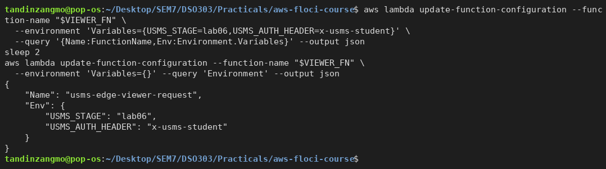

**[Screenshot placeholder: Step 14b - edge eligibility]**
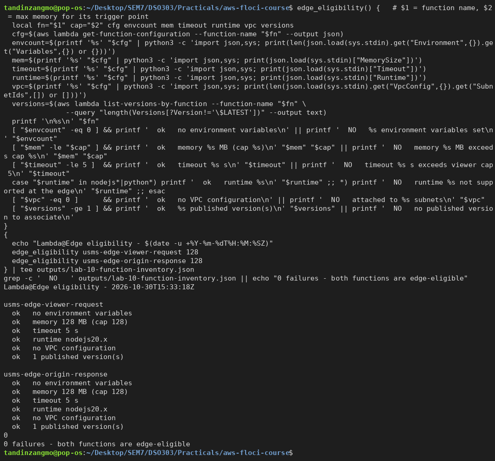

## Step 15 - CloudFront distribution (Checkpoint 6)

`templates/lab-10-distribution-config.json` is valid JSON:

- **Origin:** `usms-student-data.s3.us-east-1.amazonaws.com`.
- **Cache key:** the URI plus the header `x-usms-student`, with no cookies and no query string.
- **Associations:** viewer-request → `usms-edge-viewer-request:1` and origin-response → `usms-edge-origin-response:1`.

**Path A:** `create-distribution` returned **`E2Q9BI3T548JQK`** (`E2Q9BI3T548JQK.cloudfront.net`), Enabled, Status **Deployed**.

**Floci limitation:** reading the distribution back shows `LambdaFunctionAssociations: {"Quantity": 0}`, so the associations were silently dropped. `AllowedMethods` also came back doubled (`GET, HEAD, GET, HEAD`). The association could not be proven by readback, so I also ran the **Path B structural validation** on the config file: **11 ok, 0 errors**.

**[Screenshot placeholder: Step 15a - distribution created (Path A)]**
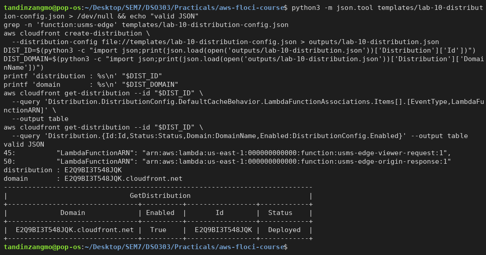

**[Screenshot placeholder: Step 15b - associations dropped + structural validation]**
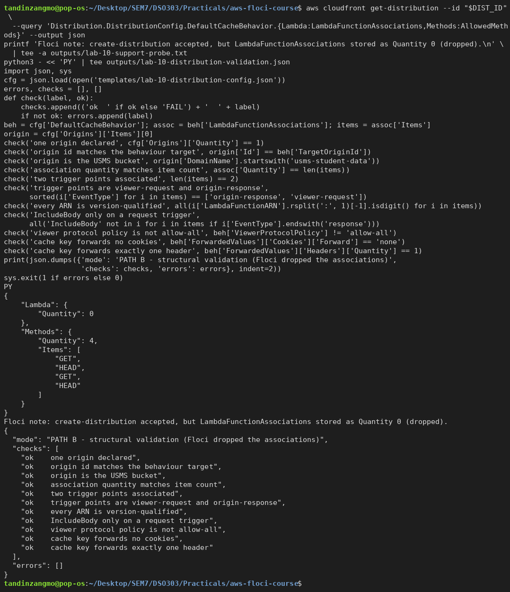

## Step 16 - Edge chain without CloudFront (Checkpoint 7)

`scripts/utilities/usms-edge-simulate.sh` invokes the two functions in CloudFront's order:

- **Allow:** the chain was viewer-request → origin → origin-response, with status 200. The URI was normalised, and **five headers were added** (four security headers + cache-control). `x-usms-edge-chain` proves the two functions composed.
- **Deny:** the chain stopped at viewer-request with status **403** (`DENY - the origin is never contacted`).

The allow trace was then restored in `outputs/lab-10-edge-trace.json`.

**[Screenshot placeholder: Step 16 - simulator allow and deny]**
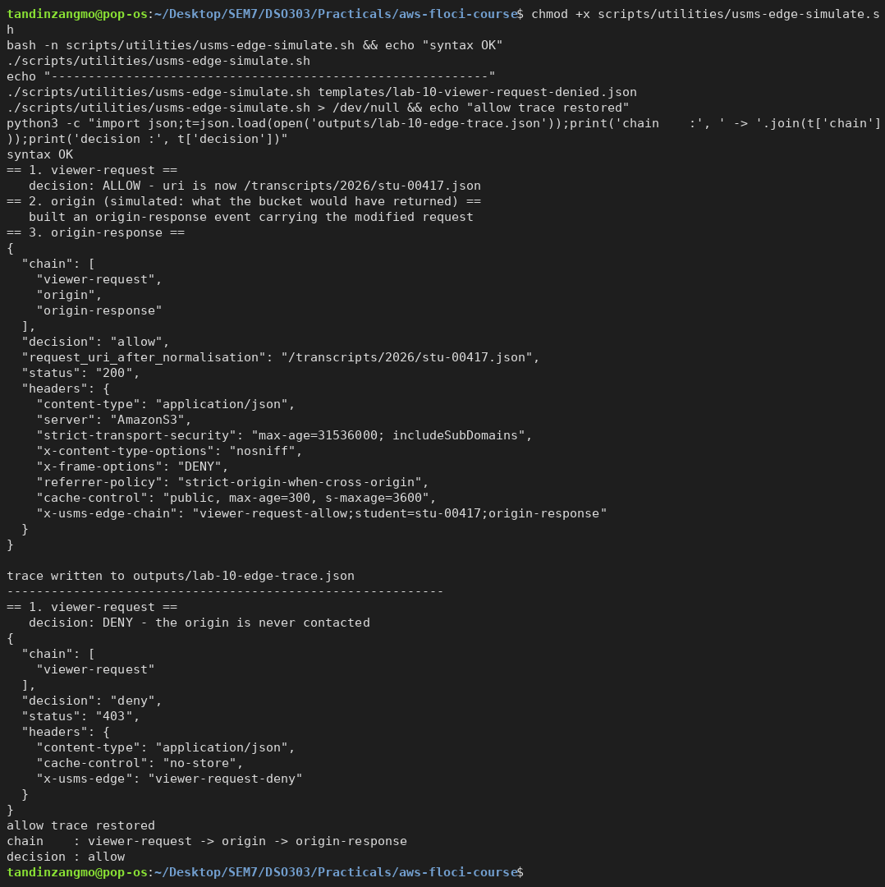

## Steps 17–18 - Regional notifier, version and alias (Checkpoint 8)

`notifier.py` compiles, and it reads two environment variables. `usms-transcript-notifier` has these settings:

- python3.12, `notifier.handler`, **256 MB, 30 s**;
- env `USMS_BUCKET=usms-student-data` and `USMS_NOTIFY_CHANNEL=stdout`, which are legal here and illegal at the edge;
- version **1** and alias **`live` → 1**, with ARN `...:usms-transcript-notifier:live`.

**Your turn:** I published version 2 and repointed `live` → 2, then put it back to `live` → 1. Versions `$LATEST, 1, 2` existed throughout.

**Floci limitation:** `get-function-configuration --qualifier live` reports Version `$LATEST`, not `1`. The alias resolution is shown correctly only by `list-aliases`.

**[Screenshot placeholder: Steps 17–18 - notifier, version 1, alias live]**
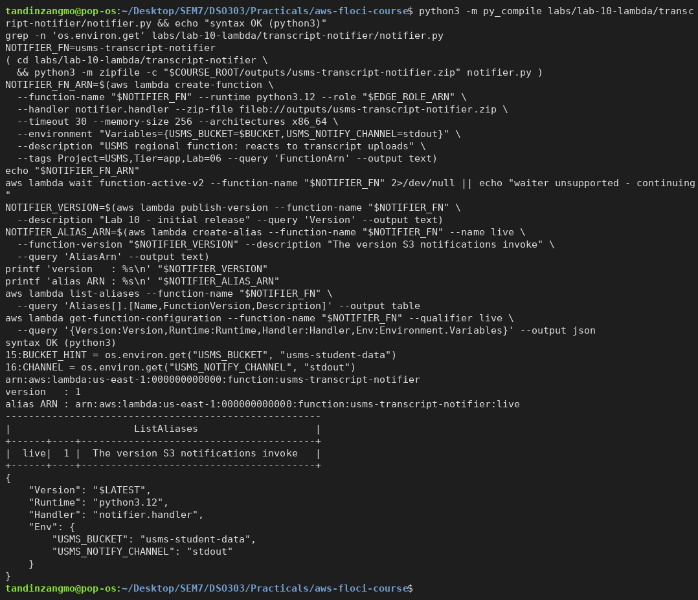

**[Screenshot placeholder: Step 18 - alias repoint (Your turn)]**
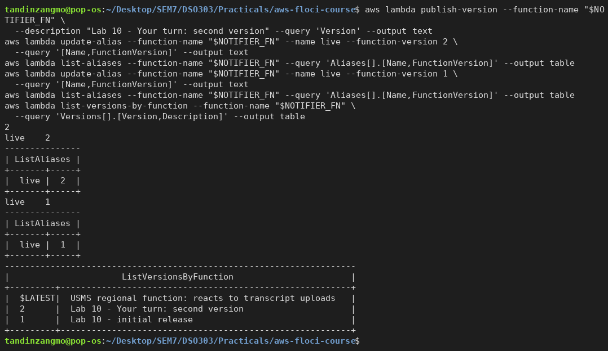

## Step 19 - Resource policy for S3

`add-permission` on `--qualifier live` granted `s3.amazonaws.com` `lambda:InvokeFunction` with `--source-arn arn:aws:s3:::usms-student-data` and `--source-account 000000000000`. The check printed `resource policy: scoped to one bucket in one account`.

**Floci limitation:** the stored statement keeps only the `ArnLike AWS:SourceArn` condition. It drops `StringEquals AWS:SourceAccount`, and its Resource has no `:live` qualifier. The policy is recorded, never enforced.

**[Screenshot placeholder: Step 19 - scoped resource policy]**
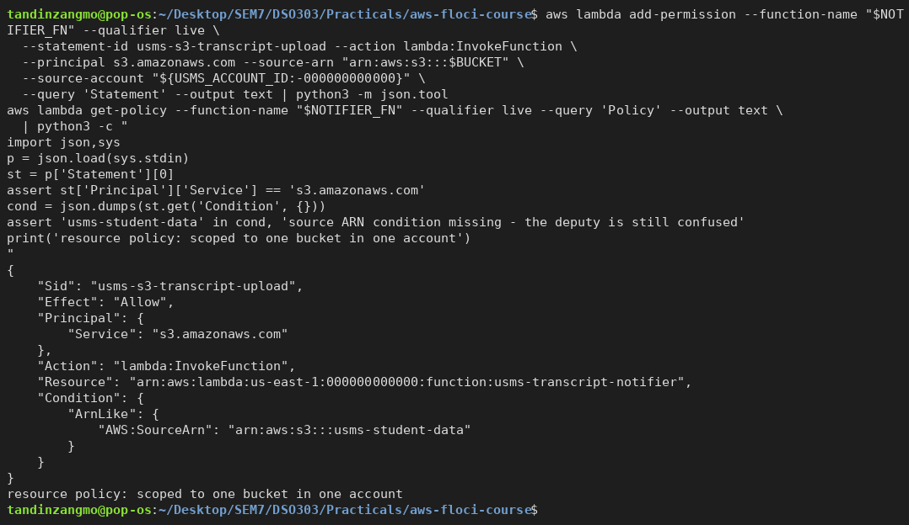

## Step 20 - Bucket notification and first object (Checkpoint 9)

The notification `usms-transcript-upload` sends `s3:ObjectCreated:*` to `usms-transcript-notifier:live`, filtered to prefix `transcripts/` and suffix `.json`. I uploaded `outputs/lab-08-scaling-evidence.json` as `transcripts/evidence/lab-08-scaling-evidence.json` (2856 bytes).

**[Screenshot placeholder: Step 20 - notification and upload]**
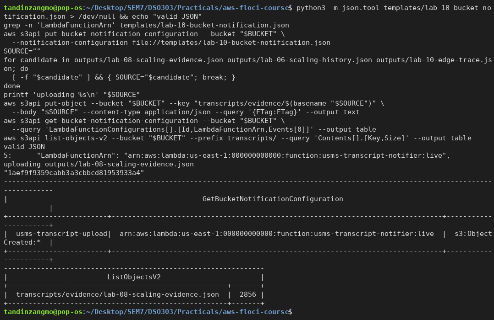

## Step 21 - Proving the notifier ran

- **Real trigger:** no log group appeared after the upload, so **S3 → Lambda delivery is not implemented on this build** (0 `USMS_NOTIFY` lines).
- **Fallback, synthetic event:** I invoked `:live` directly with the event. It returned `{"processed": 1, "keys": ["transcripts/evidence/synthetic-probe.json"]}`, and the log shows the `USMS_NOTIFY` line with `"read_error": "ClientError", "readable": false`. That error is expected, because the synthetic key does not exist.
- **Your turn, filters:** I uploaded `notes/ignore-me.json` and `transcripts/evidence/ignore-me.txt`. The `USMS_NOTIFY` count stayed at 2 → 2. The bucket lists all three objects. Because delivery is not implemented, that alone proves nothing, so per object:
  - `notes/ignore-me.json` is excluded by the **prefix** rule (`transcripts/`).
  - `transcripts/evidence/ignore-me.txt` matches the prefix but is excluded by the **suffix** rule (`.json`).

**[Screenshot placeholder: Step 21a - no delivered events]**
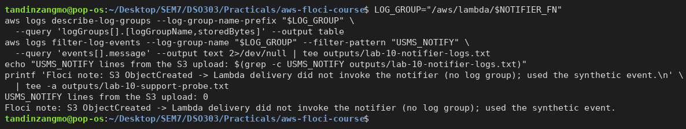

**[Screenshot placeholder: Step 21b - synthetic S3 event through live]**
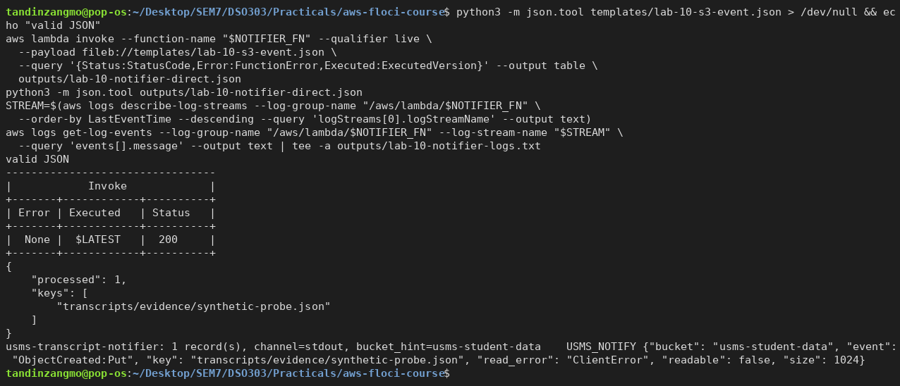

**[Screenshot placeholder: Step 21c - prefix/suffix filters (Your turn)]**
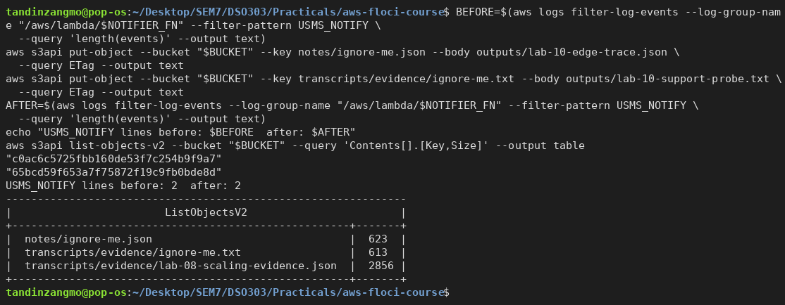

## Step 22 - Restart and read back (Checkpoint 10)

I recorded the inventory: 3 functions, the viewer's version 1, alias `live 1`, 3 objects and notification `usms-transcript-upload`. Then I ran `floci-down.sh` (compose stop) and `floci-up.sh`, and read everything back. `diff` → **IDENTICAL - every Lab 10 artefact survived the restart**. Running the simulator again still produced `x-usms-edge-chain`, and distribution `E2Q9BI3T548JQK` was still Deployed.

**[Screenshot placeholder: Step 22a - pre-restart inventory and restart]**
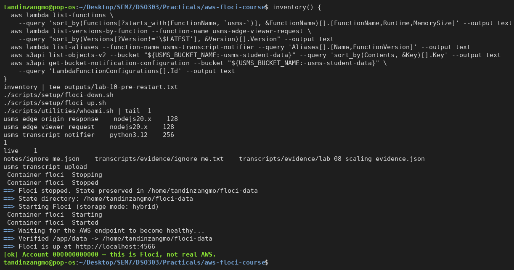

**[Screenshot placeholder: Step 22b - identical after restart]**
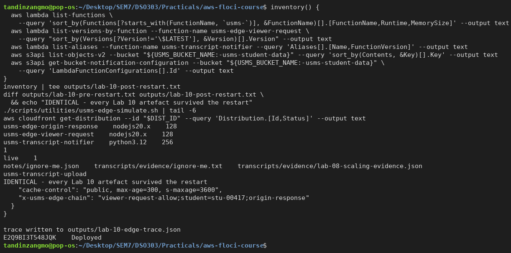

## Step 23 - configs/lab-10.env

`configs/lab-10.env` has **25 exports**, all populated, and it sources cleanly.

**Floci limitation:** `list-distributions` returns nothing, although `get-distribution` finds the distribution, so the lab's lookup wrote `not-created`. I replaced the two CloudFront lines with the real ID and domain from `outputs/lab-10-distribution.json`, so the cleanup script can find the distribution.

**[Screenshot placeholder: Step 23a - lab-10.env]**
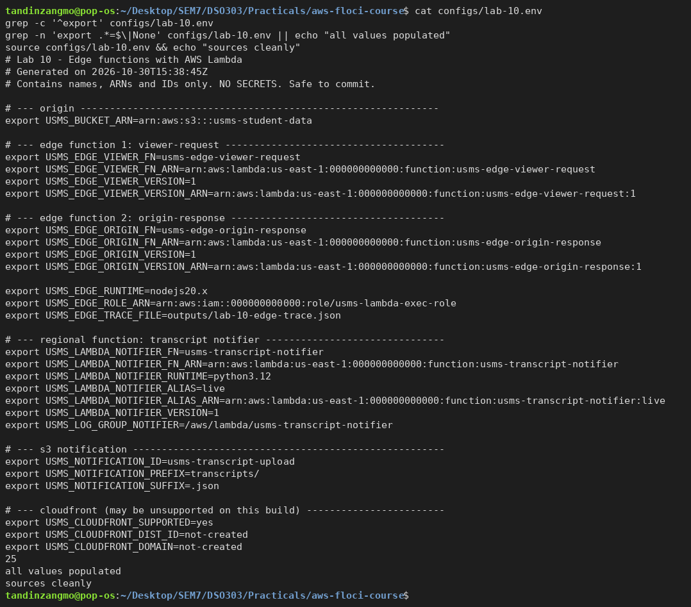

**[Screenshot placeholder: Step 23b - list-distributions empty, real ID recorded]**
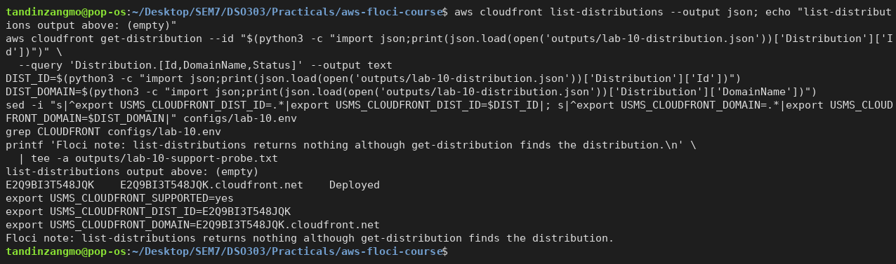

## Section 8 - Verification and cleanup script

- **`verify-lab-10.sh`:** **PASS=50 FAIL=1**. The one failure is `no secret is tracked`, caused by the tracked placeholder `outputs/.gitkeep`, the same false positive as Lab 09. The check is also **flaky**: `grep -q` exits on the first match, `git ls-files` gets SIGPIPE, and under `set -o pipefail` the pipeline sometimes fails, so the `!` flips it. Five runs gave 50/1, 50/1, **51/0**, 50/1, 50/1. Every resource check passes.
- **`lab-10-cleanup.sh`:** passes `bash -n`, with the six inside-out stages. **Not run.**

**[Screenshot placeholder: Section 8a - verify-lab-10]**
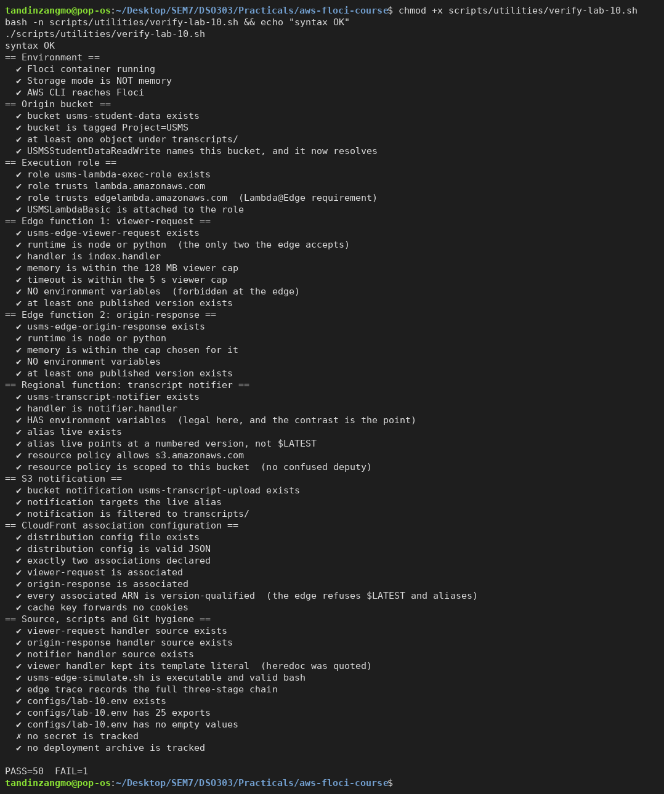

**[Screenshot placeholder: Section 8b - .gitkeep and cleanup script]**
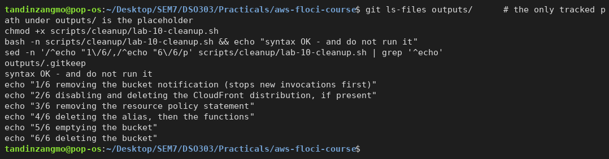

**[Screenshot placeholder: Section 8c - verify after the exercises (flaky .gitkeep check)]**
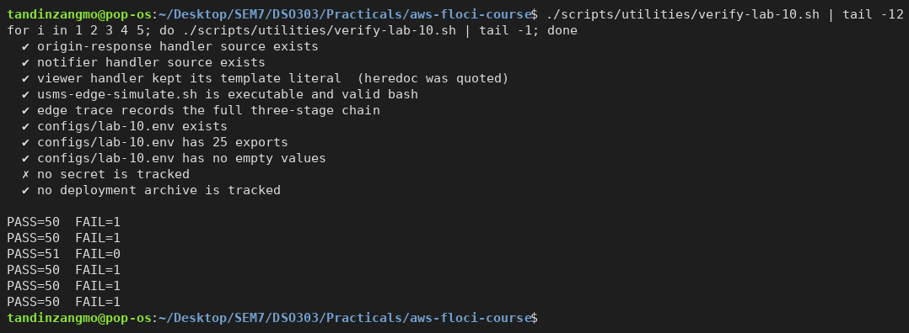

## Step 24 - Git hygiene

`git status` lists only the source, templates, policies, scripts and `configs/lab-10.env`. `check-ignore` names `.gitignore:7 outputs/*` for the zip and the trace. `git ls-files outputs/` lists only `.gitkeep`, and there is no `__pycache__` or `.zip` under `labs/`. **Nothing has been committed yet.**

**[Screenshot placeholder: Step 24 - git hygiene]**
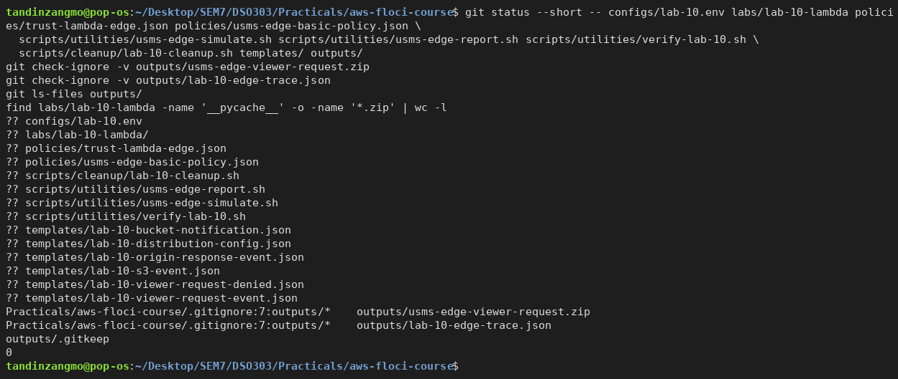

---

## Observed vs recorded

| Observed on Floci | Recorded only (real AWS enforces it) |
|---|---|
| Three functions created, invoked, versioned; alias `live` | Trust must name `edgelambda.amazonaws.com` for association/replication |
| CloudFront event shape: request returned (allow) vs 403 response (deny) | Edge accepts only a version-qualified ARN |
| Origin-response adds 4 security headers + cache-control | No env vars / VPC / layers at the edge; 128 MB / 5 s viewer caps |
| Two functions compose (`x-usms-edge-chain`) | Associations validated and replicated to every PoP |
| Bucket, notification, resource policy stored | S3 delivery; resource policy checked; IAM evaluated |
| Everything survives a restart | Latency, caching, cold starts and cost were **not** tested |

## Floci limitations met

| What | Floci | Real AWS |
|---|---|---|
| `--log-type Tail` / Node.js log events | `LogResult` None, streams empty | Last 4 KB of log, base64 |
| CloudFront `LambdaFunctionAssociations` | Stored as `Quantity: 0` | Validated and stored |
| `list-distributions` | Empty | Lists the distribution |
| `AllowedMethods` readback | Duplicated items | As sent |
| Resource policy | Drops `SourceAccount` and the `:live` qualifier; not enforced | Stored as sent; checked on every invoke |
| S3 ObjectCreated → Lambda | Not delivered | Asynchronous invoke |
| `--qualifier` on invoke / get-function-configuration | Ignored: always `$LATEST` | Runs that version |
| IAM / trust policies | Stored, never evaluated | Evaluated on every call |

## Conclusion

The edge logic works where it can be observed. The viewer-request function refuses unauthenticated transcript requests before the cache and normalises the URI. The origin-response function attaches security headers that would be cached with the object. The two compose in the right order. The regional notifier is wired to the bucket through a pinned alias and a resource policy scoped to one bucket.

What Floci could not show (the association, replication, S3 delivery and IAM) is recorded and checked statically: the version-qualified ARNs, the two-principal trust and the structural validation. The main lesson matches Lab 09. `create-distribution`, `add-permission` and the env-var update all "succeeded" while storing something different from what was asked or meant. A control counts only once its stored state has been read back, and an edge rule is only checked when CloudFront tries to use it.

Exercises are in [exercises.md](exercises.md). Review answers are in [notes/lab-10-notes.md](../../notes/lab-10-notes.md), and the Exercise 4 design is in [notes/lab-10-edge-design.md](../../notes/lab-10-edge-design.md).
