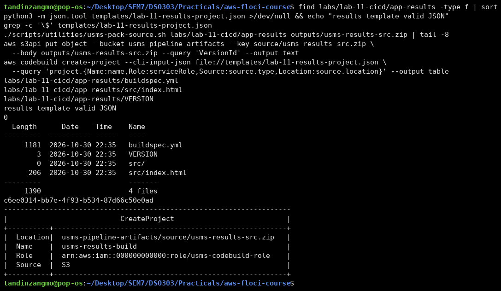
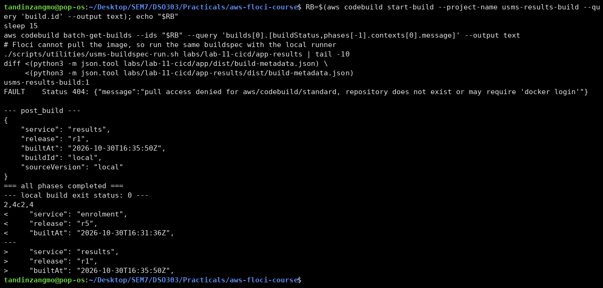
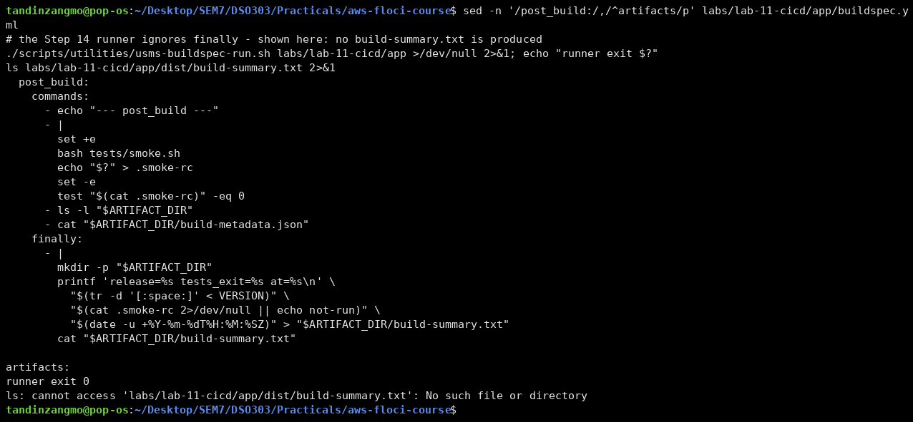
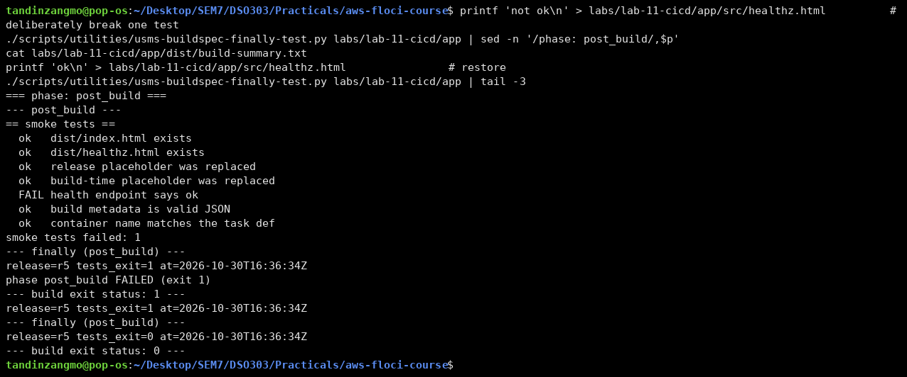
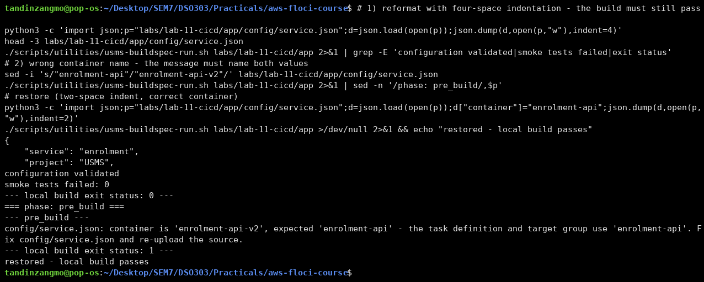
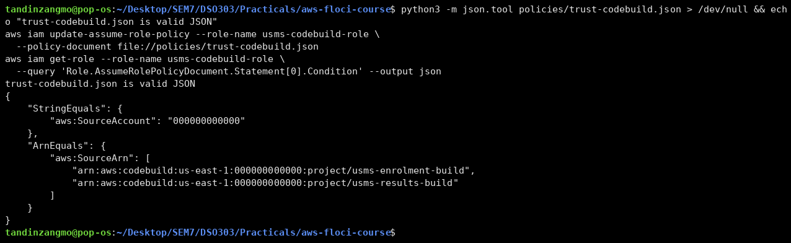
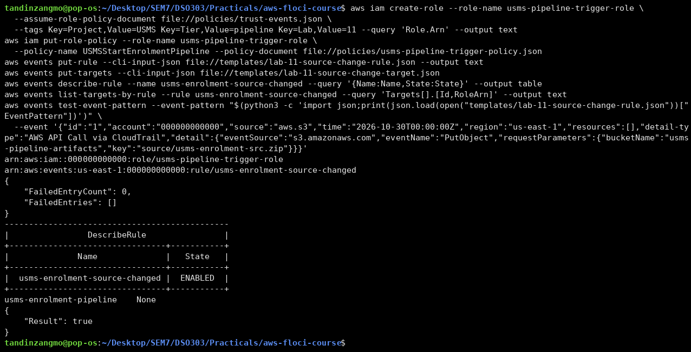
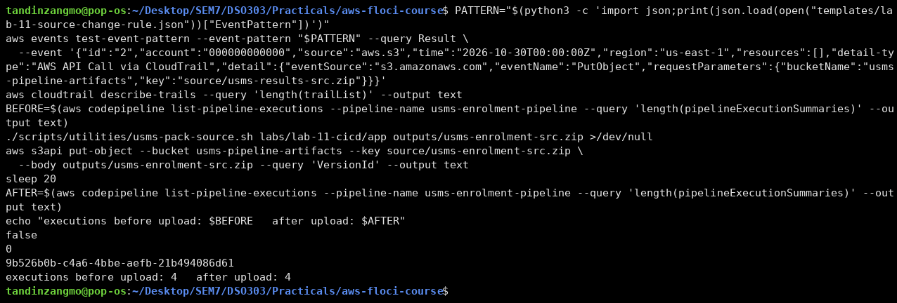
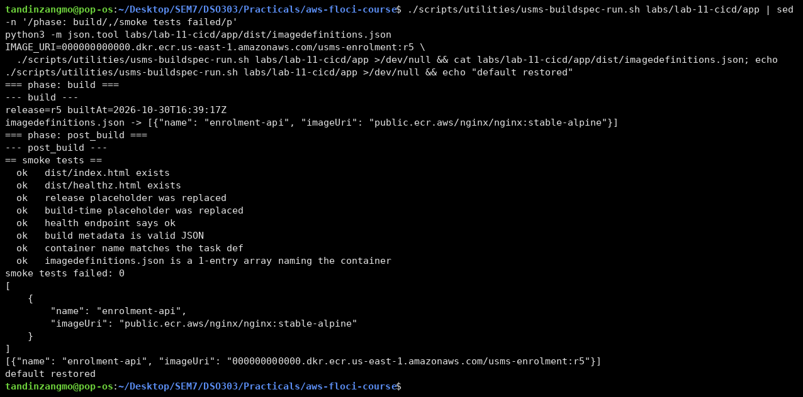
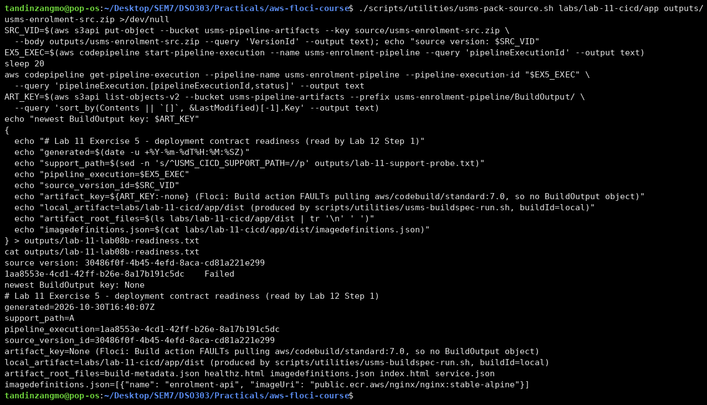

# Lab 11 - Independent Exercises

All five exercises were done against Floci. Screenshots are in `screenshots/`. On this Floci build CodeBuild cannot pull `aws/codebuild/standard:7.0`, so every CodeBuild run ends in `FAULT`. Where an exercise needed a build to run, I used the local runner and say so.

---

## Exercise 1 - Basic: a second build project for the results service

- **Source tree:** `labs/lab-11-cicd/app-results/` has `VERSION` (`r1`), `src/index.html` (with a `__RELEASE__` placeholder) and its own `buildspec.yml`. The buildspec has pre_build, build and post_build phases, writes `build-metadata.json` with `"service": "results"`, and checks in post_build that the placeholder was replaced.
- **Project:** `templates/lab-11-results-project.json` is Step 10's template with only these fields changed: `name: usms-results-build`, `description`, `source.location: usms-pipeline-artifacts/source/usms-results-src.zip`, `artifacts.name: usms-results-build.zip`, its own log group, and `USMS_SERVICE=results`. It has 0 unexpanded `$`. The source type is **S3**, so the project can run on its own, and it **reuses `usms-codebuild-role`** (no second role).
- **Source:** packed with `usms-pack-source.sh` (buildspec at the root) and uploaded to `source/usms-results-src.zip` (version `c6ee0314-…`).

**Does `USMSCodeBuildBase` already allow it?** Only partly. The S3 statement covers `usms-pipeline-artifacts/*`, which includes both the results source zip and `build/usms-results-build.zip`. The logs statement, however, names only `/aws/codebuild/usms-enrolment-build`, so on real AWS the results build could not write its own logs. I did not change the policy, because Lab 12 creates version 2 of `USMSCodeBuildBase`. Adding `/aws/codebuild/usms-results-build` belongs in that version.

**Result:** `start-build --project-name usms-results-build` → `usms-results-build:1`, status **FAULT** (the same image-pull error). The same buildspec run with the local runner passed (exit 0). Comparing the two local `build-metadata.json` files shows the results artifact clearly: `service` is `results` instead of `enrolment`, and `release` is `r1` instead of `r5`. **Not shown:** an object under `build/` written by CodeBuild.

**[Screenshot placeholder: Exercise 1a - results tree, template, upload, create-project]**


**[Screenshot placeholder: Exercise 1b - standalone build FAULT, local build, metadata diff]**


---

## Exercise 2 - Intermediate: a finally block and a build report

The enrolment buildspec's `post_build` now:

1. runs `tests/smoke.sh` with `set +e`;
2. saves the exit code to `.smoke-rc`;
3. fails the phase with `test "$(cat .smoke-rc)" -eq 0`.

A `finally:` block at the same level as `commands:` writes `dist/build-summary.txt`:

```
release=<VERSION> tests_exit=<smoke exit code | not-run> at=<UTC timestamp>
```

`base-directory: dist` with `files: '**/*'` means the summary is part of the artifact. `.smoke-rc` is ignored by Git and excluded by `usms-pack-source.sh` (I added `-x '.smoke-rc'`), so it never ships as source.

**How I tested it, and what that means for the claim:** the Step 14 runner reads only `commands:`, and I showed that it ignores `finally`: no `build-summary.txt` is produced. I wrote a separate harness, `scripts/utilities/usms-buildspec-finally-test.py`, which models CodeBuild's rule:

- commands run until one fails;
- the phase's `finally` then runs anyway;
- a failed phase still fails the build.

I deliberately broke one test (`healthz.html` → `not ok`). The output showed `FAIL health endpoint says ok`, the `finally` block ran, `build-summary.txt` read `release=r5 tests_exit=1 …`, and the build exit status was **1**: the `finally` block ran but did not rescue the build. After I restored the file, the summary read `tests_exit=0` and the exit status was 0.

**Claim:** my *model* of CodeBuild's `finally` behaviour produces the summary on failure. CodeBuild itself never ran this buildspec, so I have not shown that the summary reaches a real artifact. On real AWS a failed Build action also gives the next pipeline stage no `BuildOutput`.

**[Screenshot placeholder: Exercise 2a - the finally block; the Step 14 runner ignores it]**


**[Screenshot placeholder: Exercise 2b - broken test, finally still writes tests_exit=1, build fails]**


---

## Exercise 3 - Problem solving: make the configuration check robust

**The check:** both `pre_build` greps (the container, and my port check from Step 8) became a single `python3 -c` block that parses `config/service.json` with the standard library and compares the values:

```
config/service.json: container is 'enrolment-api-v2', expected 'enrolment-api' - the task definition and target group use 'enrolment-api'. Fix config/service.json and re-upload the source.
```

The message names both the actual and the expected value. The smoke test's container assertion had the same whitespace dependency, so it now parses the JSON too. Otherwise a reformatted file would pass pre_build and fail post_build.

**Proofs (local runner):**

- I rewrote `service.json` with **four-space indentation**. Result: `configuration validated`, `smoke tests failed: 0`, exit 0.
- I changed the container to `enrolment-api-v2`. Result: the build stopped in `pre_build` with the message above (exit 1).
- I restored the file (two-space indent, correct name) and the build passed.

**Trust policy:** `policies/trust-codebuild.json` now has two conditions: `StringEquals aws:SourceAccount = 000000000000` and `ArnEquals aws:SourceArn = [project/usms-enrolment-build, project/usms-results-build]`. I applied it with `update-assume-role-policy` and read the condition back. Both projects are listed because Exercise 1 reuses the role. The explanation of what `aws:SourceArn` closes that `aws:SourceAccount` alone does not is in [notes/lab-11-notes.md](../../notes/lab-11-notes.md).

**[Screenshot placeholder: Exercise 3a - 4-space JSON passes; wrong container fails naming both values]**


**[Screenshot placeholder: Exercise 3b - trust policy with SourceAccount and SourceArn]**


---

## Exercise 4 - Challenge: trigger the pipeline without polling

**Design (event-driven, no polling):**

```
put-object source/usms-enrolment-src.zip
   -> CloudTrail data event (trail with an advanced event selector on that one object ARN)
   -> EventBridge rule usms-enrolment-source-changed
        source=aws.s3, detail-type="AWS API Call via CloudTrail",
        eventName in {PutObject, CompleteMultipartUpload, CopyObject},
        requestParameters.bucketName=usms-pipeline-artifacts,
        requestParameters.key=source/usms-enrolment-src.zip
   -> target: arn:aws:codepipeline:...:usms-enrolment-pipeline
        RoleArn: usms-pipeline-trigger-role  (codepipeline:StartPipelineExecution on that one pipeline)
```

**Documents (all valid JSON):**

| File | Purpose |
|---|---|
| `templates/lab-11-source-change-rule.json` | `put-rule` input; the pattern matches **one object key** |
| `templates/lab-11-source-change-target.json` | `put-targets` input |
| `templates/lab-11-cloudtrail-data-events.json` | Advanced event selectors: write data events for that one object ARN only |
| `policies/trust-events.json` | Trusts `events.amazonaws.com`, conditioned on `SourceAccount` and this rule's `SourceArn` |
| `policies/usms-pipeline-trigger-policy.json` | `codepipeline:StartPipelineExecution` on one pipeline ARN |

**Why the target role is not the pipeline role:** the target role is assumed by **EventBridge**, and its only job is to *start* the pipeline. The pipeline role is assumed by **CodePipeline**. It can read and write the artifact store, start builds and pass the build role, and it trusts `codepipeline.amazonaws.com`, not `events.amazonaws.com`. Reusing it would mean adding EventBridge to its trust policy, which gives an event rule every permission the pipeline has. The trigger needs exactly one action on one resource.

**The CloudTrail dependency:** S3 object-level API calls such as PutObject are **data events**, and CloudTrail does not record them unless a trail has event selectors for them. Without a trail, EventBridge never sees `AWS API Call via CloudTrail` for the upload, so the rule never fires. The other route is to enable the bucket's own EventBridge notifications (`put-bucket-notification-configuration` with `EventBridgeConfiguration`). That route emits `detail-type: "Object Created"` with `detail.object.key`. It needs a different pattern and has no CloudTrail cost or trail setup. I chose the CloudTrail route because that is the one CodePipeline's documentation for S3 sources describes. The selector file limits it to one object ARN, so the trail does not log the whole bucket.

**What ran:**

- `create-role` with an inline policy; `put-rule` (ARN returned, `ENABLED`); `put-targets` (`FailedEntryCount: 0`).
- `test-event-pattern` gives **`true`** for a CloudTrail `PutObject` event on `source/usms-enrolment-src.zip` and **`false`** for the same event on `source/usms-results-src.zip`. The rule matches one key, not the whole bucket.

**What did not run, and why:**

- `cloudtrail describe-trails` returns **0** trails. Floci does not model S3 data events reaching EventBridge.
- I uploaded a new source version (`9b526b0b-…`) and waited 20 s. Pipeline executions went **4 → 4**, so the trigger did not fire.
- The target's `RoleArn` read back as `None`.

So the rule document and its matching logic were shown. The trail-to-rule-to-pipeline delivery is design only (*Conceptual / Real AWS*).

**[Screenshot placeholder: Exercise 4a - trigger role, put-rule, put-targets, test-event-pattern true]**


**[Screenshot placeholder: Exercise 4b - other key false, no trails, upload does not start an execution]**


---

## Exercise 5 - Integration: prepare the deployment contract for Lab 12

The enrolment `build` phase now:

1. sets `IMAGE_URI="${IMAGE_URI:-public.ecr.aws/nginx/nginx:stable-alpine}"`. The default is the placeholder image that task definition `usms-enrolment:2` runs today.
2. runs a `python3 -c` block that reads the container name **from `config/service.json`** (not hard-coded a second time) and writes `dist/imagedefinitions.json` as a **one-entry JSON array**.

`tests/smoke.sh` has an **eighth assertion**: the file is a list of length 1 whose `name` equals the configured container and whose `imageUri` is not empty.

**Results (local runner):**

- Default run: `[{"name": "enrolment-api", "imageUri": "public.ecr.aws/nginx/nginx:stable-alpine"}]`, with 8 of 8 smoke tests ok.
- `IMAGE_URI=000000000000.dkr.ecr.us-east-1.amazonaws.com/usms-enrolment:r5`: the override won, the same way a CodeBuild project variable would override it in Lab 12.
- `imagedefinitions.json` sits at the artifact root next to `index.html`, with no `dist/` prefix.

**Pipeline:** I uploaded the source (`30486f0f-…`) and ran execution `1aa8553e-…`. Source Succeeded, Build FAULT, so `BuildOutput/` is empty (`None`) and there was no CodeBuild artifact to download.

`outputs/lab-11-lab08b-readiness.txt` records:

- the support path;
- the execution ID;
- the source version ID;
- `artifact_key=None` and why;
- that the artifact came from the **local** runner (`buildId=local`);
- the root file list;
- the `imagedefinitions.json` contents.

Lab 12 Step 1 therefore inherits an honest inventory rather than an artifact key that does not exist.

**[Screenshot placeholder: Exercise 5a - imagedefinitions.json built locally, 8 smoke tests, IMAGE_URI override]**


**[Screenshot placeholder: Exercise 5b - pipeline run and the readiness file]**

