# Lab 11 Report - Building a CI/CD Pipeline with AWS CodePipeline and CodeBuild

## Aim

To build the first half of the USMS delivery pipeline for the enrolment service:

- a **versioned S3 artifact store** (`usms-pipeline-artifacts`) that also holds the source archive;
- the enrolment service **source tree** with a `buildspec.yml` (four phases, seven smoke tests);
- scoped **CodeBuild** and **CodePipeline** service roles, including an `iam:PassRole` limited by `iam:PassedToService`;
- a CodeBuild project, `usms-enrolment-build`, and a **two-stage pipeline**, `usms-enrolment-pipeline` (S3 Source → CodeBuild Build);
- a **local buildspec runner**, so the build can be run and checked without CodeBuild.

Everything was done on Floci. The support probe reported **Path A**: CodeBuild and CodePipeline both answer, and Floci stores the project and pipeline and runs the Source action. **Floci cannot run a build, though.** Every build ends in `FAULT` because the image `aws/codebuild/standard:7.0` cannot be pulled (*Known Issues - Lab 11*). I did not try to work around this. I recorded it, and produced the build artifact with the Step 14 local runner. The artifact is labelled `buildId: local` throughout.

> In this report, **observed** means the command ran and its stored state was read back. **Recorded** means a document I wrote and validated that Floci stores but does not run or enforce. "The build passed locally" and "the build passed in CodeBuild" are different claims, and only the first was shown.

**Repository note:** the source tree is in `labs/lab-11-cicd/` (the folder I had already created), as the handout expects. The report is `readme.md`, to match Labs 09 and 10.

---

## Steps 1–2 - Floci, identity and earlier environments

Floci was already running in hybrid mode, bind-mounted to `~/floci-data`, and every storage check was `[ok]`. `whoami.sh` reported account `000000000000`. All ten earlier env files were sourced, including Lab 09's. No line said `MISSING`, and `USMS_ENROLMENT_CONTAINER` is `enrolment-api`, the name Lab 12's `imagedefinitions.json` has to match.

**[Screenshot placeholder: Step 1 - Floci up, storage check and identity]**
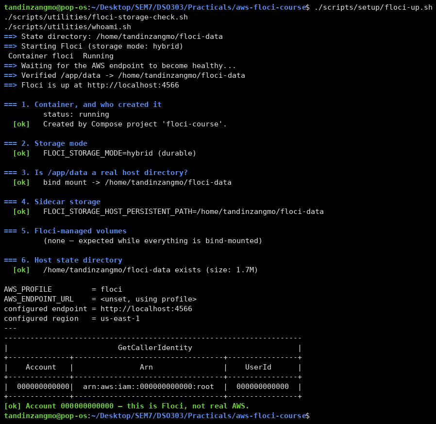

**[Screenshot placeholder: Step 2 - earlier lab env files and the values Lab 12 needs]**
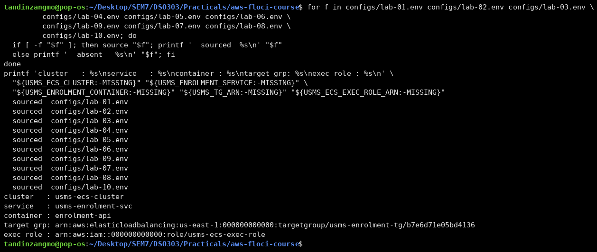

## Step 3 - CI/CD support probe (Checkpoint 1)

`cicd-support-probe.sh` created and deleted the throwaway project `usms-probe-delete-me`. `list-pipelines`, `ecr describe-repositories` and even `codedeploy list-applications` all answered, so the probe wrote `USMS_CICD_SUPPORT_PATH=A` to `outputs/lab-11-support-probe.txt`.

The probe only tests whether the API answers. It does not test whether a build runs, which is why the result is "Path A as recorded, Path C for builds".

**[Screenshot placeholder: Step 3 - support probe, Path A]**
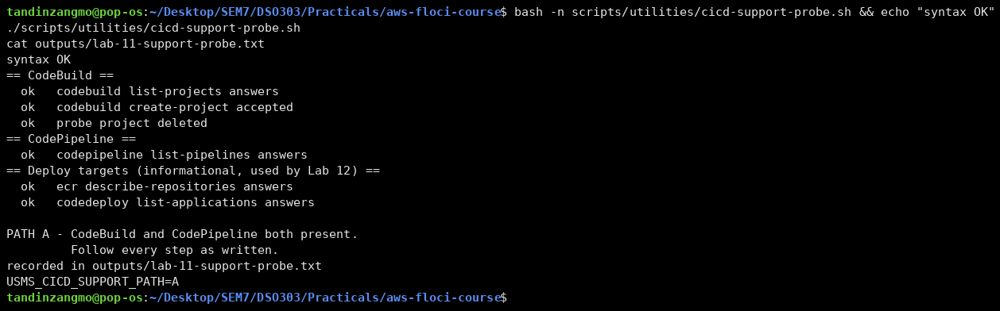

## Steps 4–6 - Artifact bucket and versioning proof (Checkpoint 2)

I created the lab directories and the bucket `usms-pipeline-artifacts`, with the tags `Project=USMS`, `Tier=pipeline` and `Lab=11`. Versioning is `Enabled` and all four public-access blocks are on.

Versioning was proved, not just read from the configuration. Two `put-object` calls to `probe/versioning.txt` gave **two versions** (7 bytes, Latest=True, and 6 bytes). After I read the delete warning, I deleted both versions by `--version-id`, and the final count is `0`.

**[Screenshot placeholder: Steps 4–5 - directories, bucket, versioning and tags]**
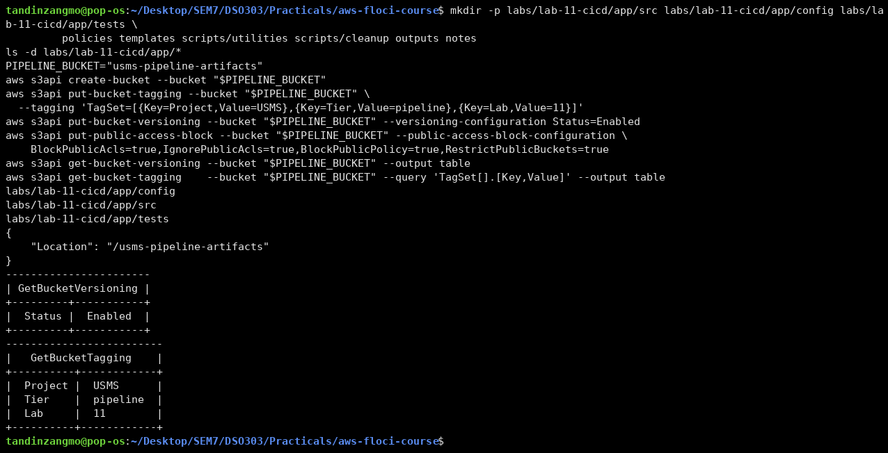

**[Screenshot placeholder: Step 6 - two versions at one key, then cleaned up]**
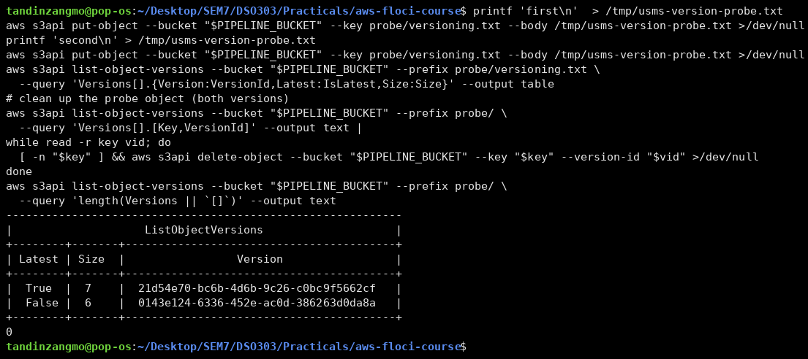

## Steps 7–8 - Source tree and buildspec (Checkpoint 3)

`labs/lab-11-cicd/app/` contains:

- `VERSION` (`r3`);
- `src/index.html` (with the `__RELEASE__` and `__BUILT_AT__` placeholders) and `src/healthz.html`;
- `config/service.json`;
- `tests/smoke.sh` (seven assertions; `bash -n` clean);
- `buildspec.yml`: version `0.2`, the phases `install → pre_build → build → post_build`, and `artifacts.base-directory: dist`.

PyYAML parsed the buildspec and found all four phases.

**Your turn (port check):** I added a second `- |` command to `pre_build` that fails the build unless `config/service.json` sets `"port": 80`. The error message tells the reader what to fix and where. I changed the port to 8080 and re-ran the local runner. The build stopped in `pre_build` with my message and exit status 1. I then put back port 80. (Exercise 3 later replaced both greps with a JSON parse.)

**[Screenshot placeholder: Steps 7–8 - source tree, JSON/YAML validation]**
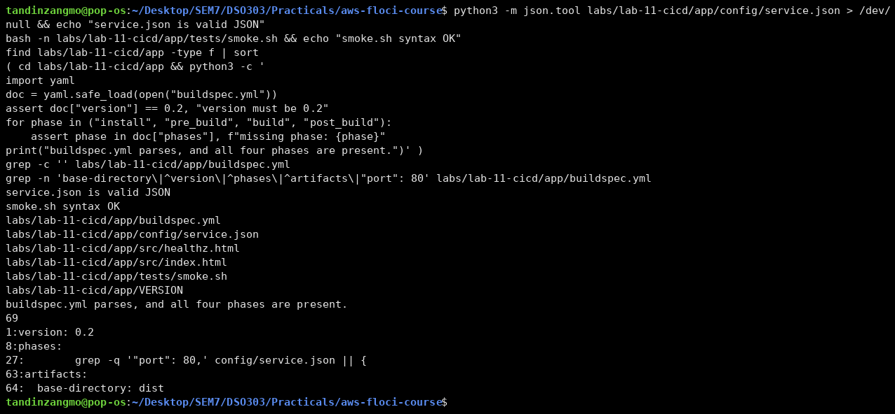

**[Screenshot placeholder: Step 8 Your turn - port 8080 stops the build in pre_build]**
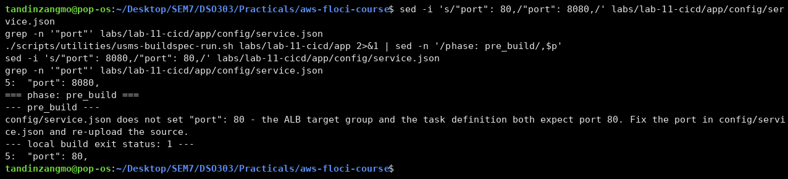

## Steps 9–10 - Build role and CodeBuild project (Checkpoint 4)

- **`usms-codebuild-role`** trusts `codebuild.amazonaws.com`, the global service principal, under an `aws:SourceAccount` condition.
- **`USMSCodeBuildBase`** is its only attached policy. It allows:
  - its own log group (two ARNs: the group, and the group with `:*` for its streams);
  - `Get/PutObject` and related bucket reads on `usms-pipeline-artifacts` (the bucket ARN and the object ARN are listed separately, as in Lab 01).

  It also has an **explicit Deny** on `usms-student-data`. The Deny makes sure no build can touch student records, even if a later policy adds a broad S3 Allow.
- **`usms-enrolment-build`** was created from `templates/lab-11-codebuild-project.json`. The template contains **0** unexpanded `$`. Readback shows source `S3` at `usms-pipeline-artifacts/source/usms-enrolment-src.zip`, image `aws/codebuild/standard:7.0` and a 15-minute timeout.

**[Screenshot placeholder: Step 9 - build role, policy, principal]**
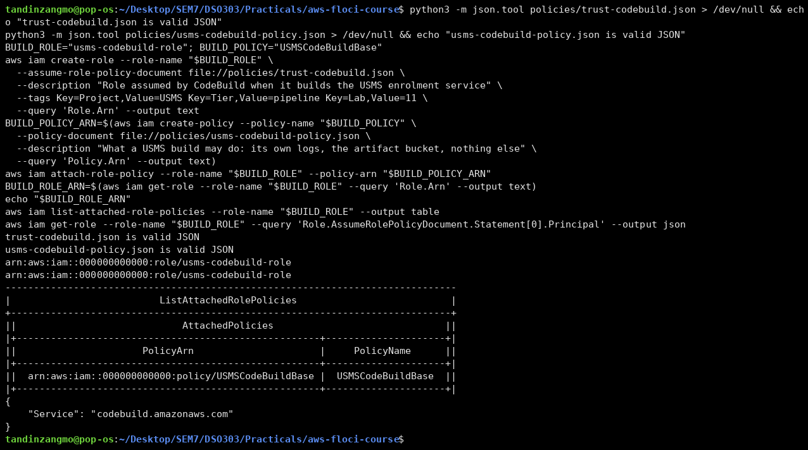

**[Screenshot placeholder: Step 10 - project template and create-project readback]**
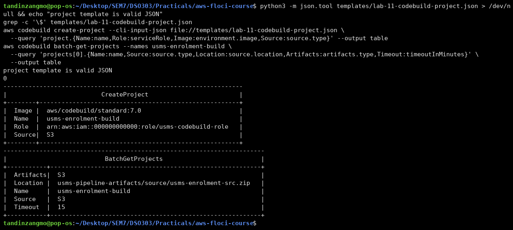

## Step 11 - Package and upload the source

`usms-pack-source.sh` packed the **contents** of `app/`. `buildspec.yml` and `VERSION` are at the zip root, with no `app/` prefix and no `dist/`. It was uploaded as version `f65f4911-…`. `git check-ignore` confirms that `outputs/*` keeps the zip out of Git.

**[Screenshot placeholder: Step 11 - archive layout and source VersionId]**
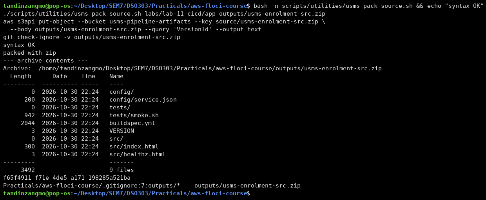

## Steps 12–13 - Standalone build and its phases (Checkpoint 5): Floci limitation

`start-build` returned `usms-enrolment-build:1`. After about 10 seconds the build was `FAULT`.

`batch-get-builds` shows SUBMITTED, QUEUED, PROVISIONING and DOWNLOAD_SOURCE as `SUCCEEDED`, then COMPLETED as `FAILED` with the context:

```
Status 404: {"message":"pull access denied for aws/codebuild/standard, repository does not exist or may require 'docker login'"}
```

So Floci did fetch the source, but could not start the build container. None of my four phases ran. The log stream `2026/10/30/usms-enrolment-build/1` exists but is **empty**, and there is **no object under `build/`**. The build JSON was saved to `outputs/lab-11-build-<epoch>.json`.

**Floci limitation:** this is the documented 2.0.1 issue (the image cannot be pulled). As instructed, I did not repoint the project at `python:3.12-slim`. On real AWS the image is cached and the build would run in seconds, through all ten phases.

**[Screenshot placeholder: Step 12 - start-build and the poll loop ending in FAULT]**
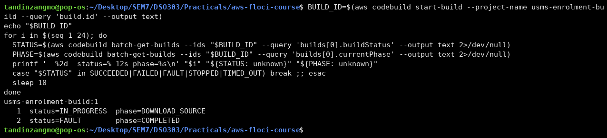

**[Screenshot placeholder: Step 13 - phases, failure context, empty logs, no artifact]**
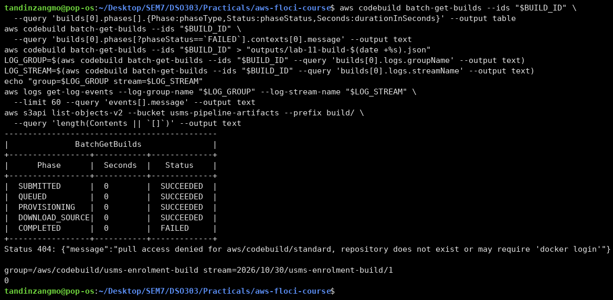

## Step 14 - Local buildspec runner (Checkpoint 6)

`usms-buildspec-run.sh` parsed the buildspec with **PyYAML (4 phases)**, generated a script that passes `bash -n`, and ran it in the app directory. The install, pre_build ("configuration validated"), build (`release=r3`) and post_build phases all ran. All **7 smoke tests passed**, and the exit status was **0**.

`dist/build-metadata.json` shows `"release": "r3"` and `"buildId": "local"`, and `index.html` reads `release: r3`. `labs/lab-11-cicd/app/dist/` was added to `.gitignore`, and `check-ignore` confirms it.

**[Screenshot placeholder: Step 14a - local runner, four phases, seven ok]**
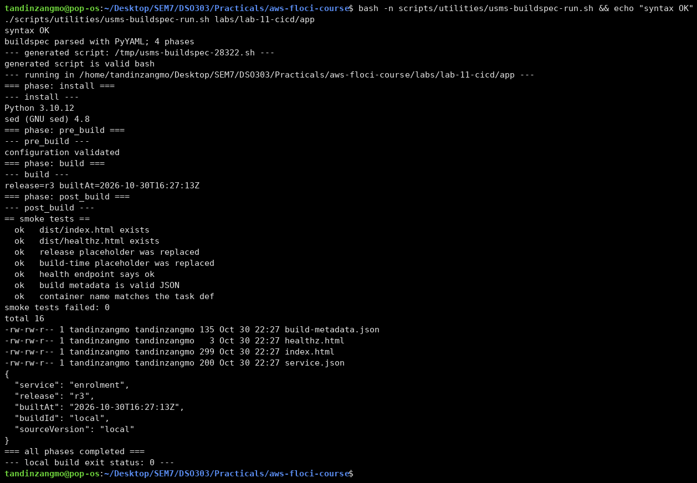

**[Screenshot placeholder: Step 14b - local artifact metadata and dist/ ignored]**
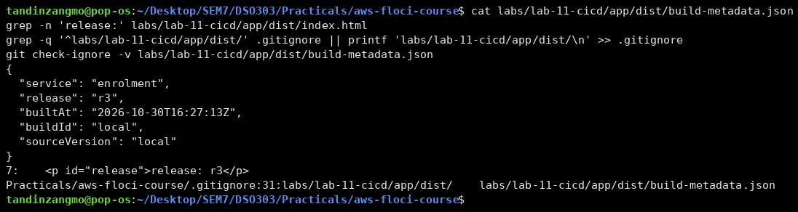

## Step 15 - Pipeline role and the scoped PassRole

**`usms-codepipeline-role`** trusts `codepipeline.amazonaws.com`. **`USMSCodePipelineBase`** (Default `v1`, attached `1`) allows:

- reads and writes on the artifact store, including `s3:GetBucketVersioning`;
- `StartBuild`, `BatchGetBuilds` and `StopBuild` on **one** project ARN;
- `iam:PassRole` on **`usms-codebuild-role` only**, with `iam:PassedToService = codebuild.amazonaws.com`.

My answer to the "`Resource: "*"` but keep the condition" question is in [notes/lab-11-notes.md](../../notes/lab-11-notes.md).

**[Screenshot placeholder: Step 15 - pipeline role, policy and the PassRole statement]**
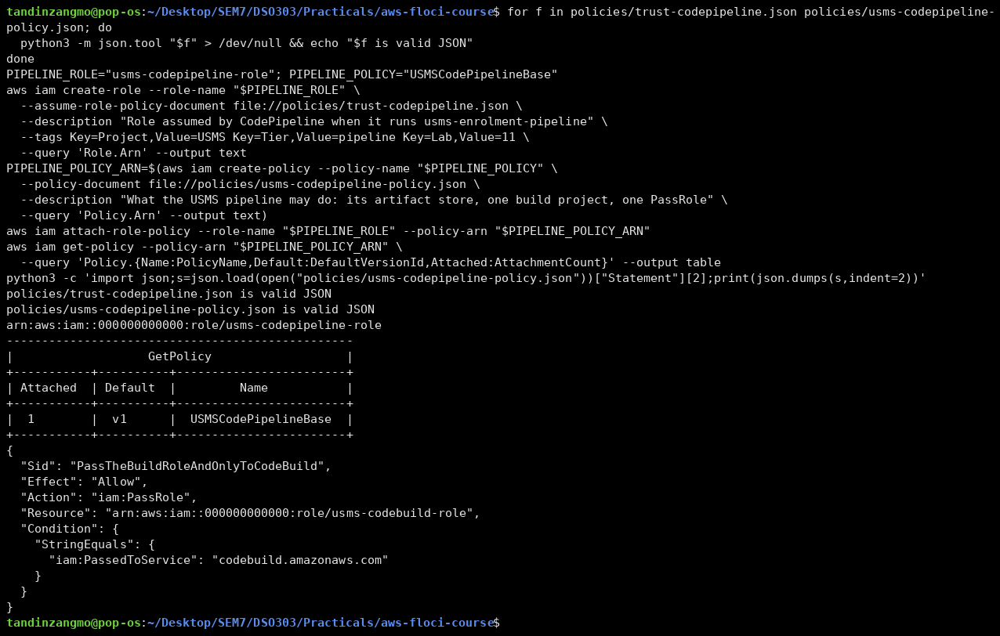

## Steps 16–17 - Pipeline definition and creation (Checkpoint 7)

`templates/lab-11-pipeline.json` is valid JSON with **0** unexpanded `$`. It defines Source (`S3`, `PollForSourceChanges: "false"`, output `SourceOutput`) and Build (`CodeBuild`, project `usms-enrolment-build`, output `BuildOutput`). `create-pipeline` returned the name, the role and **2 stages**.

**Observed difference:** on Floci, creating the pipeline did **not** start an automatic execution. `get-pipeline-state` shows both stages with status `None`, and `list-pipeline-executions` returned `0`.

**[Screenshot placeholder: Steps 16–17 - template validation, create-pipeline and initial state]**
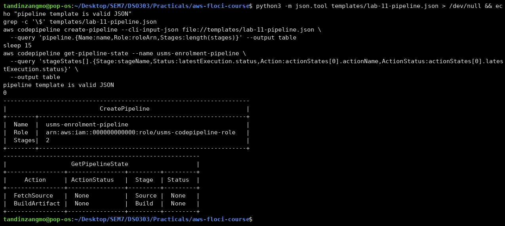

## Step 18 - Hand the project to the pipeline

`update-project` set the source and artifacts to `CODEPIPELINE`.

**Recorded, not observed:** on real AWS, `start-build --project-name usms-enrolment-build` now fails with `InvalidInputException`. Floci **accepted** it and returned build `:2`. The escape hatch (`--source-type-override S3 --source-location-override …`) also returned a build ID (`:3`).

**[Screenshot placeholder: Step 18 - CODEPIPELINE source, plain start-build accepted by Floci, override]**
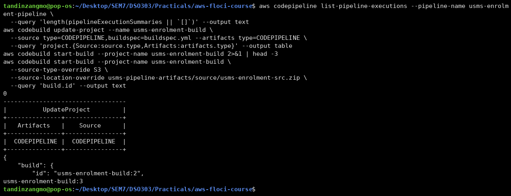

## Step 19 - Run the pipeline end to end (Checkpoint 8)

**Perturb:** I changed `VERSION` to `r4`, repacked and uploaded it. The new source version is **`3bdc0c4b-aefd-490b-ad18-c8676a56105e`**. `list-object-versions` shows two versions, one of them Latest.

**Run:** execution `4f82be51-…` ended `Failed`. Floci leaves the **stage-level** status as `None`, so I read the **action-level** state:

| Stage | Action | Status | externalExecutionId |
|---|---|---|---|
| Source | FetchSource | **Succeeded** | `3bdc0c4b-aefd-490b-ad18-c8676a56105e` |
| Build | BuildArtifact | Failed | `usms-enrolment-build:4` (FAULT) |

**Read back:** the Source action's `externalExecutionId` **is the r4 version ID I uploaded**. This is the observed evidence that the pipeline used my new source. The Build action then faulted on the image pull, so `usms-enrolment-pipeline/BuildOutput/` holds **0** objects and there is no CodeBuild artifact to download. Running the same buildspec locally against the r4 tree gave `release: r4` and `buildId: local`. That is the Path C result, and I report it as a local build.

**Your turn (r5):** I uploaded r5 (version `4c2f6b21-…`) and ran the pipeline again (`376f73b3-…`, Failed). The counts are **3** source versions, **0** BuildOutput objects and **2** executions. They differ because a new version appears on every upload, but a BuildOutput object appears only when a Build action succeeds. The full answer is in the notes.

**[Screenshot placeholder: Step 19a - r4 uploaded, two source versions]**
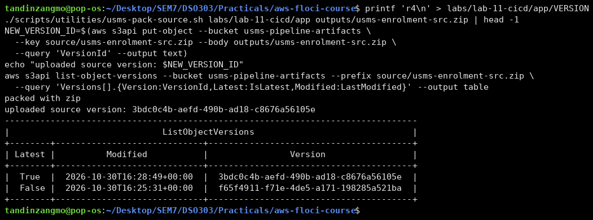

**[Screenshot placeholder: Step 19b - start-pipeline-execution and the poll loop]**
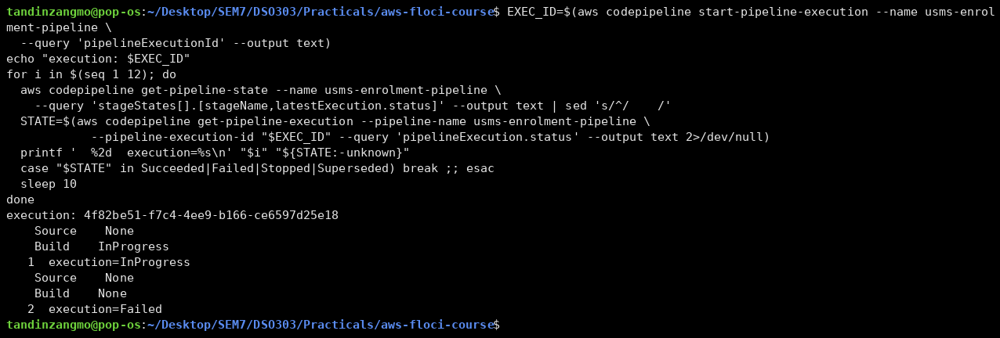

**[Screenshot placeholder: Step 19c - action-level state: Source consumed the r4 version; Build FAULT; local r4 artifact]**
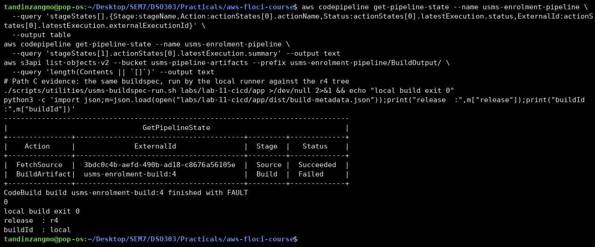

**[Screenshot placeholder: Step 19 Your turn - r5, three versions, zero BuildOutput]**
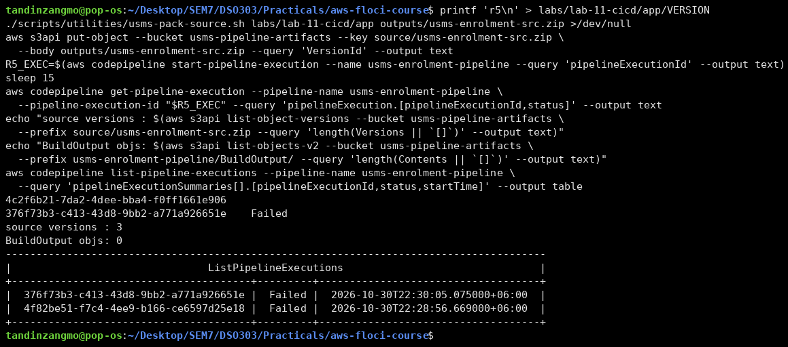

## Step 20 - Deliberate failure, diagnosis, fix (Checkpoint 9)

**Break:** I set `container` to `enrolment-api-v2` and uploaded it (`992ece95-…`). Execution `fbecaf1d-…` ran. The state shows Source `Succeeded` and Build `Failed` (`build usms-enrolment-build:6 finished with FAULT`). `errorDetails.message` is `null` on Floci.

**Diagnose (stage → build → phase → command):**

1. The failure is in **Build**, so the source was fetched.
2. `list-builds-for-project` works on Floci and returned `usms-enrolment-build:6`.
3. Its only FAILED phase is **COMPLETED**, with the image-pull context, **not** PRE_BUILD. Floci failed before my code ran, so the CodeBuild chain cannot show the bug I planted.
4. Following the lab's fallback, I reproduced the build with the local runner. It stopped in **`pre_build`** with `config/service.json names the wrong container` and exit status 1. This is the expected command-level answer.

**Fix:** I set the container back to `enrolment-api`. The local runner **passed again before I repacked** (validate locally, then push). I uploaded `c361a6d0-…` and started execution `8f6e9292-…`.

| Execution | Release | Result on Floci |
|---|---|---|
| (none at create) | - | Floci started no automatic execution |
| `4f82be51` | r4 | Source Succeeded, Build FAULT |
| `376f73b3` | r5 | Source Succeeded, Build FAULT |
| `fbecaf1d` | r5, broken container | Source Succeeded, Build FAULT (locally: PRE_BUILD fails) |
| `8f6e9292` | r5, fixed | Source Succeeded, Build FAULT (locally: passes) |

**[Screenshot placeholder: Step 20a - break the container name and run the pipeline]**
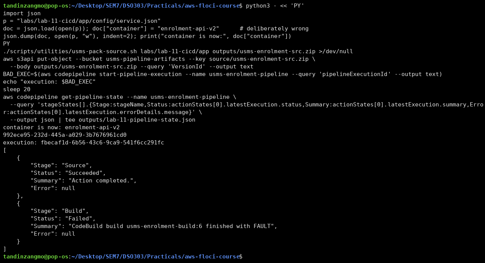

**[Screenshot placeholder: Step 20b - diagnosis: CodeBuild phase vs local runner pre_build]**
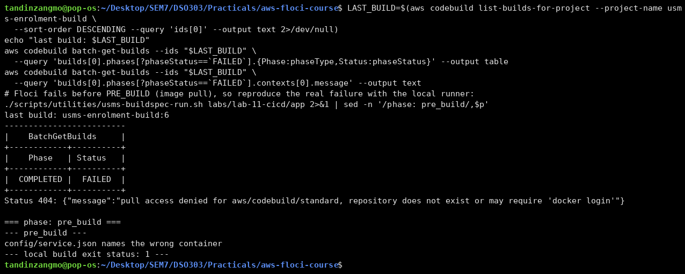

**[Screenshot placeholder: Step 20c - fix, local pass, re-upload and re-run]**
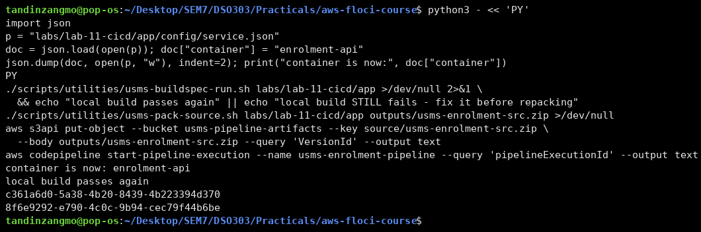

## Step 21 - Record outputs (Checkpoint 10)

`configs/lab-11.env` has **26 exports, all populated**. The verify line reads `versioning=Enabled`, `stages=2`, `release=r5` and `path=A`. The project ARN, `USMS_BUILD_SOURCE_TYPE=CODEPIPELINE` and the latest source version ID are recorded. I regenerated the file after the exercises so that `USMS_SOURCE_VERSION_ID` is current.

`git status` shows only Lab 11 source, templates, policies, scripts, `configs/lab-11.env` and the `.gitignore` change. Nothing under `outputs/` is staged. **Nothing has been committed yet.**

**[Screenshot placeholder: Step 21 - lab-11.env, 26 exports]**
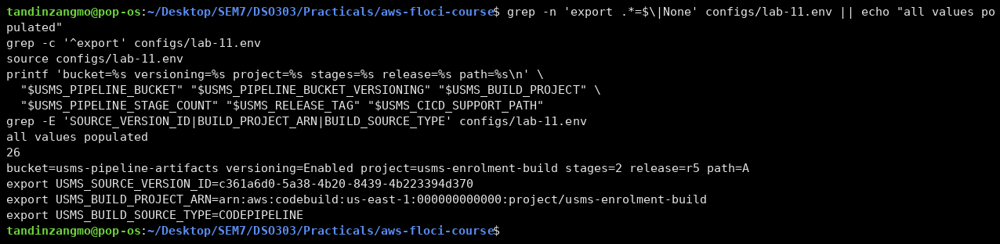

## Section 8 - Verification and cleanup script

- **`verify-lab-11.sh`:** **PASS=45 FAIL=1**. The one failure is `no secret is tracked`, caused by the tracked placeholder `outputs/.gitkeep`, the same false positive as in Labs 09 and 10. Every resource check passes, including the eight CodeBuild/CodePipeline checks. Those checks read stored **configuration**, so they pass even though Floci never ran a build. I re-ran it after the exercises and got the same 45/1.
- **`lab-11-cleanup.sh`:** passes `bash -n`, refuses to run while the pipeline has three stages, and requires typing `DELETE USMS PIPELINE`. **Not run.**

**[Screenshot placeholder: Section 8a - verify-lab-11]**
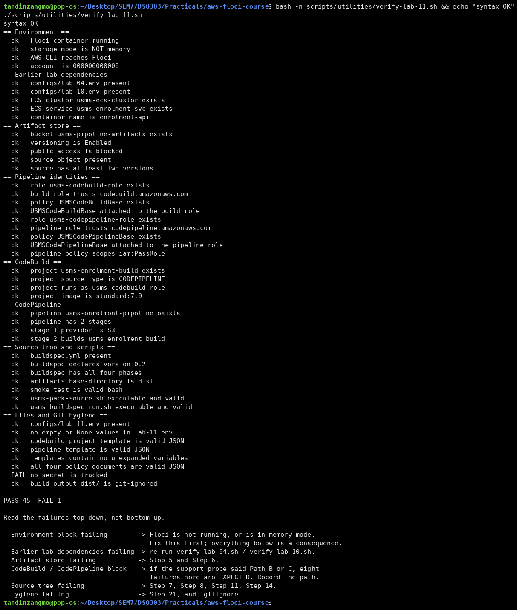

**[Screenshot placeholder: Section 8b - .gitkeep, outputs ignored, cleanup script syntax]**
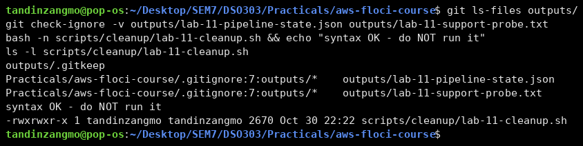

**[Screenshot placeholder: Section 8c - verify and git status after the exercises]**
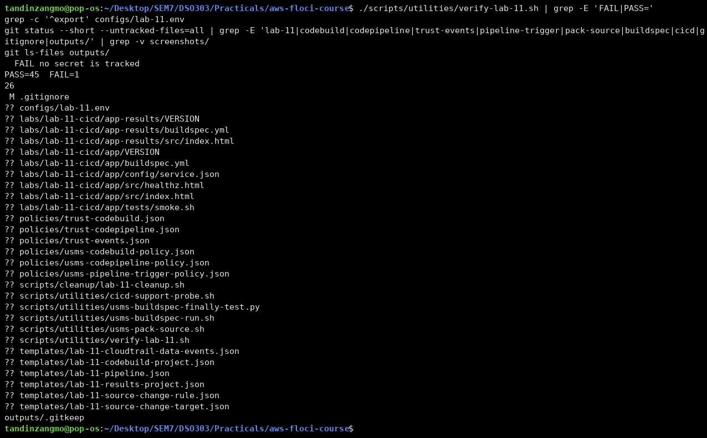

---

## Observed vs recorded

| Observed on Floci | Recorded only (Floci stores it; real AWS runs or enforces it) |
|---|---|
| Versioned bucket: two versions at one key, then deleted | Artifact encryption with KMS; `kms:Decrypt` on the build role |
| Project and pipeline created and read back (2 stages) | A build actually running in `aws/codebuild/standard:7.0` |
| Source action fetched the exact uploaded version (`externalExecutionId`) | `SourceOutput`/`BuildOutput` artifacts written to S3 |
| Build stage reached and failed (FAULT, image pull) | The four buildspec phases running inside CodeBuild, and the logs |
| The buildspec's four phases, seven or eight smoke tests, and the pre_build failure - **locally** | `start-build` rejected after `CODEPIPELINE` source |
| `list-builds-for-project` and failed-phase `contexts` | IAM: build role scope, explicit Deny, scoped PassRole, `aws:SourceArn` |
| EventBridge rule stored; `test-event-pattern` matches only the source key | Automatic executions (on create, or from S3/CloudTrail events) |

## Floci limitations met

| What | Floci | Real AWS |
|---|---|---|
| Build image `aws/codebuild/standard:7.0` | Pull denied → every build `FAULT` | Cached; provisions in seconds |
| Build logs | Stream created, empty | Every printed line |
| Automatic execution on `create-pipeline` | None | Starts immediately |
| Stage-level `latestExecution.status` | `None` | Filled in |
| `errorDetails` in `get-pipeline-state` | `null` | Error message |
| `start-build` on a `CODEPIPELINE`-source project | Accepted | `InvalidInputException` |
| EventBridge target `RoleArn` readback | `None` | As sent |
| S3 → CloudTrail → EventBridge trigger | Not modelled; 0 trails | Starts the pipeline |
| IAM / trust policies | Stored, never evaluated | Evaluated on every call |

## Conclusion

The parts of the pipeline that do not depend on running a build work and were read back:

- the versioned artifact store;
- the two service identities with a scoped `PassRole`;
- the CodeBuild project;
- the two-stage pipeline, whose Source action provably fetched the exact S3 version I uploaded.

The buildspec itself works where it could be run. Locally it substitutes the release, passes its smoke tests, fails in `pre_build` on a wrong container name or port, and now writes the `imagedefinitions.json` contract that Lab 12 needs.

What I cannot claim is that **CodeBuild** built anything. On this Floci build every build faults while pulling the image, so the chain "uploaded source → build → artifact" is observed up to the Source stage and then continued locally. The lesson matches Labs 09 and 10: a green `create-*` and a passing verify script show that the configuration was stored. The behaviour only counts once it has been read back from something the system actually produced.

Exercises are in [exercises.md](exercises.md). Review answers are in [notes/lab-11-notes.md](../../notes/lab-11-notes.md).
