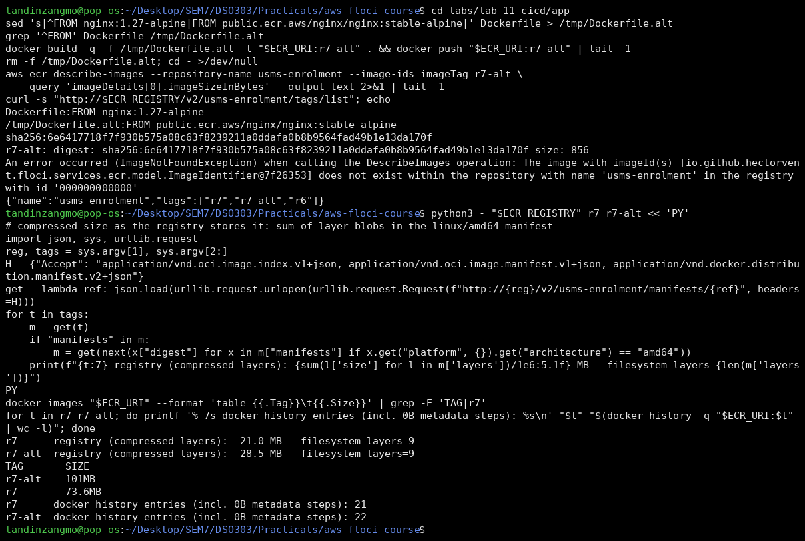
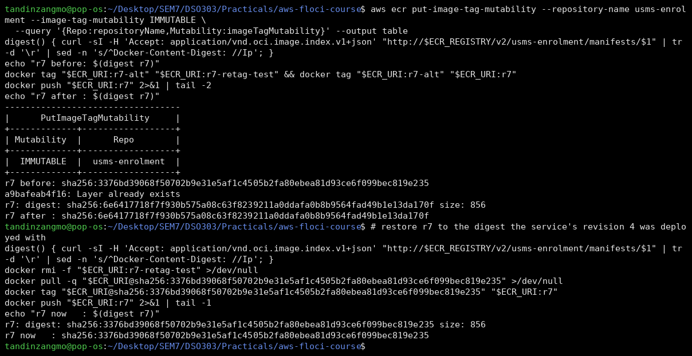
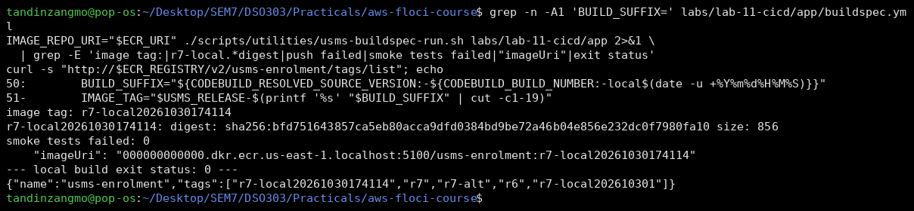
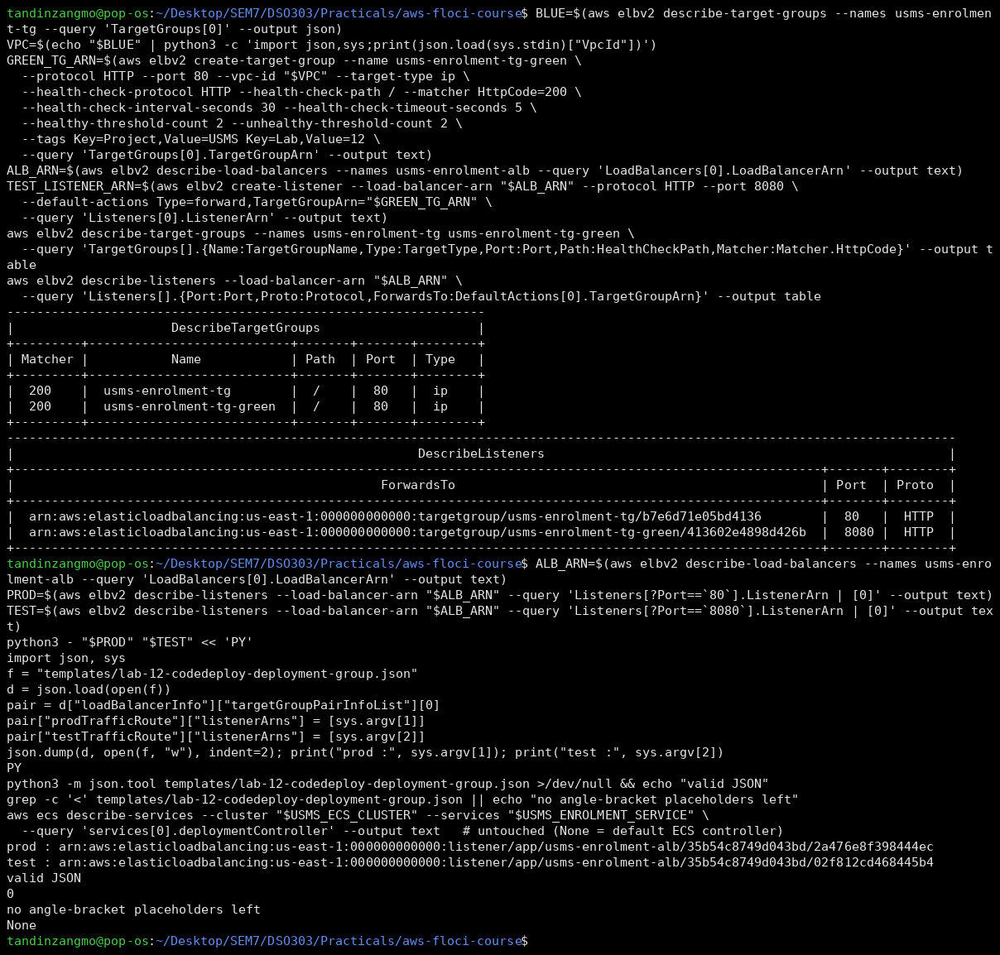
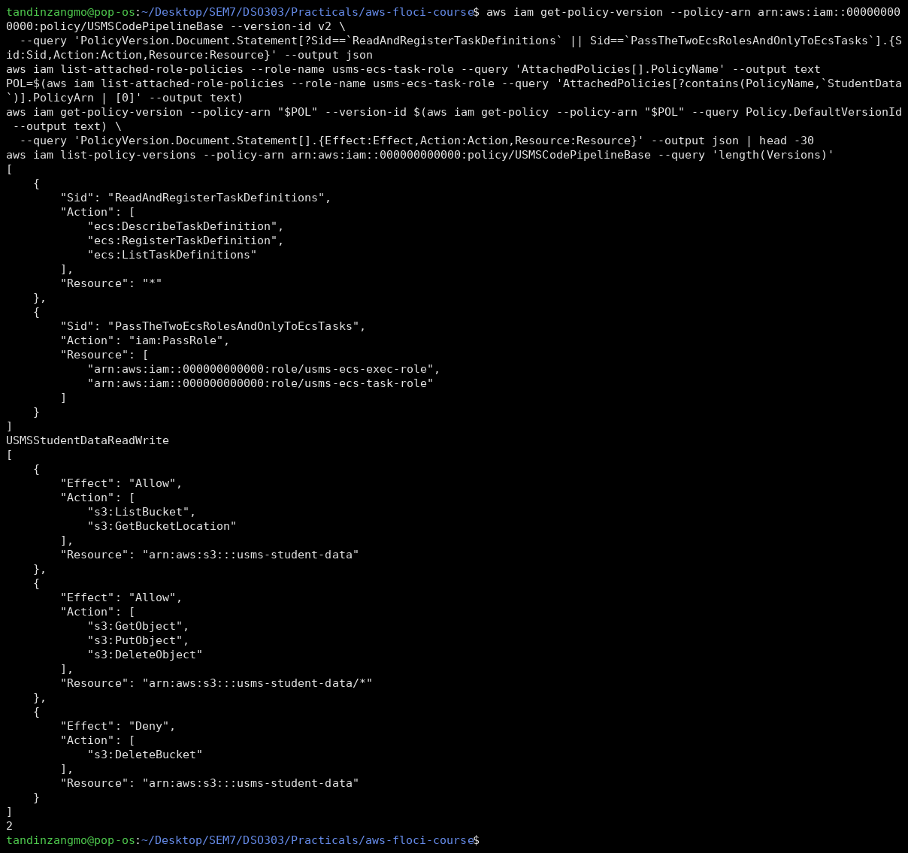
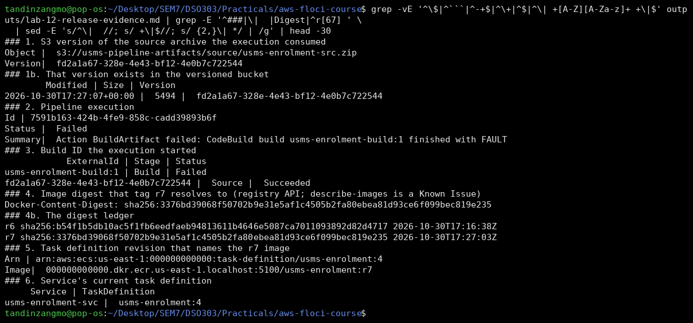
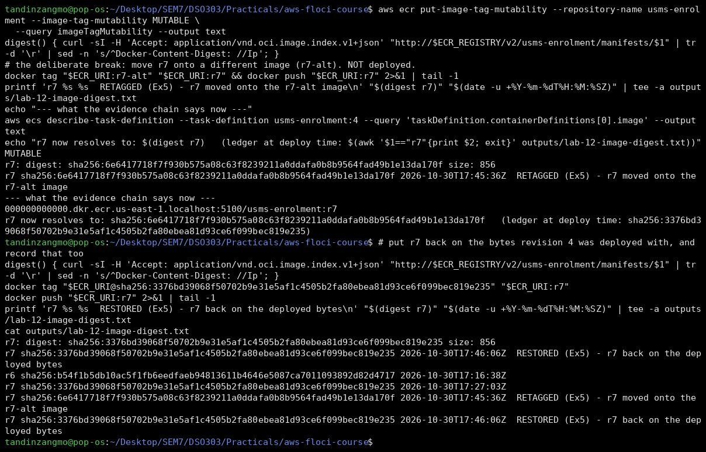

# Lab 12 - Independent Lab Exercises

All five were done on Floci (Path A). The same three Floci limitations as the main report apply:

- `ecr describe-images` is blind to pushed images, so I read sizes and digests from the registry's v2 API;
- CodeBuild cannot run a build;
- ECS does not replace tasks.

---

## Exercise 1 - A second base image, and a smaller one

I rebuilt the enrolment image `FROM public.ecr.aws/nginx/nginx:stable-alpine` (Lab 04's placeholder base) with a temporary Dockerfile and pushed it as **`r7-alt`**: `sha256:6e641771…`. `VERSION` was not touched, and the image was not deployed.

`describe-images` returned `ImageNotFoundException` for `r7-alt` (Known Issue), so I took the registry-side size from the image manifest instead. That is the sum of the compressed layer blobs, which is exactly what ECR's `imageSizeInBytes` reports.

| Tag | Base | Registry (compressed layers) | Local `docker images` (unpacked) | Filesystem layers | `docker history` entries |
|---|---|---|---|---|---|
| `r7` | `nginx:1.27-alpine` | **21.0 MB** | 73.6 MB | 9 | 21 |
| `r7-alt` | `public.ecr.aws/nginx/nginx:stable-alpine` | **28.5 MB** | 101 MB | 9 | 22 |

**Why the registry number and the local number differ:** the registry stores layers **gzip-compressed** and reports their compressed size. The local daemon reports the **unpacked** filesystem, which is about 3.5× larger here. That is most of the gap, but not all of it:

- `docker history` counts every Dockerfile instruction, including the 0 B metadata steps (`ENV`, `EXPOSE`, `CMD`, `LABEL`). Those add history entries but no blobs, so the manifest has 9 filesystem layers while history shows 21 or 22.
- The local figure also includes the unpacked snapshot that containerd keeps alongside the content.

**What the size difference consists of:** both builds add the same 41 kB `COPY dist/` layer. The 7.5 MB (compressed) difference is entirely in the **base image**. `stable-alpine` is a different (newer) nginx/Alpine build. Its history shows extra packaging, for example `ENV ACME_VERSION` and a 51.8 MB unpacked `RUN … apk` layer. `nginx:1.27-alpine` is the smaller and more tightly pinned base, so it remains the better choice.

**[Screenshot placeholder: Exercise 1 - r7-alt built and pushed; registry vs local sizes and layer counts]**


## Exercise 2 - Immutable tags

**The attempt.** I ran `aws ecr put-image-tag-mutability --image-tag-mutability IMMUTABLE`, and readback showed `IMMUTABLE`. I then pushed a *different* image (`r7-alt`'s bytes) as `r7`:

- r7 before: `sha256:3376bd39…`
- push: **accepted**, `r7: digest: sha256:6e641771…`
- r7 after: `sha256:6e641771…`. **The tag moved.**

**Recorded result:** on Floci, immutability is **stored but not enforced**. On real ECR the push is rejected with `ImageTagAlreadyExistsException`, because the tag already exists in an immutable repository. I immediately pushed `r7` back onto `sha256:3376…`, the bytes revision 4 was deployed with.

**The buildspec change.** With immutable tags, `r7` can be pushed exactly once, but every build of release `r7` tries to push `r7` again. So the tag must be unique per build. I added this to the build phase of `labs/lab-11-cicd/app/buildspec.yml`:

```bash
BUILD_SUFFIX="${CODEBUILD_RESOLVED_SOURCE_VERSION:-${CODEBUILD_BUILD_NUMBER:-local$(date -u +%Y%m%d%H%M%S)}}"
IMAGE_TAG="$USMS_RELEASE-$(printf '%s' "$BUILD_SUFFIX" | cut -c1-19)"
```

`docker build`, `docker push`, `build-metadata.json` and `imagedefinitions.json` now all use `$IMAGE_TAG`:

- **In CodeBuild**, the suffix is the resolved source version (the S3 object version or commit). Two builds of the same source get the same tag *and the same content*, which is correct.
- **In the local runner**, which sets neither variable, the suffix falls back to a UTC timestamp.

My first version cut the suffix to 14 characters, which truncated the timestamp to `local202610301` (unique only to the ten-minute window). I fixed it to 19. The re-run produced `r7-local20261030174114`, pushed into the repository, passed all 8 smoke tests, and `imagedefinitions.json` names that tag, so it is still deployable.

**What immutable tags buy:** a tag becomes a durable name. `r7` means one set of bytes forever, so a task definition naming a tag is as reproducible as one naming a digest, and the Exercise 5 attack (moving a tag under a running service) is impossible.

**What they cost:**

- You cannot fix a bad push by re-pushing. You must cut a new tag.
- Tags get uglier (`r7-<source-version>`), and humans lose the short release name unless it is kept as a *second*, separate label.
- Convenience tags like `latest` stop working.
- Every rebuild leaves another image behind, so you need lifecycle policies.

**Final setting:** I set the repository back to **MUTABLE** in Exercise 5, because that exercise must retag `r7`. `verify-lab-12.sh` does not check this field, and later labs that retag would fail on real AWS if it were left immutable. The setting is recorded in `configs/lab-12.env` (`USMS_ECR_TAG_MUTABILITY=MUTABLE`).

**[Screenshot placeholder: Exercise 2a - IMMUTABLE set, re-push of r7 accepted and tag moved (not enforced), r7 restored]**


**[Screenshot placeholder: Exercise 2b - buildspec with a per-build unique tag pushed into the repo]**


## Exercise 3 - The blue/green scaffolding

I read Lab 05's `usms-enrolment-tg` with `--query` (HTTP:80, target type `ip`, health check `HTTP /`, matcher `200`, 30 s interval, 5 s timeout, 2/2 thresholds) and created **`usms-enrolment-tg-green`** with the same settings in the same VPC. I then created a **test listener on port 8080** of `usms-enrolment-alb`, forwarding to the green target group.

Readback: two target groups with identical settings, and two listeners (80 → blue, 8080 → green).

I substituted both listener ARNs into `templates/lab-12-codedeploy-deployment-group.json` with Python, reading them by port from `describe-listeners` rather than copying them by hand. The document is valid JSON with **0 angle-bracket placeholders**. It would be accepted by an account where CodeDeploy exists, given a `usms-codedeploy-role` and a service created with the `CODE_DEPLOY` controller.

The service's `deploymentController` was left untouched (readback `None`, the default ECS controller), as Step 19 requires.

**[Screenshot placeholder: Exercise 3 - green target group and 8080 test listener; placeholders replaced with real ARNs]**


## Exercise 4 - The hole in the pipeline policy

**The attack.** A compromised pipeline role can call `ecs:RegisterTaskDefinition` on `"*"`. It can register a new `usms-enrolment` revision whose image is the attacker's own (any public registry; pulling a public image needs no ECR permission). That revision can set `taskRoleArn` to `usms-ecs-task-role`, which `PassTheTwoEcsRolesAndOnlyToEcsTasks` allows *by design*. It can also change `command`/`entryPoint` or `environment`.

`ecs:UpdateService` on `usms-enrolment-svc` then runs that code as `usms-ecs-task-role`. The evidence shows that role holds **`USMSStudentDataReadWrite`**: `s3:GetObject`, `PutObject` and `DeleteObject` on `usms-student-data/*`. The result is attacker code reading, rewriting or deleting every student record, behind the load balancer, under a legitimate service name.

The PassRole condition does not bound this. It limits *which* roles can be passed and *to whom*, not *what code the role is given to*.

**Can IAM alone close it?** No, not for the pipeline role, and I am not writing a v3 that only looks safer.

- `ecs:RegisterTaskDefinition` has no condition key for the container image, the command or the task role. The Service Authorization Reference ("Actions, resources, and condition keys for Amazon Elastic Container Service") lists only the tag keys (`aws:RequestTag/${TagKey}`, `aws:TagKeys`) for it. I will not invent a condition I cannot cite.
- Scoping `Resource` to `task-definition/usms-enrolment:*` stops the attacker from creating new families, but the attack above uses the real family.
- Removing `ecs:ListTaskDefinitions` is harmless but closes nothing.
- Removing the second PassRole would break the deploy action itself.

**Where the control belongs:**

1. **Least privilege on the task role.** The enrolment service should not have `DeleteObject` on all student data. Give `usms-ecs-task-role` only the prefixes and actions the enrolment code needs. This is the most effective fix, because it limits what *any* code running as the role can do, whoever deployed it.
2. **Image provenance at deploy time.** Only allow images from `…/usms-enrolment@sha256:…` that the build produced. On AWS that is ECR image signing with a verification step (or an admission control) before `UpdateService`. Pipeline-side, a check between Build and Deploy can compare `imagedefinitions.json` against the build's recorded digest.
3. **Separate the duties.** A manual approval action before Deploy (Practical 7 Task C), and CloudTrail alarms on `RegisterTaskDefinition` calls whose image is not from the account's ECR.

**Evidence:**

**[Screenshot placeholder: Exercise 4 - the "*" statement, the PassRole statement, and what usms-ecs-task-role can do to student data]**


## Exercise 5 - A release, end to end, for an auditor

`outputs/lab-12-release-evidence.md` (git-ignored) was generated by commands only. Each value is shown with the command that produced it:

| Link | Value | From |
|---|---|---|
| Source archive S3 version | `fd2a1a67-328e-4e43-bf12-4e0b7c722544` (5494 bytes) | `get-pipeline-execution … artifactRevisions`, confirmed by `list-object-versions` |
| Pipeline execution | `7591b163-424b-4fe9-858c-cadd39893b6f` (Failed at Build) | `get-pipeline-execution` |
| Build ID | `usms-enrolment-build:1` (FAULT on Floci) | `list-action-executions … externalExecutionId` |
| Image digest for `r7` | `sha256:3376bd39068f50702b9e31e5af1c4505b2fa80ebea81d93ce6f099bec819e235` | registry manifest `Docker-Content-Digest` (describe-images is a Known Issue) |
| Task definition revision | `arn:aws:ecs:us-east-1:000000000000:task-definition/usms-enrolment:4`, image `…:r7` | `describe-task-definition` |
| Service's task definition | `usms-enrolment:4` | `describe-services` |

**Honest gap in the chain, even before the break:** the build that FAULTed is **not** the build that produced the image. On Floci, `r7` was built and pushed by hand (Step 17), so the link "build `usms-enrolment-build:1` → digest `3376…`" is asserted by my ledger, not by any AWS record.

**The break.** I set the repository back to MUTABLE and pushed `r7-alt`'s bytes as `r7`. It was not deployed. The ledger `outputs/lab-12-image-digest.txt` now has a second `r7` line, `sha256:6e641771… RETAGGED`. Afterwards I restored `r7` and recorded a third line, `sha256:3376… RESTORED`.

- **Can still prove:** source version → execution → build ID → task definition revision `:4` → service on `:4`. Each of those is an immutable record.
- **Cannot prove any more:** *which bytes* `:4` runs. Revision 4 names the string `…:r7`, not a digest. After the retag, `describe-task-definition` returns exactly the same output, but a task started now would pull `sha256:6e64…`. Only my ledger line, written at deploy time, says `3376…` was intended.

So the link a mutable tag breaks is **tag → digest**. That is why a task definition that names a tag cannot, on its own, prove which bytes ran. Pinning `image@sha256:…` in the task definition (or an *enforced* immutable repository, which Floci does not provide) closes it.

**[Screenshot placeholder: Exercise 5a - the evidence chain, every value from a command]**


**[Screenshot placeholder: Exercise 5b - r7 retagged (second ledger line), revision 4 unchanged but r7 now resolves elsewhere; r7 restored]**

