# Lab 12 Report - Deploying to Amazon ECS from the Pipeline

## Aim

To take the Lab 11 pipeline (S3 Source → CodeBuild Build) to a running service:

- a private **ECR repository**, `usms-enrolment`, with Docker authenticated through a token on standard input;
- a **Dockerfile** beside the source, and an image built, tagged, pushed and identified by **digest**;
- a task definition revision derived with **describe → strip → register**, changing only the image;
- **version 2** of both pipeline IAM policies (ECR push for the build; ECS deploy and a second scoped `iam:PassRole` for the pipeline);
- a third pipeline stage, **Deploy (provider ECS)**, driven by `imagedefinitions.json`;
- a **rollback drill**, and a **blue/green (CodeDeploy)** specification that is written and validated but not run.

Everything was done on Floci. The probe reported **Path A**: Docker, ECR and ECS all answer, and `docker push` to the Floci registry works. Floci still has gaps, and I recorded them instead of trying to fix them:

- **CodeBuild cannot run a build.** As in Lab 11, the build FAULTs pulling `aws/codebuild/standard:7.0`, so the pipeline's Deploy stage never executes.
- **`ecr describe-images` does not see pushed images.** This is *Known Issues - Lab 12*. I read tags and digests from the registry's own v2 API instead.
- **ECS changes the service's task definition pointer but does not roll the tasks.** The two running tasks stay on revision 2. `deployments[]`, `events` and the circuit breaker are all empty or null.

For the Deploy stage I used the Known Issues alternative: I did the ECS deploy action's four steps by hand from the build's `imagedefinitions.json`.

> In this report, **observed** means the command ran and its result was read back. **Recorded** means a document or setting that Floci stores but does not run or enforce. "The service points at revision 4" is observed. "Revision 4's tasks are serving r7" is **not**: Floci kept running revision 2's tasks. I proved the r7 image itself by running it locally and getting HTTP 200.

**Repository note:** the report and exercises are in `labs/lab-12-ecspipeline/` (the folder I had already created). The handout calls it `labs/lab-12-cicd-deploy/`. The Dockerfile, `.dockerignore` and modified `buildspec.yml` are in `labs/lab-11-cicd/app/`, beside the source they package, as the handout requires.

---

## Steps 1–2 - Floci, identity and earlier environments

Floci was running in hybrid mode, bind-mounted to `~/floci-data`, and every storage check was `[ok]`. `whoami.sh` reported account `000000000000`. Lab 11's readiness file was present. It records that Lab 11's build artifact was produced by the local runner (`buildId=local`), because CodeBuild FAULTs on Floci.

All eleven earlier env files were sourced and nothing printed `MISSING`. The two join keys are correct: `container=enrolment-api` and `pipeline=usms-enrolment-pipeline`.

**[Screenshot placeholder: Step 1 - Floci up, storage check, identity, Lab 11 readiness file]**
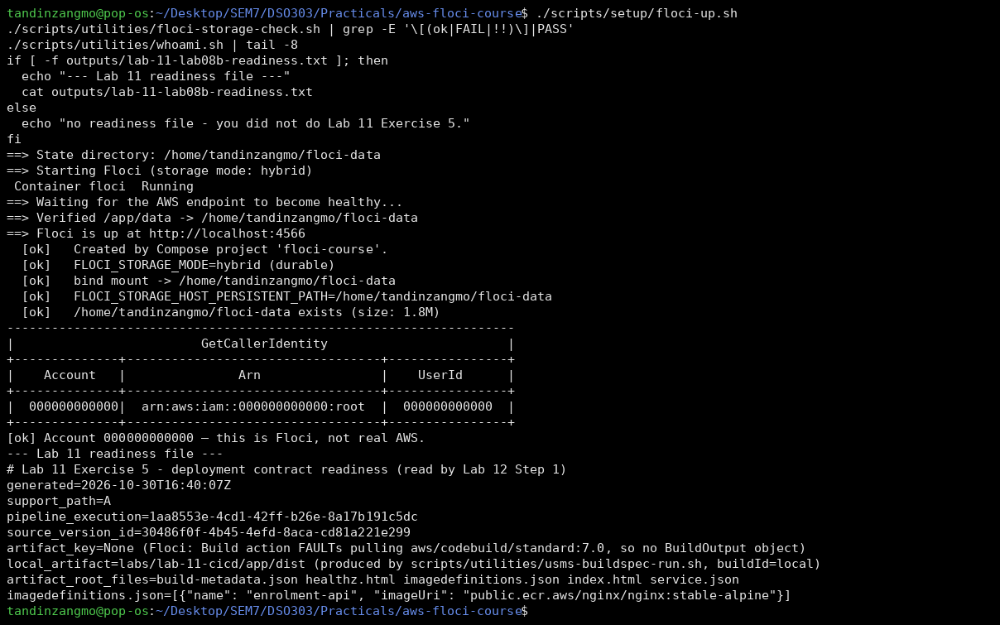

**[Screenshot placeholder: Step 2 - earlier env files and the six values this lab keys off]**
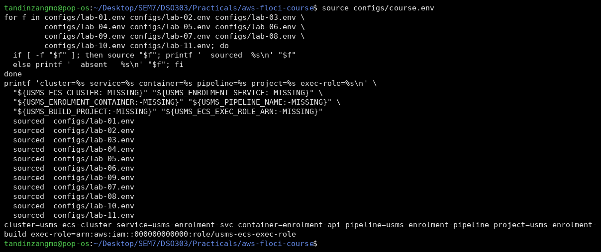

## Step 3 - Deployment support probe (Checkpoint 1)

`deploy-support-probe.sh` created and deleted the throwaway repository `usms-probe-delete-me`. It read back its `repositoryUri`: `000000000000.dkr.ecr.us-east-1.localhost:5100/usms-probe-delete-me`. The host is `localhost:5100`, not `*.amazonaws.com`, which is why no step types the registry host. ECS answered, and so did `deploy list-applications`, so the probe recorded `USMS_CICD_DEPLOY_PATH=A` and `USMS_CODEDEPLOY_SUPPORTED=yes`.

The CodeDeploy API answering does not mean blue/green works. Step 19 stays conceptual: nothing in this lab creates a CodeDeploy application or recreates the service.

**[Screenshot placeholder: Step 3 - probe output, Path A]**
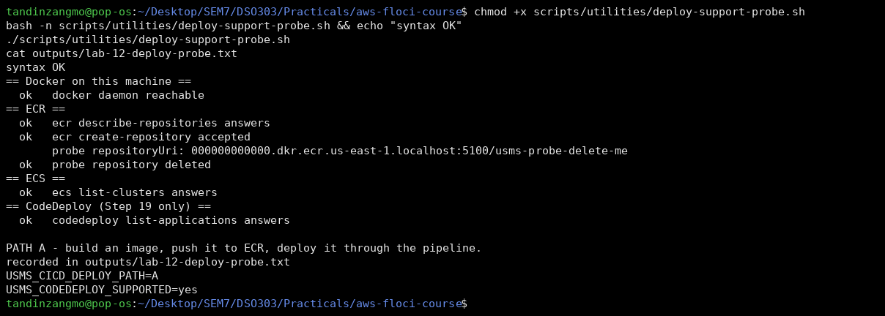

## Step 4 - The ECR port range (finding: not needed on this Floci build)

`docker-compose.yml` had no commented `5100-5104` line to uncomment, so I backed the file up (`docker-compose.yml.bak-20261030230955`) and added the range under `ports:` by hand.

`floci-up.sh` then failed to start the recreated container: `Bind for 0.0.0.0:5100 failed: port is already allocated`. The port is held by **`floci-floci-course-ecr-registry`**. This Floci build already runs the registry as a **separate sidecar container**, created through the Docker socket and published on host port 5100. So the Floci container must not publish the same range itself.

I removed the line, re-ran `floci-up.sh`, and checked the result:

- `docker port` shows `4566` on Floci and `5100->5000` on the registry sidecar;
- `usms-enrolment-svc` is still `ACTIVE` on `usms-enrolment:2`, so the recreate lost nothing;
- `docker-compose.yml` is byte-identical to its backup.

I did not commit a `docker-compose.yml` change, because there is none.

**[Screenshot placeholder: Step 4a - adding the 5100-5104 publish under ports:]**
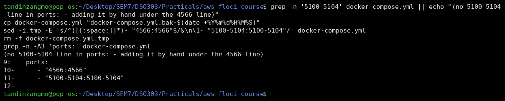

**[Screenshot placeholder: Step 4b - recreate fails, port 5100 already allocated]**
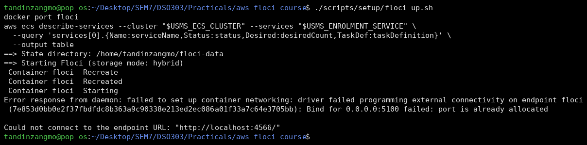

**[Screenshot placeholder: Step 4c - registry sidecar owns 5100; line reverted; service survived]**
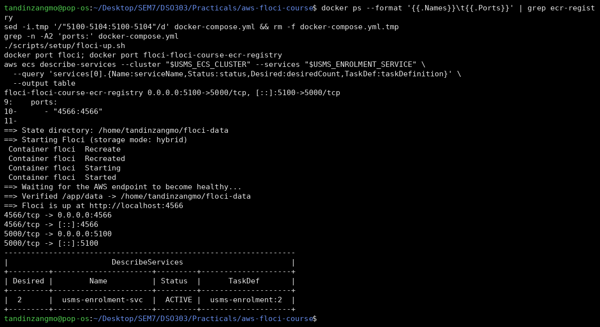

## Steps 5–6 - ECR repository and docker login (Checkpoint 2)

I created `usms-enrolment` with **MUTABLE** tags (on purpose, so Step 18 and Exercise 5 can show what that costs), `scanOnPush=true`, AES256 encryption and the tags `Project/Tier/Lab`. `ECR_URI` was read from `describe-repositories`, and `ECR_REGISTRY="${ECR_URI%%/*}"` = `000000000000.dkr.ecr.us-east-1.localhost:5100`.

`aws ecr get-login-password | docker login --username AWS --password-stdin "$ECR_REGISTRY"` printed **Login Succeeded**. The token went through a pipe and never appeared on a command line or in shell history. No `insecure-registries` change was needed on this machine. The registry host resolves to loopback, and Docker allows plain-HTTP registries on 127.0.0.0/8 by default.

**[Screenshot placeholder: Steps 5–6 - repository created, registry host derived, Login Succeeded]**
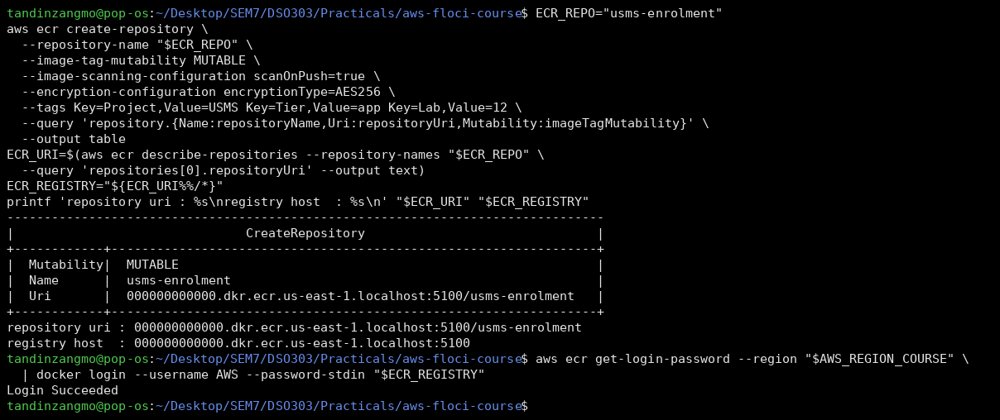

## Step 7 - Dockerfile and .dockerignore

The `Dockerfile` (`FROM nginx:1.27-alpine`, `COPY dist/ /usr/share/nginx/html/`, `EXPOSE 80`) sits in `labs/lab-11-cicd/app/`. **`COPY dist/` ships the *built* output, not the source**, so the image contains exactly what the smoke tests checked. `.dockerignore` keeps `src/`, `config/`, `tests/`, `buildspec.yml` and `VERSION` out of the build context.

**[Screenshot placeholder: Step 7 - Dockerfile, .dockerignore, dist/ present]**
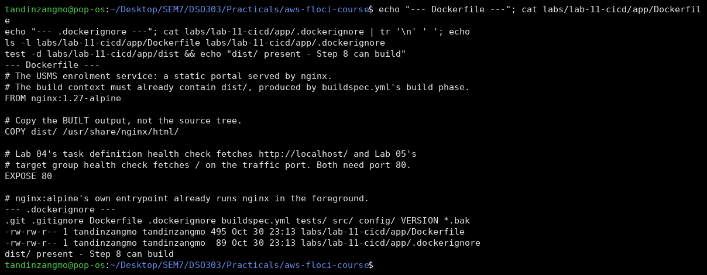

## Step 8 - Build, tag and push by hand

I set `VERSION` to `r6`. The local runner rebuilt `dist/`: all smoke tests passed and `build-metadata.json` says `"release": "r6"`. Then `docker build` → `docker tag "$ECR_URI:r6"` → `docker push`. The push ended with:

`r6: digest: sha256:b54f1b5db10ac5f1fb6eedfaeb94813611b4646e5087ca7011093892d82d4717`

**[Screenshot placeholder: Step 8a - release r6 set and dist/ rebuilt]**
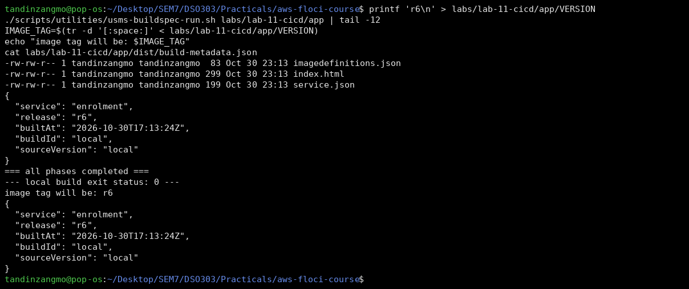

**[Screenshot placeholder: Step 8b - docker build, tag, push to the Floci registry]**
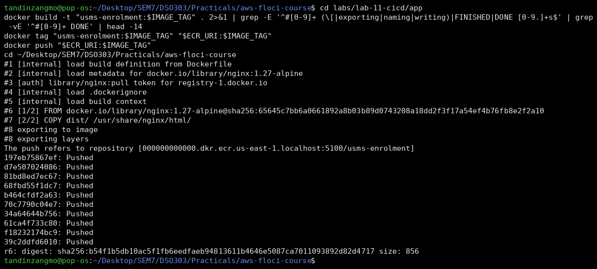

## Step 9 - Prove the image is in the registry (Checkpoint 3)

`aws ecr describe-images` returned an **empty table**, and with `--image-ids imageTag=r6` it returned **ImageNotFoundException**, right after a successful push. This is the documented Floci 2.0.1 issue ("describe-images reports image-not-found even though push and pull work"), and I did not try to fix it.

Following *Known Issues*, I checked the image itself instead of the metadata:

- the registry's `/v2/usms-enrolment/tags/list` shows `r6`;
- the manifest `HEAD` returns `Docker-Content-Digest: sha256:b54f1b5d…`, the same digest the push reported;
- I removed the empty-digest ledger line and wrote the correct line to `outputs/lab-12-image-digest.txt`.

**Create, perturb, read back:** after `docker rmi` of both names, "no local copy remains". `docker pull "$ECR_URI@sha256:b54f…"` then pulled the image back **by digest**, so it is in the registry, not just in my local cache.

**[Screenshot placeholder: Step 9a - describe-images: empty table and ImageNotFoundException (Known Issue)]**
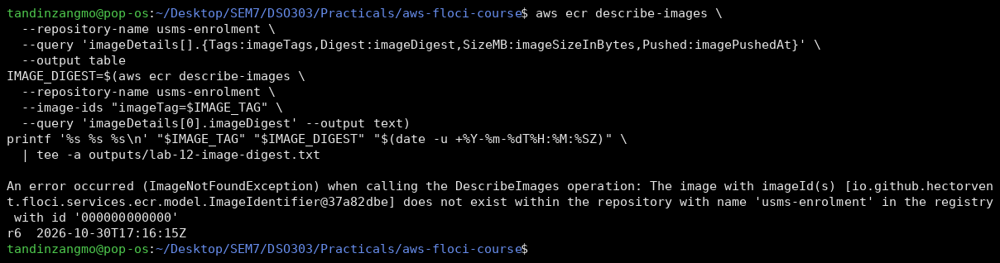

**[Screenshot placeholder: Step 9b - digest read from the registry, ledger line, deleted locally and pulled back by digest]**
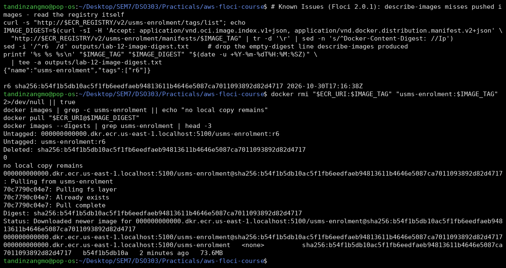

## Step 10 - Revision 3, derived rather than written

I ran `describe-task-definition` into `templates/lab-12-taskdef-base.json`. The Python step stripped all eight read-only fields, found the container **by name** (`enrolment-api`), and changed one value:

- old image: `public.ecr.aws/nginx/nginx:stable-alpine`
- new image: `…localhost:5100/usms-enrolment:r6`

The output is valid JSON with **0** unexpanded `$`. `register-task-definition` returned `usms-enrolment:3`. Readback shows Cpu `256`, Memory `1024`, and both roles (`usms-ecs-exec-role`, `usms-ecs-task-role`), all inherited.

`healthCheck` reads `null`, but that is inherited too. Floci's stored revision 2 has no health check, so the derived revision correctly has none. Writing a health check in by hand would have been writing a definition, not deriving one.

**[Screenshot placeholder: Step 10 - describe/strip/register; revision 3 keeps cpu, memory and both roles]**
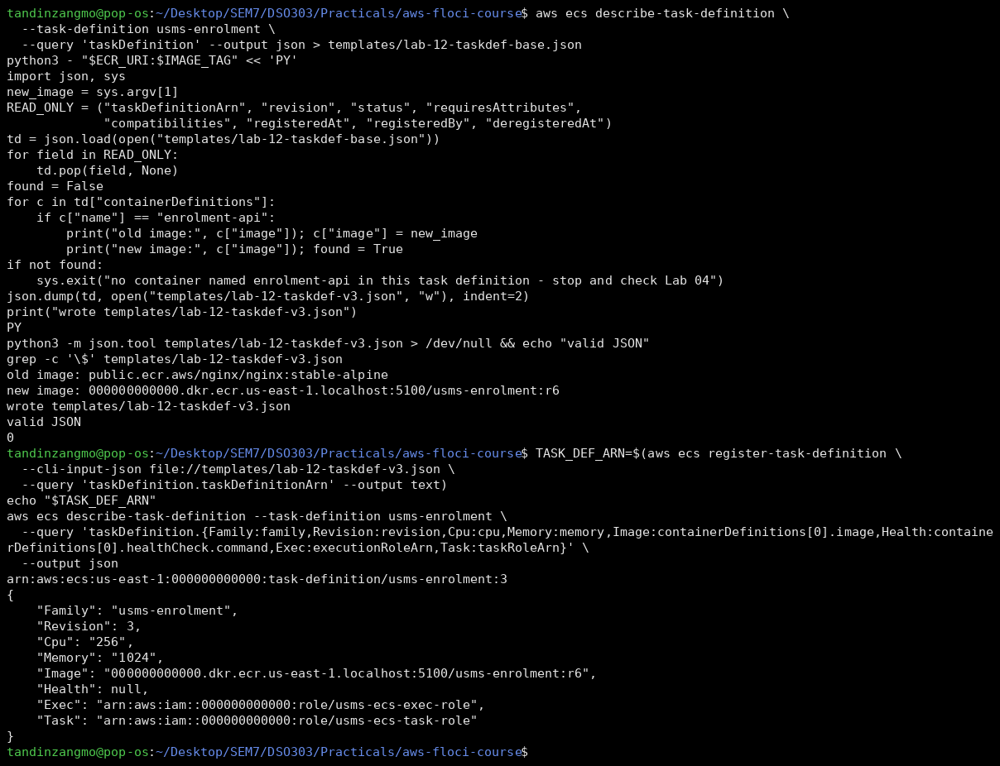

## Step 11 - Deploy revision 3 by hand (Checkpoint 4)

`usms-ecs-watch.sh` was written and syntax-checked. `update-service --task-definition usms-enrolment:3` returned `TaskDef usms-enrolment:3`. The watcher never settled: every poll's table was empty, because Floci returns `deployments: null`.

**Floci limitation:** the service *pointer* moved to `:3`, but `describe-tasks` shows both RUNNING tasks still on **`usms-enrolment:2`** with the placeholder image. They stayed there even after `--force-new-deployment` (Lab 04's lever). This is the "tasks may not run / pointer changes" row of Section 11.

To show the image itself is a working release, I ran it locally from the registry digest. `/build-metadata.json` returned `"release": "r6"` and `/healthz.html` returned `ok`.

**[Screenshot placeholder: Step 11a - watcher written; update-service to :3; watcher cannot settle on Floci]**
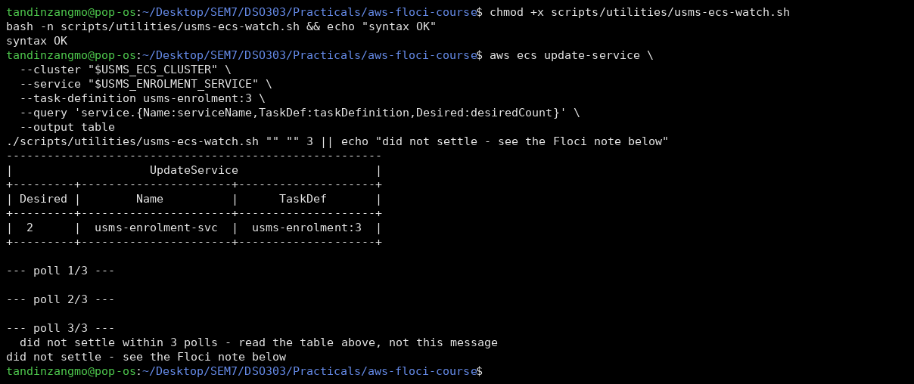

**[Screenshot placeholder: Step 11b - service on :3 but tasks still :2; r6 image serves release r6 locally]**
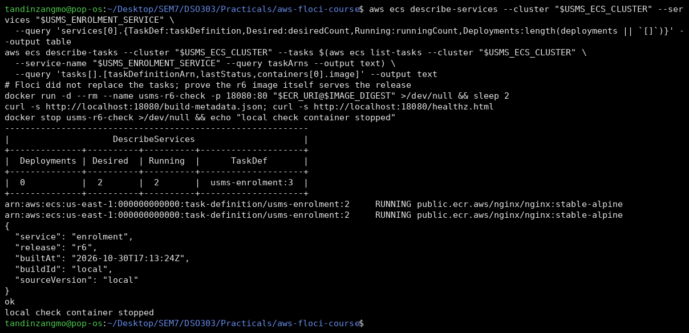

## Step 12 - USMSCodeBuildBase v2

`policies/usms-codebuild-policy-v2.json` is v1 plus two statements:

- `GetARegistryTokenWhichCannotBeScoped`: `ecr:GetAuthorizationToken` on `Resource: "*"`. The token is registry-level, so there is no repository ARN to scope it to.
- `PushAndPullTheEnrolmentImageOnly`: the five push actions plus pull/describe, on `repository/usms-enrolment` only.

The Deny on `usms-student-data` stays. `create-policy-version --set-as-default` returned `v2 True`. `get-policy` shows **DefaultVersionId v2**, and `list-policy-versions` shows v1 `False` and v2 `True`.

**Your turn:** my draft of the pipeline policy is in `notes/lab-12-my-pipeline-policy.json`, and the comparison is in `notes/lab-12-notes.md`.

**[Screenshot placeholder: Step 12 - v2 created and set as default]**
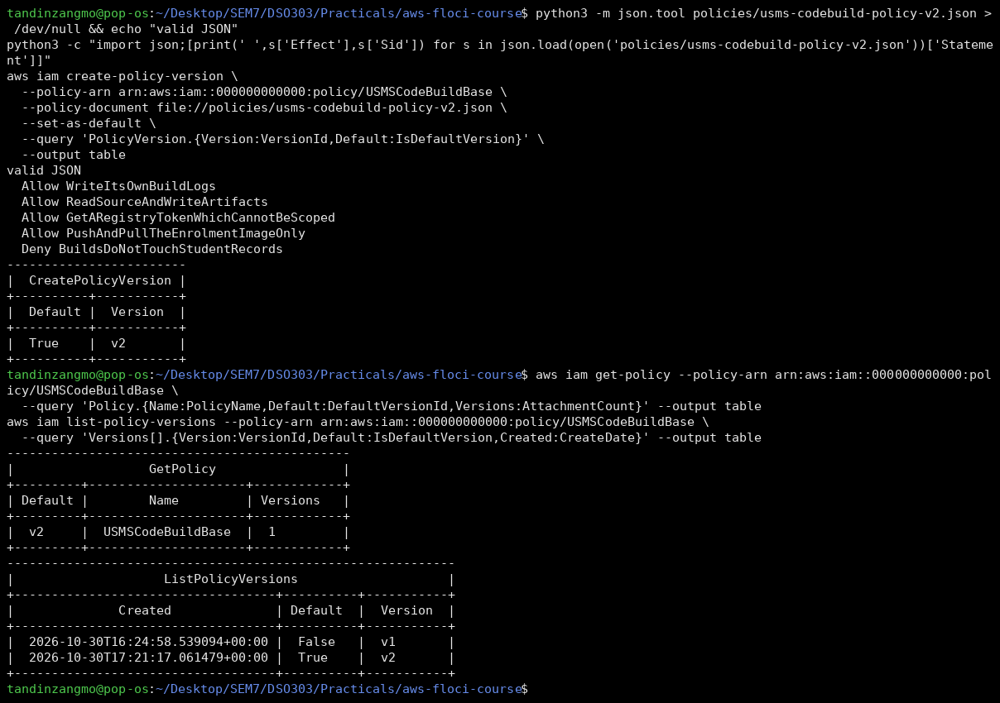

## Step 13 - Let the build run Docker (Checkpoint 5)

`templates/lab-12-codebuild-update.json` has 0 unexpanded `$` and sets `privilegedMode: true` plus all four environment variables, including `IMAGE_REPO_URI`. The whole `environment` block is replaced, so all four have to be resent.

Readback after the update:

- `Source` is still **CODEPIPELINE** (Lab 11 Step 18 was not undone);
- `Role` is still `usms-codebuild-role`;
- `Privileged` is `True`;
- `Repo` is my ECR URI.

`privilegedMode` gives the build container a Docker daemon with elevated capabilities. Anyone who can change the buildspec effectively gets root on the build host, which is why the pipeline role's `StartBuild` is scoped to this one project.

**[Screenshot placeholder: Step 13 - update-project and batch-get-projects readback]**
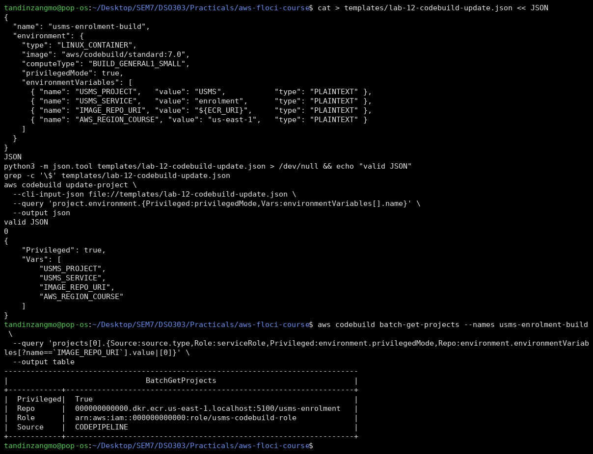

## Step 14 - Buildspec builds the image and writes imagedefinitions.json (Checkpoint 6)

The Lab 11 buildspec was kept as `buildspec.yml.lab08a`. The new one parses with all four phases and `artifacts.base-directory: dist`. It:

- logs in to the registry, deriving the host with `${IMAGE_REPO_URI%%/*}`;
- builds and pushes behind a `docker info` guard;
- always writes `dist/imagedefinitions.json`, reading the container name from `config/service.json`.

`tests/smoke.sh` already had an eighth `imagedefinitions` assertion from Lab 11 Exercise 5, so the Python patch printed "already present". `grep -c '^t "'` = **8**.

Local run with `IMAGE_REPO_URI="$ECR_URI"`: all **8 smoke tests passed**, and `imagedefinitions.json` is a one-element array naming `enrolment-api` with my registry URI.

The in-build push of the manifest failed this time: Docker Desktop's proxy timed out (`proxyconnect tcp … :3128: i/o timeout`). The buildspec's guard caught it (`push failed - … will use the existing tag`) and the build still exited 0. That is the guard doing its job. `r6` in the registry was unchanged.

I packed the new source and uploaded it to `source/usms-enrolment-src.zip`, getting a new version ID.

**[Screenshot placeholder: Step 14a - buildspec replaced and parsed; 8 smoke assertions]**
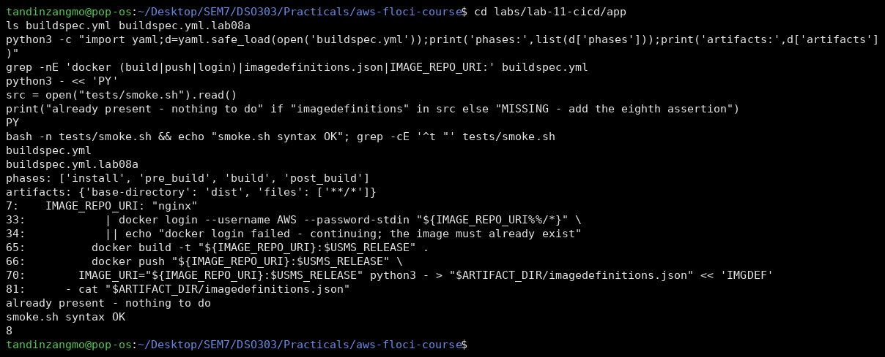

**[Screenshot placeholder: Step 14b - local run: 8 ok, imagedefinitions.json with the ECR URI]**
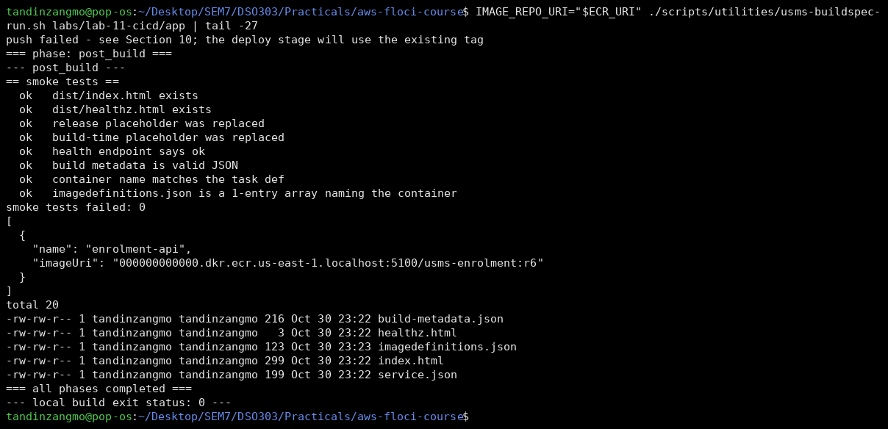

**[Screenshot placeholder: Step 14c - source packed and uploaded, new version ID]**
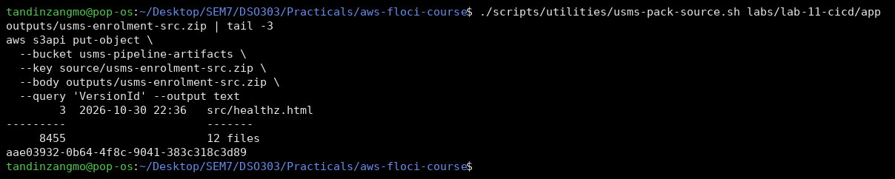

## Step 15 - USMSCodePipelineBase v2

Six statements: the three from v1 plus three new ones.

- `DeployToTheEnrolmentServiceOnly`: `ecs:DescribeServices` and `ecs:UpdateService` on one service ARN.
- `ReadAndRegisterTaskDefinitions`: on `"*"`. A revision has no ARN until it is registered.
- `PassTheTwoEcsRolesAndOnlyToEcsTasks`: `iam:PassRole` on the exec role and the task role, with `iam:PassedToService = ecs-tasks.amazonaws.com`. The receiver is the tasks principal, not `ecs.amazonaws.com`.

Readback shows six Sids and default **v2**.

**[Screenshot placeholder: Step 15 - v2 created, six Sids, default v2]**
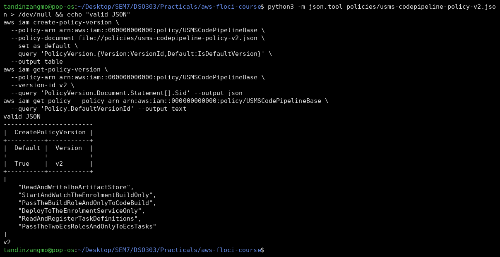

## Step 16 - Add the Deploy stage (Checkpoint 7)

I read the danger note first: `update-pipeline` replaces the whole document.

1. `get-pipeline --query 'pipeline'` dropped the metadata. The document had two stages, `['Source', 'Build']`.
2. The surgery script asserts the first two stages and refuses to add a second Deploy. It appended `DeployToECS` (provider `ECS`, `FileName: imagedefinitions.json`, `DeploymentTimeout: "10"`, input `BuildOutput`). The result is valid JSON with 0 `$`.
3. `update-pipeline` returned **Stages 3, Version 2**.

Readback shows the artifact chain down the Input column: `None → SourceOutput → BuildOutput`.

**Your turn:** answered in `notes/lab-12-notes.md`.

**[Screenshot placeholder: Step 16 - read current pipeline, surgery, update-pipeline, three-stage readback]**
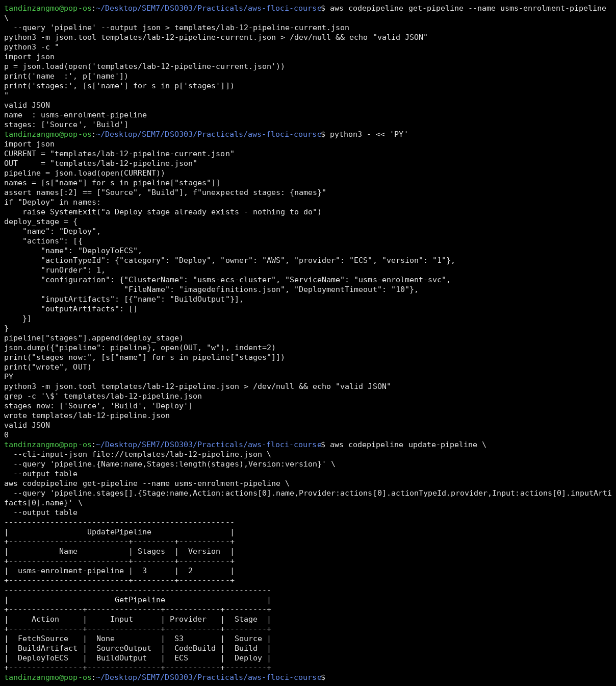

## Step 17 - Run it end to end (Checkpoint 8)

**Before:** the service was on `usms-enrolment:3`.

I set `VERSION` to `r7` and the local build wrote `imagedefinitions.json` naming `…/usms-enrolment:r7`. CodeBuild cannot run on Floci, so following the lab's "push first" note I **built and pushed r7 by hand**: `sha256:3376bd39…`. The registry then listed `r7` and `r6`. I uploaded the source (version `fd2a1a67-328e-4e43-bf12-4e0b7c722544`) and started execution `7591b163-424b-4fe9-858c-cadd39893b6f`.

**Result (Floci limitation, not fixed):** Source **Succeeded**, then Build **Failed**, because `usms-enrolment-build:1` finished with **FAULT** on image `aws/codebuild/standard:7.0`. The Deploy stage never ran.

**Known Issues alternative:** I did the deploy action's four steps by hand, driven by the build's `imagedefinitions.json`:

1. read the service's current task definition (`:3`);
2. replace the `enrolment-api` image with the `imageUri` from the file;
3. register the result, which became **`usms-enrolment:4`**;
4. `update-service` to `:4`.

The three proofs, saved in `outputs/lab-12-deploy-evidence.txt`:

- the revision went from `:3` to `:4`;
- the image is `…:r7`;
- revision 4 still has Cpu 256, Mem 1024 and both roles. The log driver is `None`, inherited, as in Step 10.

I also checked the image itself rather than its metadata: `docker pull` plus `image inspect` gave `sha256:3376…`. A local container from it answered **HTTP 200** with `"release": "r7"`.

What this proves: **artifact → task revision → service pointer**. It does **not** show the managed ECS Deploy action working, and on Floci the tasks themselves stayed on revision 2.

**[Screenshot placeholder: Step 17a - before = :3; r7 imagedefinitions; r7 pushed by hand]**
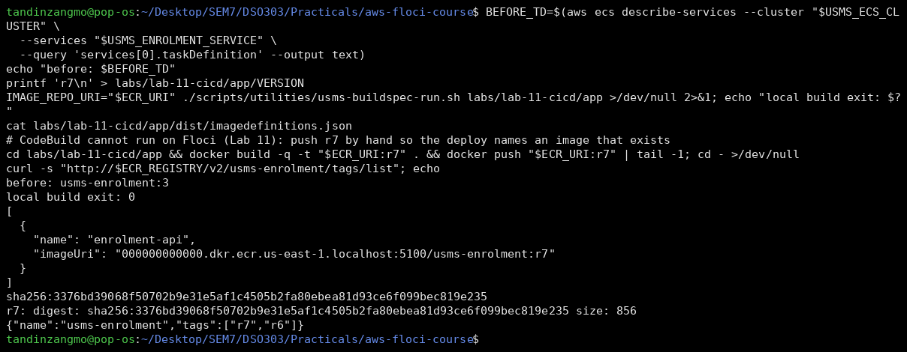

**[Screenshot placeholder: Step 17b - pipeline run: Source Succeeded, Build FAULT (Floci)]**
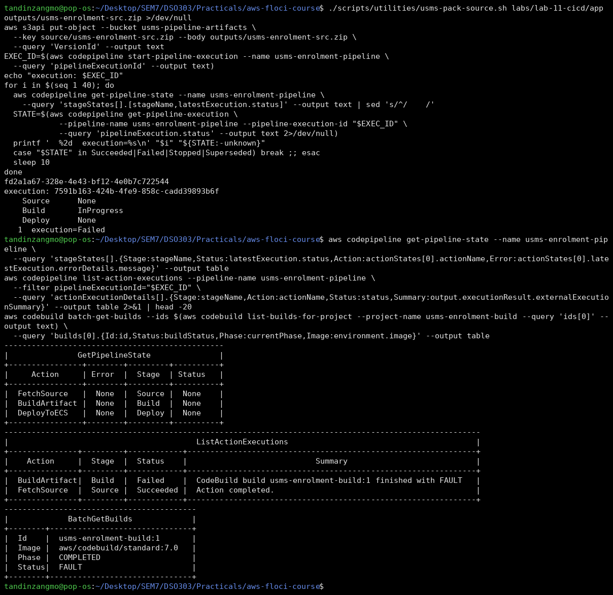

**[Screenshot placeholder: Step 17c - deploy action's steps by hand from imagedefinitions.json → :4]**
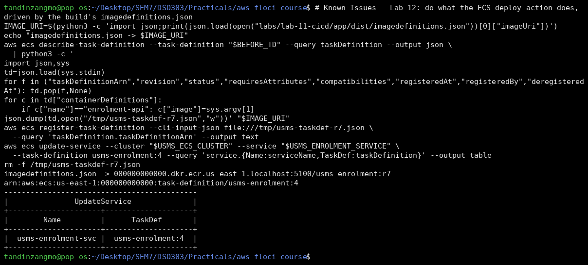

**[Screenshot placeholder: Step 17d - evidence file, revision 4 unchanged except image, r7 answers HTTP 200]**
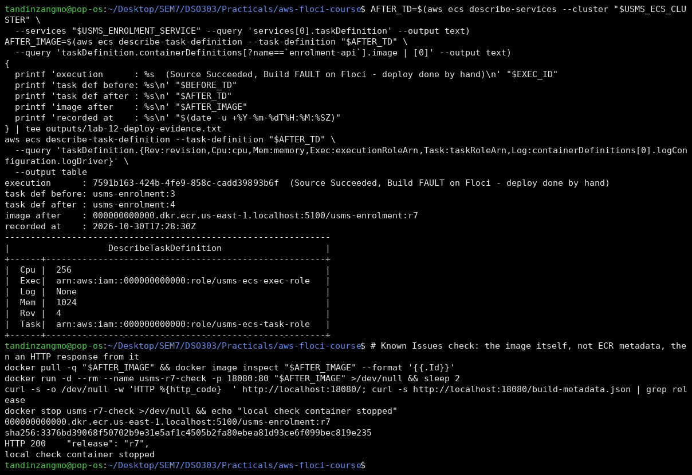

## Step 18 - The rollback drill (Checkpoint 9)

I set `VERSION` to `r8` and ran the local build with Docker deliberately unreachable (`DOCKER_HOST=unix:///nonexistent.sock`). It skipped the image build, still wrote `imagedefinitions.json` naming `…:r8`, and **exited 0**. That is a green build that names an image which does not exist. The registry listed only `r7` and `r6`. I uploaded the source and noted the good revision, `usms-enrolment:4`.

The pipeline again stopped at Build (FAULT). So I did the deploy action's steps by hand, which registered **`usms-enrolment:5`** naming `:r8` and pointed the service at it. Thirty seconds later:

- `deployments` → `null`;
- `events` → `None`;
- `deploymentCircuitBreaker` → `null`;
- the service reported `TaskDef usms-enrolment:5`, `Running 2`.

The running count is still revision 2's tasks. **Nothing objected.** On real AWS the new tasks would hit `CannotPullContainerError` and the circuit breaker would trip. Here, `docker pull …:r8` shows the error a task would hit: `not found`.

**Rollback by hand:** `update-service --task-definition usms-enrolment:4`. The service is back on `:4`. Rollback means naming a revision that already exists; there is no undo. I then fixed the source back to `r7` and uploaded it. The family now has revisions 1–5.

**Your turn (revision 5):** decision and reason in `notes/lab-12-notes.md`.

**[Screenshot placeholder: Step 18a - r8 release with no pushed image; good revision noted]**
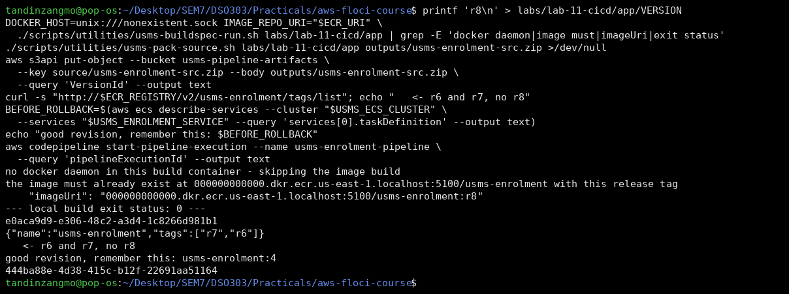

**[Screenshot placeholder: Step 18b - :5 registered and deployed; no deployments, events or breaker on Floci]**
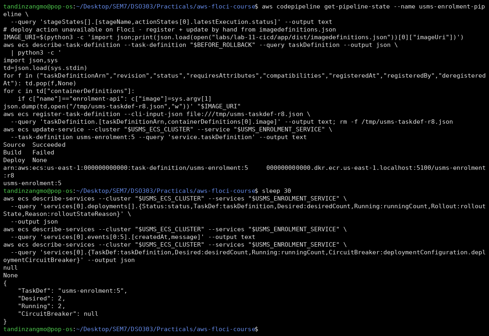

**[Screenshot placeholder: Step 18c - r8 not found; rollback to :4; source fixed]**
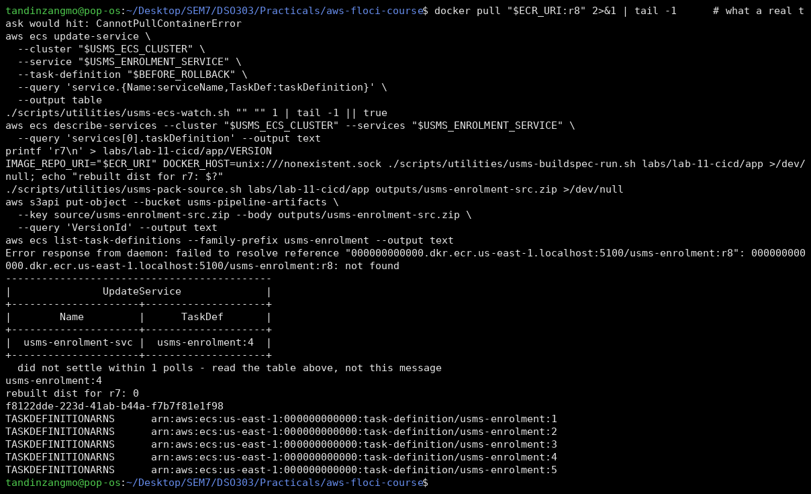

## Step 19 - Blue/green with CodeDeploy, on paper (Checkpoint 10)

- `templates/lab-12-appspec.yaml` parses: container `enrolment-api`, port `80`, five hooks. `AfterAllowTestTraffic` is the one that tests through the test listener before production traffic arrives.
- `templates/lab-12-codedeploy-deployment-group.json` is valid JSON: `BLUE_GREEN`, `CodeDeployDefault.ECSLinear10PercentEvery1Minutes`, target groups `usms-enrolment-tg` and `usms-enrolment-tg-green`.

The ECS service was **not** switched to `deploymentController: CODE_DEPLOY`. That would mean deleting and recreating the service, and stranding Lab 05's load-balancer registration and Lab 06's scalable target. **What I can claim: I specified a blue/green deployment. I did not perform one.**

**[Screenshot placeholder: Step 19 - appspec and deployment group validated]**
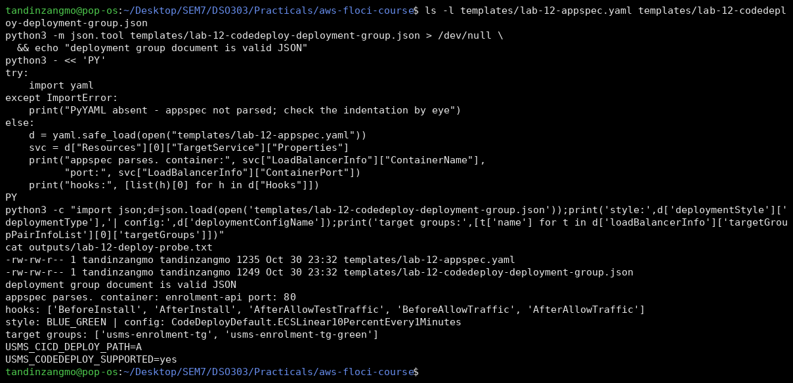

## Step 20 - configs/lab-12.env

The generator was saved as `scripts/utilities/lab-12-write-env.sh` so it can be re-run. It is the handout's heredoc plus `source configs/course.env` and **two Floci fallbacks**:

- `USMS_IMAGE_DIGEST` falls back to the registry API when `describe-images` misses `r7` (Known Issue);
- `USMS_SERVICE_TASK_DEF` accepts Floci's short `usms-enrolment:4` form, where real AWS returns an ARN.

Result: **26 exports**, all values populated. `stages=3`, both policies at `v2`, digest `sha256:3376…`, path `A`.

**[Screenshot placeholder: Step 20 - lab-12.env generated and sourced]**
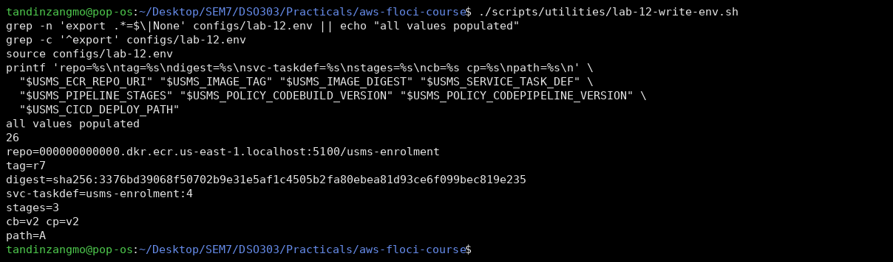

## Section 8 - Verification and cleanup script

`verify-lab-12.sh`: **PASS=42 FAIL=3**. The same count came back after the exercises.

| Failure | Why | Benign? |
|---|---|---|
| `at least one image is present` | `describe-images` returns nothing on Floci 2.0.1 (Known Issue); the registry API lists `r6, r7, r7-alt, …` | Yes - metadata API defect, images are present and pullable |
| `tag r7 is present` | Same cause; `docker pull …:r7` and the manifest digest both work | Yes - same |
| `no secret is tracked` | The check greps `git ls-files` for `^outputs/`, which matches `outputs/.gitkeep`, the placeholder `.gitignore` keeps on purpose (`!outputs/.gitkeep`). No real output file is tracked | Yes - false positive (Lab 11 found the same) |

`scripts/cleanup/lab-12-cleanup.sh` was written and `bash -n` passes. **It was not run.** It is for the end of the course, before `lab-11-cleanup.sh`.

**[Screenshot placeholder: Section 8a - verify-lab-12.sh PASS=42 FAIL=3; cleanup script syntax only]**
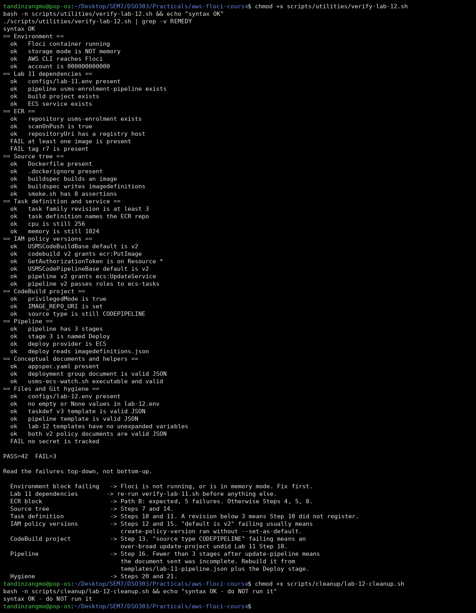

**[Screenshot placeholder: Section 8b - why the three failures are benign]**
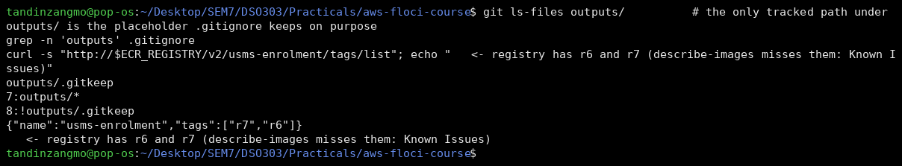

## Step 21 - Git hygiene

`docker-compose.yml.bak-*` was added to `.gitignore`, and `git check-ignore` confirms the Step 4 backup is ignored. `git status --short` shows no `outputs/` file and no compose backup.

`templates/lab-12-taskdef-base.json` and `templates/lab-12-pipeline-current.json` are snapshots of live state and should **not** be staged. `docker-compose.yml` is unchanged, so it is not staged either (see Step 4). Nothing has been committed yet.

**[Screenshot placeholder: Step 21 - .gitignore entry and git status]**
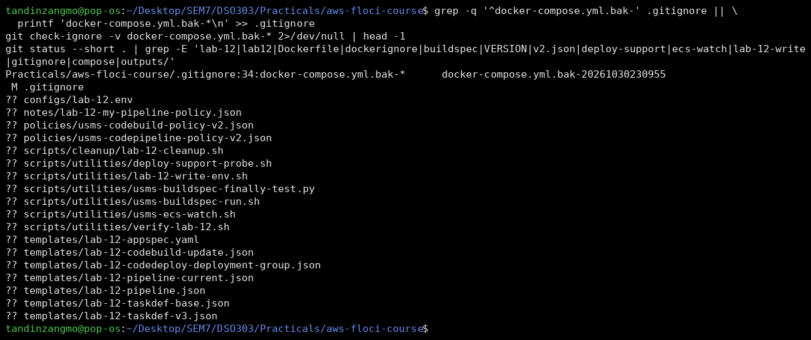

---

## Floci vs real AWS - what I observed and what I only recorded

| Observed on Floci | Recorded / not observable on Floci |
|---|---|
| ECR repository created; `repositoryUri` read from the API (`localhost:5100`) | `scanOnPush` stored, no scan performed |
| `docker login` with the token on stdin; `docker push`/`pull`, pull **by digest** | Tag immutability: stored, **not enforced** (Exercise 2) |
| Registry served by a **sidecar container** on host 5100 (Step 4 finding) | `describe-images` blind to pushed images (Known Issue) |
| Revisions 3, 4 and 5 derived with one field changed | Tasks replaced by a rolling deployment: **not** done; tasks stayed on `:2` |
| Service pointer moved `:2 → :3 → :4 → :5 → :4` | `deployments[]`, `rolloutState`, service events: empty or null |
| Three-stage pipeline stored; Source runs | Build FAULTs on Floci; the ECS Deploy action never executed |
| Both v2 policies created and default | Their scoping was never exercised, because no managed build or deploy action ran under those roles |
| r6 and r7 images serve the right release locally (HTTP 200) | Circuit breaker and automatic rollback: absent |
| Blue/green documents validated; green TG and 8080 listener created (Ex 3) | CodeDeploy deployment: not performed |

## Files produced

```
labs/lab-11-cicd/app/Dockerfile, .dockerignore, buildspec.yml (modified), buildspec.yml.lab08a
labs/lab-12-ecspipeline/readme.md, exercises.md, screenshots/
policies/usms-codebuild-policy-v2.json, usms-codepipeline-policy-v2.json
templates/lab-12-taskdef-v3.json, lab-12-codebuild-update.json, lab-12-pipeline.json,
          lab-12-appspec.yaml, lab-12-codedeploy-deployment-group.json
          (lab-12-taskdef-base.json, lab-12-pipeline-current.json - live snapshots, not for commit)
scripts/utilities/deploy-support-probe.sh, usms-ecs-watch.sh, verify-lab-12.sh, lab-12-write-env.sh
scripts/cleanup/lab-12-cleanup.sh          (NOT run)
configs/lab-12.env                         (26 exports)
notes/lab-12-notes.md, notes/lab-12-my-pipeline-policy.json
outputs/lab-12-deploy-probe.txt, lab-12-image-digest.txt, lab-12-deploy-evidence.txt,
        lab-12-release-evidence.md         (git-ignored)
```

Exercises 1–5 are in [exercises.md](exercises.md). The Your-turn answers and the Section 14 review questions are in [notes/lab-12-notes.md](../../notes/lab-12-notes.md).
